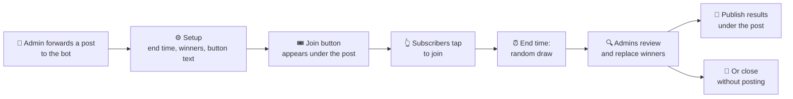

  

  
  
  
  
  

# 🍷 read_wine_bot

[@read_wine_bot](https://t.me/read_wine_bot) is a Telegram bot that runs giveaways on channel posts. It was built for the [@read_wine](https://t.me/read_wine) channel and works in any channel that adds it as an admin.

| | |
| --- | --- |
| **What** | Giveaways on Telegram channel posts, with an admin review before results go live |
| **Who** | Channel owners, their admins and giveaway partners |
| **Languages** | 🇺🇦 Ukrainian (default) and 🇬🇧 English, picked per user with `/language` |
| **Stack** | Go 1.27, PostgreSQL 18, one static binary in Docker |

## ✨ What it does

- 🎟️ **Join button.** Adds a join button under a channel post and collects participants.
- 🎲 **Random draw.** Draws winners at random when the giveaway ends.
- 🔍 **Review before posting.** Channel admins check which channels each winner is subscribed to, replace a winner, then publish the results under the post or close the giveaway quietly.

## 🔄 How a giveaway works

## 👥 Who uses the bot

| Who | What they do | What they grant |
| --- | --- | --- |
| 👑 Channel owner | Adds the bot to the channel as an admin. | The giveaway rights below. |
| 🛠️ Channel admin | Creates, edits and reviews giveaways in a private chat with the bot. | Nothing. Telegram tells the bot who the channel's admins are. |
| 🤝 Giveaway partner | Runs a giveaway together with a channel owner. Winners are expected to subscribe to the partner's channel too. | The partner rights below. |
| 🎉 Participant | Taps the join button under the giveaway post. | Nothing. |

## 🔐 Rights to grant

> [!IMPORTANT]
> Grant only the rights listed here and leave every other toggle off. The bot never asks for more.

### 📢 Channel that runs giveaways

In the channel, go to **Administrators → Add Admin → @read_wine_bot** and turn on:

| Right | Why the bot needs it |
| --- | --- |
| ✅ **Manage messages → Post messages** | Posts the giveaway results as a reply to the giveaway post. |
| ✅ **Manage messages → Edit messages of others** | Adds the join button under your post, and removes it when the giveaway ends. |

The bot checks both rights when an admin starts a giveaway, and stops the setup if either is missing.

Being an admin also lets the bot check winner subscriptions. Telegram does not share them with bots that are not admins.

🚫 Rights to leave off (the bot does not use them)

- Manage messages → Delete messages of others
- Change channel info
- Send welcome messages
- Manage stories
- Add members
- Manage live streams
- Manage direct messages
- Add new admins
- Ban users

### 🤝 Giveaway partner

A partner's channel needs **no rights at all**. Add @read_wine_bot as an admin and turn every toggle off. Telegram answers "is this user subscribed?" only to a channel's admins. That status is the only thing the bot needs from you.

With no rights, the bot cannot post, edit, delete or ban anything in your channel. It also cannot run giveaways there, because that needs Edit messages of others.

> [!NOTE]
> Your channel appears in the results review of every giveaway the bot runs, in every channel. The review lists each winner's subscriptions to it. Admins of other channels see these subscriptions.

To end a partnership, remove the bot from your admins. It stops checking your channel right away.

## 🗄️ What the bot stores

The bot keeps its data in its own PostgreSQL database:

| Data | What is kept |
| --- | --- |
| 👤 **Users the bot sees** | Telegram ID, first and last name, username, Telegram app language, Premium flag, and whether the account is a bot. When any of these change, the bot saves a new revision and keeps the old ones. |
| 🎁 **Giveaways** | The channel post, end time, number of winners, button text, participants, winners and replaced winners. |
| 📺 **Channels** | Which channels the bot is an admin of. Titles and usernames are not stored; the bot reads them from Telegram when it shows them. |

## 🚀 Run your own

You need Go 1.27, Docker and a bot token from [@BotFather](https://t.me/BotFather). Prebuilt binaries for Linux and macOS are on the [Releases](https://github.com/alexander-danilenko/read_wine_bot/releases) page.

1. `cp .env.example .env`, then set `TELEGRAM_BOT_TOKEN`.
2. `docker compose up -d` starts PostgreSQL 18.
3. `go run .` starts the bot.

The bot reads settings only from environment variables and `.env` files. It checks every setting, the database and the token before it starts, and it exits with an error that names the problem.

> [!TIP]
> In production, set `DATABASE_URL` to an external PostgreSQL and run the image from the `Dockerfile` with `docker run --env-file .env`.

## 🧭 Where to read next

| File | What is in it |
| --- | --- |
| [CLAUDE.md](CLAUDE.md) | Developer notes, commands and conventions, for humans and coding agents |
| [GLOSSARY.md](GLOSSARY.md) | Domain terms: giveaway, winner draw, results review, reroll and more |
| [docs/adr/](docs/adr/) | Architecture decisions and why they were made |
| [docs/telegram-ux.md](docs/telegram-ux.md) | Rules for everything the user sees in Telegram |
