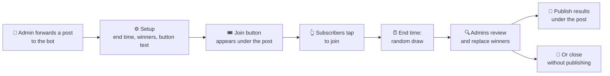

<p align="center">
  
</p>

<p align="center">
  <a href="https://t.me/read_wine_bot"></a>
  
  
  
  <a href="LICENSE"></a>
</p>

# 🍷 read_wine_bot

[@read_wine_bot](https://t.me/read_wine_bot) is a Telegram bot that runs giveaways on channel posts. It was built for the [@read_wine](https://t.me/read_wine) channel and works in any channel that adds it as an admin.

> [!WARNING]
> The hosted [@read_wine_bot](https://t.me/read_wine_bot) has no guarantees. It can stop, lose data or change at any time. For your own channel, [host it yourself](#-run-your-own) with your own bot token.

| | |
| --- | --- |
| **What** | Giveaways on Telegram channel posts, with an admin review before the bot publishes the results |
| **Who** | Channel owners, their admins and giveaway partners |
| **Languages** | 🇺🇦 Ukrainian (default) and 🇬🇧 English, picked per user with `/language` |
| **Stack** | Go 1.27, PostgreSQL 18, one static binary for Windows, macOS and Linux |

## ✨ What it does

- 🎟️ **Join button.** Adds a join button under a channel post and collects participants.
- 🎲 **Random draw.** Draws winners at random when the giveaway ends.
- 🔍 **Review before publishing.** Channel admins see which channels each winner is subscribed to, and can replace a winner. Then they publish the results under the post, or close the giveaway without results.

## 🔄 How a giveaway works



## 👥 Who uses the bot

| Who | What they do | What they grant |
| --- | --- | --- |
| 👑 Channel owner | Adds the bot to the channel as an admin. | The giveaway permissions below. |
| 🛠️ Channel admin | Creates, edits and reviews giveaways in a private chat with the bot. | Nothing. Telegram tells the bot who the channel's admins are. |
| 🤝 Giveaway partner | Runs a giveaway together with a channel owner. Winners must also subscribe to the partner's channel. | The partner permissions below. |
| 🎉 Participant | Taps the join button under the giveaway post. | Nothing. |

## 🔐 Permissions to grant

> [!IMPORTANT]
> Grant only the permissions listed here and disable every other toggle. The bot never asks for more.

### 📢 Channel that runs giveaways

In the channel, go to **Administrators → Add Admin → @read_wine_bot** and enable:

| Permission | Why the bot needs it |
| --- | --- |
| ✅ **Manage messages → Post messages** | Publishes the giveaway results as a reply to the giveaway post. |
| ✅ **Manage messages → Edit messages of others** | Adds the join button under your post. Removes the button when the giveaway ends. |

When an admin starts a giveaway, the bot checks both permissions. If one permission is missing, the bot stops the setup.

As an admin, the bot can also check winner subscriptions. Telegram does not give them to bots that are not admins.

<details>
<summary>🚫 Permissions to keep disabled (the bot does not use them)</summary>

- Manage messages → Delete messages of others
- Change channel info
- Send welcome messages
- Manage stories
- Add members
- Manage live streams
- Manage direct messages
- Add new admins
- Ban users

</details>

### 🤝 Giveaway partner

A partner's channel needs **no permissions at all**. Add @read_wine_bot as an admin and disable every toggle. Telegram answers "is this user subscribed?" only to a channel's admins. That status is the only thing the bot needs from you.

With no permissions, the bot cannot post, edit, delete or ban anything in your channel. It also cannot run giveaways there, because giveaways need the Edit messages of others permission.

> [!NOTE]
> Your channel appears in the results review of every giveaway the bot runs, in every channel. The review lists each winner's subscriptions to it. Admins of other channels see these subscriptions.

To end a partnership, remove the bot from your admins. The bot then stops checking your channel immediately.

## 🗄️ What the bot stores

The bot keeps its data in its own PostgreSQL database:

| Data | What is kept |
| --- | --- |
| 👤 **Users the bot sees** | Telegram ID, first and last name, username, Telegram app language, Premium flag, and whether the account is a bot. When any of these change, the bot saves a new revision and keeps the old ones. |
| 🎁 **Giveaways** | The channel post, end time, number of winners, button text, participants, winners and replaced winners. |
| 📺 **Channels** | Which channels the bot is an admin of. The bot does not store titles and usernames. It reads them from Telegram when it shows them. |

## 🚀 Run your own

You need:

- 🐘 a PostgreSQL database (tested with PostgreSQL 18). The bot creates its tables on the first start.
- 🔑 a bot token from [@BotFather](https://t.me/BotFather).

Then, on Windows, macOS or Linux:

1. Download the zip for your system from [Releases](https://github.com/alexander-danilenko/read_wine_bot/releases). The name holds the system (`windows`, `macos` or `linux`) and the processor (`amd64` for Intel and AMD, `arm64` for ARM and Apple Silicon).
2. Extract the zip to a folder.
3. In that folder, copy `.env.example` to `.env`.
4. In `.env`, set the values that `.env.example` describes.
5. Open a terminal in that folder and run the bot: `.\read_wine_bot.exe` on Windows, `./read_wine_bot` on macOS and Linux.

> [!IMPORTANT]
> Start the bot from the folder that holds `.env`. It reads `.env` from the current directory and its parents, not from next to the binary. You can also use environment variables. They override the values in the file.

Before it starts, the bot checks every setting, the database and the token. If a check fails, the bot stops with an error that names the problem.

> [!TIP]
> If the system blocks the downloaded binary, unblock it once: `Unblock-File .\read_wine_bot.exe` in PowerShell on Windows, `xattr -d com.apple.quarantine read_wine_bot` on macOS.

### 🐹 With `go install`

If you have Go 1.27 or newer, you can install the bot with one command instead of the download:

```sh
go install github.com/alexander-danilenko/read_wine_bot@latest
```

Go puts the binary in `$(go env GOPATH)/bin`. This method does not install `.env.example`. Create `.env` with the keys from [.env.example](.env.example), then run `read_wine_bot` from the folder that holds `.env`.

## 🧭 Where to read next

| File | What is in it |
| --- | --- |
| [CLAUDE.md](CLAUDE.md) | Developer notes, commands and conventions, for humans and coding agents |
| [GLOSSARY.md](GLOSSARY.md) | Domain terms, for example giveaway, winner draw, results review and reroll |
| [docs/adr/](docs/adr/) | Architecture decisions and the reasons for them |
| [docs/telegram-ux.md](docs/telegram-ux.md) | Rules for everything the user sees in Telegram |

## 📄 License

[MIT](LICENSE)
