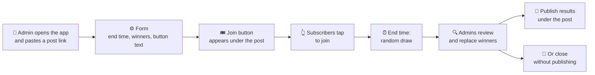

<p align="center">
  
</p>

<p align="center">
  <a href="https://t.me/read_wine_bot"></a>
  
  
  
  <a href="LICENSE"></a>
</p>

# 🍷 read_wine_bot

[@read_wine_bot](https://t.me/read_wine_bot) is a Telegram bot that runs giveaways on channel posts. It was built for the [@read_wine](https://t.me/read_wine) channel and works in any channel that adds it as an admin.

> [!WARNING]
> The hosted [@read_wine_bot](https://t.me/read_wine_bot) has no guarantees. It can stop, lose data or change at any time. For your own channel, [host it yourself](#-run-your-own) with your own bot token.

| | |
| --- | --- |
| **What** | Giveaways on Telegram channel posts, with an admin review before the bot publishes the results |
| **Who** | Channel owners, their admins and giveaway partners |
| **Languages** | 🇺🇦 Ukrainian (default) and 🇬🇧 English, picked per user in the Mini App's settings (`/language` opens them) |
| **Stack** | Go 1.27, PostgreSQL 18, one static binary for Windows, macOS and Linux |

## ✨ What it does

- 🎟️ **Join button.** Adds a join button under a channel post and collects participants.
- 🎲 **Random draw.** Draws winners at random when the giveaway ends.
- 🔍 **Review before publishing.** Channel admins see which channels each winner is subscribed to, and can replace a winner. Then they publish the results under the post, or close the giveaway without results.
- 📱 **Mini App.** Admins create, edit and review giveaways in a Telegram Mini App that opens from the chat with the bot. Its Help explains the bot and adds it to a channel; its Settings change the language and list your channels.

## 🔄 How a giveaway works



## 🔐 Add the bot to a channel

Send `/start` to [@read_wine_bot](https://t.me/read_wine_bot) and open the app: its **Help** screen has both links and explains each permission.

- 📢 **Channel that runs giveaways:** [add the bot as an admin](https://t.me/read_wine_bot?startchannel&admin=post_messages+edit_messages) with only **Post messages** (publishes the results) and **Edit messages of others** (adds the join button). Disable every other toggle.
- 🤝 **Giveaway partner:** [add the bot as an admin](https://t.me/read_wine_bot?startchannel&admin=manage_chat) with every permission disabled. Telegram shows subscriptions only to admins, and that is all the bot reads.

> [!NOTE]
> A partner channel appears in the results review of every giveaway the bot runs, and admins of other channels see which winners subscribe to it. To end a partnership, remove the bot from your admins.

For your own bot, put its username in the links.

## 🚀 Run your own

You need:

- 🐘 a PostgreSQL database (tested with PostgreSQL 18). The bot creates its tables on the first start.
- 🔑 a bot token from [@BotFather](https://t.me/BotFather).
- 🌐 a public HTTPS address for the Mini App, for example a domain behind a reverse proxy. Telegram opens Mini Apps only over HTTPS. The bot listens on `LISTEN_ADDR` (default `:8080`); the proxy forwards the address to it. Set the same address as `APP_URL` and as the Mini App URL in @BotFather.

> [!IMPORTANT]
> `APP_URL` must be a public `https://` address that anyone on the internet can open. With `http://`, `localhost` or an address only your network can reach, the Mini App does not open in Telegram. The only exception is a local test in Telegram Desktop: see [Test the Mini App locally](#-test-the-mini-app-locally).

Then, on Windows, macOS or Linux:

1. Download the zip for your system from [Releases](https://github.com/alexander-danilenko/read_wine_bot/releases). The name holds the system (`windows`, `macos` or `linux`) and the processor (`amd64` for Intel and AMD, `arm64` for ARM and Apple Silicon).
2. Extract the zip to a folder.
3. In that folder, copy `.env.example` to `.env`.
4. In `.env`, set the values that `.env.example` describes.
5. Open a terminal in that folder and run the bot: `.\read_wine_bot.exe` on Windows, `./read_wine_bot` on macOS and Linux.

> [!IMPORTANT]
> Start the bot from the folder that holds `.env`. It reads `.env` from the current directory and its parents, not from next to the binary. You can also use environment variables. They override the values in the file.

Before it starts, the bot checks every setting, the database and the token. If a check fails, the bot stops with an error that names the problem.

> [!TIP]
> If the system blocks the downloaded binary, unblock it once: `Unblock-File .\read_wine_bot.exe` in PowerShell on Windows, `xattr -d com.apple.quarantine read_wine_bot` on macOS.

### 🐹 Build from source

The binary embeds the Mini App, so build the app first. You need Go 1.27 or newer and Node.js 26:

```sh
git clone https://github.com/alexander-danilenko/read_wine_bot.git
cd read_wine_bot
npm --prefix web ci --ignore-scripts
npm --prefix web run build
go build .
```

> [!WARNING]
> `go install` does not work: it builds without the Mini App, and the bot then stops at startup.

### 🧪 Test the Mini App locally

Telegram opens a Mini App only over HTTPS. The `Caddyfile` serves `https://bot-local.readwine.com.ua` with a certificate from Caddy's local CA and forwards it to the bot on `:8080`. It works in Telegram Desktop on the same Mac; a phone does not resolve the name.

1. Install Caddy: `brew install caddy`
2. Point the name at this Mac: `echo "127.0.0.1 bot-local.readwine.com.ua" | sudo tee -a /etc/hosts`
3. Trust Caddy's local CA (asks for your password once): `sudo caddy trust`
4. Start Caddy from the repo root: `sudo caddy run` (port 443 needs `sudo`)
5. In `.env`, set `APP_URL=https://bot-local.readwine.com.ua`
6. Start PostgreSQL, build the app and run the bot: `docker compose up -d`, `npm --prefix web run build`, `go run .`
7. In Telegram Desktop, send `/start` to the bot and tap the app button.

## 🧭 Where to read next

| File | What is in it |
| --- | --- |
| [CLAUDE.md](CLAUDE.md) | Developer notes, commands and conventions, for humans and coding agents |
| [GLOSSARY.md](GLOSSARY.md) | Domain terms, for example giveaway, winner draw, results review and reroll |
| [docs/adr/](docs/adr/) | Architecture decisions and the reasons for them |
| [docs/telegram-ux.md](docs/telegram-ux.md) | Rules for everything the user sees in Telegram |

## 📄 License

[MIT](LICENSE)
