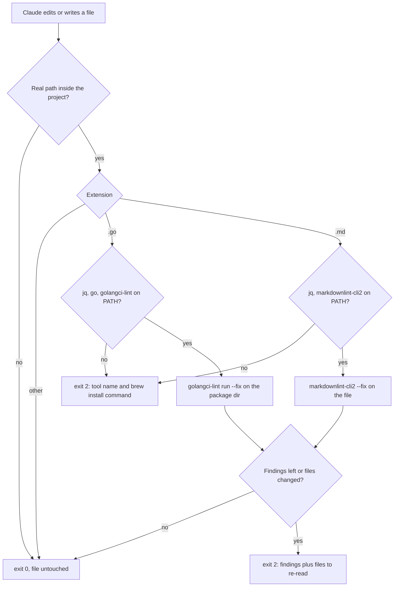
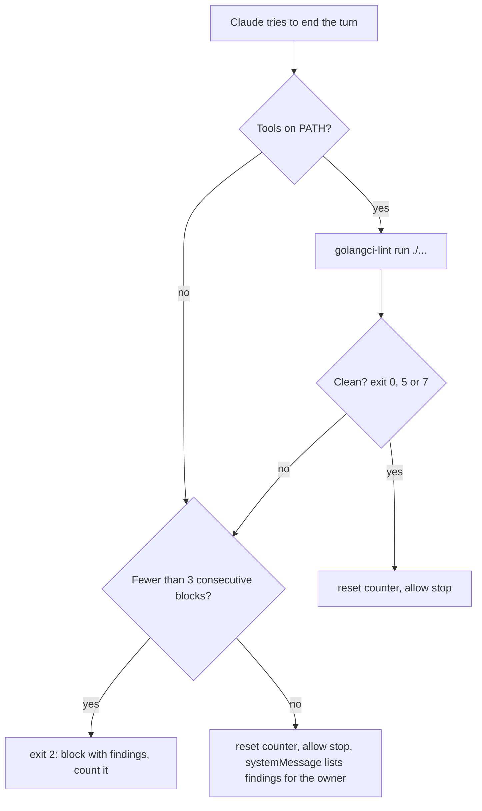

# Go Project Bootstrap - Plan

## Goal Capsule

- **Objective:** The owner can start building the @read_wine giveaway bot in a repo where every Go and Markdown change, by the owner or by Claude, is held to strict community-standard rules automatically, and where Compound Engineering skills can plan work and record learnings.
- **Means:** A hello-world Go module that already pins the chosen libraries (KTD1), a strict golangci-lint config (KTD2), project-level Claude Code hooks (KTD4), and the files Compound Engineering reads (KTD9), all following the rules in `CLAUDE.md`.
- **Product authority:** The repo owner. Bot behavior and architecture are not active scope; the owner describes them after this work lands.
- **Open blockers:** None.
- **Execution profile:** Local only. Work lands as Conventional Commits directly on `main`; no branch, no pull request, no push.
- **Stop conditions:** Stop and report if the module cannot build with `CGO_ENABLED=0` after the driver upgrades, if the scaffold cannot reach zero lint findings without weakening the config or adding `//nolint`, or if a settled decision proves unworkable.
- **Who finishes:** `ce-work` implements and verifies locally, then `ce-simplify-code` and `ce-code-review` run on the local diff; nothing is pushed, and the owner reviews the local commits.

---

## Product Contract

### Summary

A Go module whose only behavior is a hello-world log line, with GORM, both database drivers and the Telegram client already pinned in `go.mod`. Around it: a golangci-lint config with every linter on except a short justified list, Claude Code hooks that format and lint each Go and Markdown edit, and the Compound Engineering files (`docs/`, config, glossary). `CLAUDE.md` already defines the rules the code must follow.

### Problem Frame

The owner is starting a Telegram bot for quick giveaways in the @read_wine channel, in Go, without being a Go developer. They can recognize badly written code but cannot yet judge Go idioms, so the toolchain has to enforce them: a strict linter, plus hooks so Claude's edits cannot drift from it. They also want the Compound Engineering workflow (plans, learnings, glossary) working from the first feature. Bot behavior and architecture come in a later conversation, so this work prepares the repo and nothing more.

### Key Decisions

- **GORM, with tables created from Go structs (AutoMigrate), for data access.** One code path serves SQLite and Postgres; AutoMigrate never drops columns, so a destructive schema change will need a manual step. (session-settled: user-approved — chosen over GORM plus goose SQL migration files and over plain `database/sql` plus goose: the requested ORM and a one-setting database switch outweigh an explicit migration history.) Governs R2.
- **Pure-Go SQLite driver.** `gorm.io/driver/sqlite` requires CGO and a C compiler, which complicates container and cross-platform builds; `github.com/glebarez/sqlite` avoids that. Governs R2.
- **`github.com/go-telegram/bot` as the Telegram client.** (session-settled: user-approved — chosen over raw `net/http` and over telebot v4: it has zero transitive dependencies and supports the current Bot API, while raw HTTP re-implements it and telebot v4 is still beta.) Governs R2.
- **Hello world plus a placeholder import file, without database wiring.** (session-settled: user-directed — chosen over a hello world that already opens SQLite or Postgres through the switch, and over adding each dependency on first use: keep the code minimal while the chosen libraries stay pinned in `go.mod`.) Governs R1, R2, R3.
- **Every linter on, minus a justified list.** (session-settled: user-approved — chosen over disabling only deprecated duplicates: the extra disables contradict Go idioms, such as short names like `ctx` and zero-value structs, and would push code toward `//nolint` comments.) Governs R5.
- **Fix on each edit, gate at end of turn.** (session-settled: user-approved — chosen over a full blocking lint after every edit and over format-only per edit: code mid-edit often does not compile, so blocking on each edit stalls Claude on half-written code.) Governs R8, R9.
- **`docs/` is the Compound Engineering artifact root, committed and linted.** (session-settled: user-approved — chosen over a separate `docs_root` with `docs/` kept as gitignored local drafts, and over committing `docs/` without linting it.) Governs R12, R13.
- **`CLAUDE.md` is the only agent instructions file; there is no `AGENTS.md`.** (session-settled: user-directed — chosen over `AGENTS.md` holding the rules with `CLAUDE.md` as a one-line pointer: the owner asked for `CLAUDE.md` itself to enforce code style, SOLID, stdlib-first dependencies and Conventional Commits.) Governs R15.

### Requirements

#### Go module

- R1. A Go module at `github.com/alexander-danilenko/read_wine_giveaway_bot` (Go 1.27) builds one program that logs a single hello-world line through `log/slog` and exits successfully.
- R2. `go.mod` requires GORM, the pure-Go SQLite driver, the GORM Postgres driver and `github.com/go-telegram/bot`, and `go mod tidy` leaves all four in place.
- R3. One placeholder file holds those libraries with blank imports, and its comment states that it is temporary and that each import is removed once real code imports that library.
- R4. The layout follows go.dev's "Organizing a Go module": the program entry point under `cmd/`, supporting packages under `internal/` once they exist, no `pkg/`, and no empty placeholder directories.

#### Linting and formatting

- R5. A golangci-lint v2 config enables every linter except a listed set, and each disabled linter carries a one-line reason in the config.
- R6. The config's formatters (gofumpt, goimports with the module path as local prefix, golines) run as part of `--fix`, and `golangci-lint config verify` passes.
- R7. The scaffold passes the full lint with zero findings and zero `//nolint` directives.

#### Claude Code hooks

- R8. After Claude edits or writes a `.go` file, a hook formats and auto-fixes that file's package (never the single file alone) and reports remaining findings to Claude without blocking.
- R9. Before Claude ends a turn, a hook runs the full lint over the module and blocks the turn while findings remain, without trapping Claude in an endless retry loop.
- R10. After Claude edits or writes a `.md` file, a hook runs `markdownlint-cli2 --fix` on that one file and reports anything it could not fix.
- R11. When a hook's tool is not installed, Claude receives a message naming the missing tool and how to install it, instead of the hook passing silently.

#### Markdown config

- R12. `.markdownlint-cli2.yaml` no longer ignores `docs/**`, and its comments describe this repo only: references to other repos and to a Prettier step are removed, and rule settings are unchanged.

#### Compound Engineering

- R13. `docs/` is the artifact root with no `docs_root` override, and plans and solutions under it are committed.
- R14. `.compound-engineering/config.example.yaml` is copied from the plugin template, and `.compound-engineering/config.yaml` exists with every key commented out. `.compound-engineering/*.local.yaml` and `.context/compound-engineering/` are gitignored.
- R15. `CLAUDE.md` (already written and approved by the owner) stays accurate once the bootstrap lands: every command it lists works and every concrete path it names exists, and implementation follows its rules. Template paths such as `internal/<name>/` and directories Compound Engineering creates on first use, such as `docs/solutions/`, are exempt, since R4 forbids empty placeholder directories.
- R16. `CONCEPTS.md` follows the plugin's glossary format (`### Term` headings with one- or two-sentence definitions) and is seeded only with terms known today: giveaway, and the @read_wine channel.
- R17. `.gitignore` also covers the built binary, local SQLite database files, `.env` files, `.idea/` and `.remember/`.

### Acceptance Examples

- AE1. **Covers R8.** **Given** a package of two files, **when** Claude edits one so it calls a function defined in the other, **then** the hook reports no `undefined (typecheck)` finding.
- AE2. **Covers R9.** **Given** Claude leaves an unused variable in a `.go` file, **when** it tries to end the turn, **then** the hook blocks with that finding, and the turn ends once the finding is fixed.
- AE3. **Covers R10, R12.** **Given** a plan file in `docs/plans/` with a `*` bullet, **when** Claude writes it, **then** the hook rewrites the bullet to `-`.
- AE4. **Covers R11.** **Given** golangci-lint is not on `PATH`, **when** Claude edits a `.go` file, **then** Claude sees a message naming golangci-lint and its install command.

### Success Criteria

- On a fresh clone, `go build ./...`, `go run ./cmd/...`, `golangci-lint run ./...`, `go mod tidy -diff` and `markdownlint-cli2 "**/*.md"` all succeed with no findings or diff.
- The `ce-setup` health check reports no project issues.

### Scope Boundaries

- Deferred to the architecture conversation: Telegram integration (polling, handlers), database wiring and the SQLite/Postgres switch, configuration loading, domain models, and tests beyond what the hello world needs.
- Deferred: CI, Dockerfile or compose files, deployment, and `STRATEGY.md`, which `ce-strategy` writes once the product is described.
- Excluded: Prettier in the Markdown hook; markdownlint-cli2 alone formats Markdown.
- Considered and not built: a committed test harness for the hooks. The hooks run on every edit, so a broken one surfaces quickly; build one if a hook regresses unnoticed.
- Considered and not built: a lint gate on subagent stops. The main-session Stop gate already checks the final state; add it if subagent work starts landing without a main-session stop.
- Considered and not built: a Markdown check in the Stop gate. The per-edit hook fixes every Markdown file Claude edits through its edit tools; add it if Markdown written through Bash starts reaching commits unlinted.
- Considered and not built: a plan-mode exemption in the Stop gate. The per-turn block cap already bounds a block Claude cannot act on; add it if plan-mode sessions get stuck.
- Considered and not built: a `go mod tidy` check in the Stop gate. The Verification Contract checks tidiness; add it if untidy `go.mod` changes start reaching commits.

### Dependencies / Assumptions

- Hooks rely on tools installed locally with Homebrew: Go 1.27.0, golangci-lint 2.13.1 (2.14.0 is current) and markdownlint-cli2 0.23.2.
- `github.com/glebarez/sqlite` was last tagged at v1.11.0 (2024), which bundles SQLite 3.41; its `github.com/glebarez/go-sqlite` and `modernc.org/sqlite` dependencies must be upgraded explicitly.
- Assumed: the `ce-compound` directive in `CLAUDE.md` uses the "offer first" variant, not "run automatically".
- Assumed for the later database work: the switch is chosen by environment variables (driver plus DSN) read with the standard library, logging stays on `log/slog`, and SQLite connections enable foreign keys, which SQLite leaves off by default.

### Sources / Research

- Go module layout: <https://go.dev/doc/modules/layout>; the unofficial golang-standards layout and the objection to it: <https://github.com/golang-standards/project-layout/issues/117>.
- GORM migrations (AutoMigrate never drops columns): <https://gorm.io/docs/migration.html>; pure-Go SQLite alternatives: <https://github.com/go-gorm/sqlite>.
- Telegram client and Bot API version: <https://github.com/go-telegram/bot>, <https://core.telegram.org/bots/api-changelog>.
- golangci-lint v2 configuration: <https://golangci-lint.run/usage/configuration/>. Linting one file (`golangci-lint run file.go`) analyzes it as a standalone package and reports false `undefined` errors, so hooks target the package directory; `golangci-lint fmt file.go` is safe per file.
- Compound Engineering plugin 3.30.4, `ce-setup` skill: `config.example.yaml` comes from its `references/config-template.yaml`, and setup never creates `CLAUDE.md` or `config.local.yaml`.

---

## Planning Contract

Product Contract preservation: changed: R15 — clarified that template paths and first-use directories are exempt from its existence check, resolving its conflict with R4. Otherwise restructured, no scope change. The four "Deferred to Planning" questions are answered by KTD1 (placeholder location), KTD2 (disable list), KTD3 (version pin and task runner) and KTD6 (stop-gate retry), so the Outstanding Questions section is removed; the considered-and-not-built items join Scope Boundaries.

### Key Technical Decisions

- KTD1. **The placeholder imports live in `cmd/bot/deps.go`, in package `main`, with no build tag.** revive accepts blank imports in a main package, so no `//nolint` is needed, and every `CGO_ENABLED=0` build re-proves the pure-Go driver choice. A `//go:build`-tagged file was rejected because it hides the libraries from build and lint along with the binary. The comment says "temporary" without `TODO`, `FIXME` or `BUG`, which godox would flag. Covers R2, R3.
- KTD2. **`.golangci.yml` follows the research draft that passed `golangci-lint config verify` on 2.13.1.** (session-settled: user-approved — chosen over disabling only the deprecated duplicates: the extra disables contradict Go idioms and would push code toward `//nolint` comments.) Covers R5, R6. The configuration:
  - Disabled, each with a one-line reason in the file: depguard, gomodguard, gomodguard_v2, exhaustruct, exhaustruct_v5, wsl, wsl_v5, nlreturn, noinlineerr, varnamelen, lll, gosmopolitan, testpackage, paralleltest.
  - Settings: errcheck checks type assertions and blank assignments; govet enables all analyzers except fieldalignment; tagliatelle uses snake case for JSON tags; nolintlint requires an explanation and a named linter.
  - Exclusions: generated code strict; presets `comments`, `std-error-handling`, `common-false-positives`; `_test.go` files exempt from funlen, dupl, gocognit, err113, wrapcheck, mnd and goconst.
  - Formatters: gofumpt with `extra.group-params`, goimports with the module path as local prefix, golines at 120 columns.
- KTD3. **No pinned golangci-lint version and no task runner.** `CLAUDE.md` lists the raw commands and the minimum tool versions. Pinning the linter through a `tool` directive would pull its large module graph into `go.sum`, against the stdlib-first rule, and a Makefile would duplicate the `CLAUDE.md` command table. Covers R15.
- KTD4. **Hooks are three bash scripts in `.claude/hooks/` that parse hook input with `jq`, registered in the committed `.claude/settings.json` with explicit timeouts.** Plain-bash JSON parsing is fragile, and a Go hook binary would recompile on every call. Covers R8–R11.
  - `go-lint-fix.sh` and `markdownlint-fix.sh` run on PostToolUse with matcher `Edit|Write|MultiEdit|NotebookEdit`; `go-lint-gate.sh` runs on Stop. `markdownlint-fix.sh` is the name the existing markdownlint config comment already uses.
  - Each command is `bash "$CLAUDE_PROJECT_DIR/.claude/hooks/<script>"`, so a lost executable bit cannot disable a hook.
  - The per-edit hooks act only on files whose resolved real path lies inside the resolved project directory; anything else exits 0 untouched. Project hooks fire on every edit in the session, and a test showed the Markdown fixer rewriting a file outside the repo with the repo's rules (memory files, scratch notes in `/tmp`).
  - Every message to Claude goes out as exit 2 with stderr, the one PostToolUse channel Claude always sees; exit 0 output never reaches Claude.
- KTD5. **The Go edit hook runs `golangci-lint run --fix --allow-serial-runners` on the edited file's package directory, from that file's module root, then reports.** (session-settled: user-approved — chosen over a full blocking lint after every edit and over format-only per edit: code mid-edit often does not compile, so blocking on each edit stalls Claude.) Covers R8, AE1.
  - It never lints the single file: that reports false `undefined (typecheck)` errors.
  - It never runs `golangci-lint fmt` on the file either, because goimports then deletes an import Claude added one edit before its first use.
  - While the package does not compile, `--fix` changes nothing and the compile errors come back as `typecheck` findings; the hook reports them as expected mid-edit noise rather than failures.
  - `--allow-serial-runners` makes a second concurrent run (a parallel subagent) wait for golangci-lint's lock instead of erroring.
  - It exits 2 when findings remain or when `--fix` changed any file in the package, listing the changed files so Claude re-reads them before its next edit.
  - Conflict call-out: per-edit fixing is a no-op while the package does not compile, and rewriting files Claude just edited makes its earlier reads stale. Both are workable: the Stop gate (KTD6) catches anything the per-edit pass could not fix, and the re-read list closes the stale-read gap.
- KTD6. **The Stop gate lints the whole module and blocks at most three times per turn.** It works from the repository root of the stop event's `cwd`, so it follows the session into a worktree. Covers R9, AE2.
  1. A missing tool counts as failing output: per R11, Claude gets the tool name and its `brew install` command, under the same block cap as findings.
  2. `golangci-lint run ./...` exit 0, or exit 5 or 7 (no Go code or no module yet, which the bootstrap session itself passes through), counts as clean. Exit 1 means findings or compile errors and exit 3 means a bad config; those and any other code count as failing.
  3. Failing output blocks the stop with exit 2 and the findings. A per-session counter in the temp directory caps consecutive blocks at three; once spent, the stop is allowed and the findings go to the owner in a `systemMessage`.
  4. The counter resets whenever the gate allows a stop, after a clean run or a spent budget, so the cap bounds one turn's retries and the next turn is gated again.
  - The counter replaces a `stop_hook_active` check: that flag is shared with other plugins' Stop hooks (security-guidance has one), and the harness's own cap of 8 resets whenever Claude calls a tool, so neither bounds a fix-and-retry loop.
  - Subagent stops are not gated; the main-session gate checks the final state.
- KTD7. **The Markdown hook runs `markdownlint-cli2 --fix` on the edited file from the project root,** so `.markdownlint-cli2.yaml` and its ignores apply, including `gitignore: true` (U1), which skips gitignored scratch such as `.context/` and `.claude/worktrees/`. It exits 2 with any remaining findings, or with a re-read note when it changed the file. Covers R10, AE3.
- KTD8. **Each hook checks its tools with `command -v` before doing anything:** `jq` everywhere, `go` and `golangci-lint` for Go, `markdownlint-cli2` for Markdown. (`markdownlint-cli2 --version` runs a lint, so it cannot serve as a presence check.) In the per-edit hooks a missing tool exits 2 with the tool name and its `brew install` command; the Stop gate handles it per KTD6. Covers R11, AE4.
- KTD9. **The Compound Engineering config files are byte copies of the plugin's `references/config-template.yaml`,** which is what `ce-setup` writes, and `ce-setup`'s `check-health` script is the acceptance check. Covers R13, R14.
- KTD10. **Each module resolves to its latest release at implementation time,** plus explicit upgrades of `github.com/glebarez/go-sqlite` and `modernc.org/sqlite`, because the `github.com/glebarez/sqlite` v1.11.0 tag otherwise pins SQLite 3.41. Covers R2.

### High-Level Technical Design

The per-edit hooks share one shape: scope the path, check tools, run the fixer, report through exit 2. The Stop gate adds exit-code handling and a per-turn block budget.





### Assumptions

- The hello-world line is logged at Info level through the default `slog` handler; its exact text is the implementer's choice.
- `go.mod` declares `go 1.27`.
- Claude Code reads hooks at session start, so hooks added in this run take effect from the next session; this run verifies them by piping sample hook input into each script.
- The `MultiEdit` and `NotebookEdit` tool names are unverified; listing them in the matcher is harmless if they do not exist.
- `go build ./cmd/bot` writes the binary to `./bot`, so `.gitignore` ignores `/bot`.
- The `CONCEPTS.md` seed definitions are placeholders the owner refines when the domain is described.
- Edits the owner makes outside Claude (in the IDE) are checked when the next Claude turn ends, because the Stop gate lints the whole tree; a git pre-commit hook is deferred with CI.
- Hooks inherit the `PATH` of whatever launched Claude Code; launched from a desktop app, Homebrew's `/opt/homebrew/bin` may be missing, which the missing-tool messages make visible.
- The owner reviews any diff to `.golangci.yml` and any new `//nolint`; no mechanism guards the config beyond the `CLAUDE.md` rule.

### Risks

- Formatter rewrites: the per-edit hooks change files Claude just edited, so its earlier reads go stale; KTD5 lists changed files for re-read.
- Linter drift: `default: all` turns on every linter a golangci-lint upgrade ships, so a `brew upgrade` can surface new findings; `CLAUDE.md` records the tested version (U6).
- Background subagents: the Stop gate can lint code a background subagent is still writing; the per-turn three-block cap bounds the cost.

### System-Wide Impact

- The hooks run in every Claude Code session opened in this repo, including subagents, and alongside the owner's user-level hooks; security-guidance's Stop hook runs in parallel with the gate.
- `CLAUDE.md` becomes the contract every later plan and review in this repo checks against, so U6 keeps it true to the built repo.

### Output Structure

```text
.claude/
  settings.json
  hooks/
    go-lint-fix.sh
    go-lint-gate.sh
    markdownlint-fix.sh
.compound-engineering/
  config.example.yaml
  config.yaml
cmd/bot/
  main.go
  deps.go
docs/plans/
.gitignore
.golangci.yml
.markdownlint-cli2.yaml
CLAUDE.md
CONCEPTS.md
go.mod
go.sum
```

### Sequencing

U1 → U2 → U3 → U4 → U5 → U6. Each unit lands as one Conventional Commit on `main`.

---

## Implementation Units

### U1. Repo hygiene and Markdown config

**Goal:** `.gitignore` and `.markdownlint-cli2.yaml` describe this repo, and `docs/` is linted.

**Requirements:** R12, R14 (ignore entries), R17.

**Dependencies:** None.

**Files:** `.gitignore` (create), `.markdownlint-cli2.yaml` (modify).

**Approach:**

1. `.gitignore` covers `/bot`, `*.db`, `*.db-shm`, `*.db-wal`, `.env`, `.env.*`, `.idea/`, `.remember/`, `.claude/settings.local.json`, `.claude/worktrees/`, `.compound-engineering/*.local.yaml` and `.context/compound-engineering/`.
2. In `.markdownlint-cli2.yaml`, remove the `docs/**` and `**/docs/vendor/**` ignores with their comments, and add `gitignore: true` so gitignored paths are never linted.
3. Rewrite every comment that cites another repo (WeSalute OS, `backend/AGENTS.md`, `frontend/docs/hooks`, `DOCS.md`), Prettier, or `npx` so it describes this repo and the Homebrew `markdownlint-cli2` command, keeping every rule setting and the no-`globs:` rationale.

**Test expectation:** none -- configuration only.

**Verification:** `git check-ignore` matches each pattern; `markdownlint-cli2 "**/*.md"` now lints `docs/plans/`, skips `.remember/`, and reports zero issues; the config no longer mentions WeSalute, Prettier, `npx`, `backend/` or `frontend/`.

### U2. Compound Engineering scaffolding

**Goal:** Compound Engineering skills find their config and the glossary.

**Requirements:** R13, R14, R16.

**Dependencies:** U1.

**Files:** `.compound-engineering/config.example.yaml`, `.compound-engineering/config.yaml`, `CONCEPTS.md` (all new).

**Approach:**

1. Copy the plugin template to both config paths, per KTD9.
2. Write `CONCEPTS.md` in the plugin's glossary format: `# Concepts`, a one-line purpose, one `## Giveaways` group heading, then `### Giveaway` and `### Channel` entries, each with a one- or two-sentence definition and no file paths or code names. The group heading is required: `# Concepts` followed directly by `### Term` fails markdownlint MD001, which `--fix` cannot repair.

**Test expectation:** none -- configuration and documentation.

**Verification:** `check-health` reports zero project issues and resolves the artifact root to `docs`; `markdownlint-cli2 CONCEPTS.md` is clean.

### U3. Go module, hello world and pinned dependencies

**Goal:** A buildable Go module that logs one line and pins the four chosen libraries.

**Requirements:** R1, R2, R3, R4; the hello-world Key Decision (Governs R1, R2, R3); KTD1, KTD10.

**Dependencies:** U1.

**Files:** `go.mod`, `go.sum`, `cmd/bot/main.go`, `cmd/bot/deps.go` (all new).

**Approach:**

1. Initialise the module at `github.com/alexander-danilenko/read_wine_giveaway_bot`.
2. `cmd/bot/main.go` logs one hello-world line with `log/slog` and returns.
3. `cmd/bot/deps.go` blank-imports `gorm.io/gorm`, `github.com/glebarez/sqlite`, `gorm.io/driver/postgres` and `github.com/go-telegram/bot`, under the comment R3 requires, worded per KTD1.
4. Resolve versions per KTD10, then tidy.

**Test expectation:** none -- no logic to test; the run itself is the check.

**Verification:** `CGO_ENABLED=0 go build ./...` succeeds; `go run ./cmd/bot` logs the line and exits 0; `go mod tidy -diff` prints nothing; `go.mod` lists the four modules as direct requirements; `modernc.org/sqlite` resolves above v1.23.1.

### U4. Strict golangci-lint config

**Goal:** The linter enforces the house style with zero findings on the scaffold.

**Requirements:** R5, R6, R7; KTD2.

**Dependencies:** U3.

**Files:** `.golangci.yml` (new).

**Approach:** Write the configuration KTD2 specifies, with the goimports local prefix set to the module path from U3.

**Execution note:** Prove the config bites: add a throwaway violation such as an unchecked error, confirm a finding, then remove it.

**Test expectation:** none -- configuration, proven by the lint runs.

**Verification:** `golangci-lint config verify` passes; `golangci-lint run ./...` reports 0 issues; no `.go` file contains `nolint`.

### U5. Claude Code hooks

**Goal:** Every Go and Markdown edit by Claude is formatted and checked, and a turn cannot end on Go lint findings.

**Requirements:** R8, R9, R10, R11; AE1–AE4; the hook-timing Key Decision (Governs R8, R9); KTD4–KTD8.

**Dependencies:** U1, U4.

**Files:** `.claude/settings.json`, `.claude/hooks/go-lint-fix.sh`, `.claude/hooks/go-lint-gate.sh`, `.claude/hooks/markdownlint-fix.sh` (all new).

**Approach:**

1. Register the hooks per KTD4.
2. Each script is executable, runs with strict bash options, resolves paths against `CLAUDE_PROJECT_DIR`, and passes `shellcheck`.
3. Implement the flows in KTD5–KTD8 and the High-Level Technical Design.

**Execution note:** Hooks load at session start, so exercise each script by piping sample hook JSON on stdin and checking its exit code, output and file changes.

**Test scenarios** (smoke runs during implementation, not committed):

- `go-lint-fix.sh` with a `.md` path exits 0 with no output.
- `go-lint-fix.sh` with a `.go` path in a module outside the project exits 0 and leaves the file untouched.
- `go-lint-fix.sh` on a badly formatted but compiling file in `cmd/bot/` reformats it and exits 2, listing the file for re-read.
- `go-lint-fix.sh` on a package that does not compile leaves every file unchanged and exits 2 with the `typecheck` findings.
- Covers AE1. `go-lint-fix.sh` on one file of a two-file package that calls a function defined in the other file reports no typecheck finding.
- `go-lint-fix.sh` on a file with an unchecked error exits 2 and lists the errcheck finding.
- Covers AE4. `go-lint-fix.sh` with golangci-lint missing from `PATH` exits 2 naming golangci-lint and `brew install golangci-lint`.
- `markdownlint-fix.sh` on a `.md` file outside the project exits 0 and leaves it unchanged.
- Covers AE3. `markdownlint-fix.sh` on a `docs/plans/` file with a `*` bullet rewrites it to `-` and exits 2 with the re-read note.
- `markdownlint-fix.sh` on a file under `.remember/` leaves it unchanged and exits 0.
- `markdownlint-fix.sh` on a file using bold text as a heading exits 2 naming MD036.
- `go-lint-gate.sh` on the clean module exits 0.
- `go-lint-gate.sh` in a repository without `go.mod`, and in a module with no `.go` files, exits 0.
- Covers AE2. `go-lint-gate.sh` with a Go finding present exits 2 with the finding.
- `go-lint-gate.sh` with a finding present on the fourth consecutive stop exits 0 with a `systemMessage` listing the finding, and the next stop with the finding still present exits 2 again.
- `go-lint-gate.sh` with golangci-lint missing exits 2 naming golangci-lint and `brew install golangci-lint`.

**Verification:** Every scenario behaves as listed; `shellcheck .claude/hooks/*.sh` is clean; `.claude/settings.json` parses with `jq`.

### U6. CLAUDE.md accuracy pass

**Goal:** `CLAUDE.md` matches the repo as built.

**Requirements:** R15; KTD3.

**Dependencies:** U2, U3, U4, U5.

**Files:** `CLAUDE.md` (modify).

**Approach:**

1. Add one line naming the required tools and their install command (`brew install go golangci-lint markdownlint-cli2 jq`) and the golangci-lint version the config was tested on (2.13); after a `brew upgrade`, new linters under `default: all` may need attention.
2. Name the hook scripts in the existing hook gotcha, and add one line: write an import and its first use in the same edit.
3. Run every command in the Commands table and fix any that fail; change nothing else the owner approved.

**Test expectation:** none -- documentation.

**Verification:** Every command in the Commands table succeeds, with `./cmd/bot/` standing in for the `./internal/<pkg>/` template, and every concrete path `CLAUDE.md` names exists; template paths and first-use directories are exempt per R15.

---

## Verification Contract

| Gate | Command | Proves |
| --- | --- | --- |
| Build without CGO | `CGO_ENABLED=0 go build ./...` | R1, R2, pure-Go driver |
| Run | `go run ./cmd/bot` | R1 |
| Tidy | `go mod tidy -diff` prints nothing | R2 |
| Lint config | `golangci-lint config verify` | R6 |
| Lint | `golangci-lint run ./...` reports 0 issues | R5, R7 |
| No suppressions | `rg -n nolint --glob '*.go'` finds nothing | R7 |
| Markdown | `markdownlint-cli2 "**/*.md"` reports 0 issues | R10, R12 |
| Shell scripts | `shellcheck .claude/hooks/*.sh` | U5 |
| Hook behavior | U5 smoke scenarios | R8–R11, AE1–AE4 |
| Compound Engineering | `ce-setup`'s `check-health` script reports 0 project issues | R13, R14 |
| Live hooks (owner, next session) | In a new session, edit a `.go` and a `.md` file and end a turn with a finding present | R8–R10 wired into Claude Code |

---

## Definition of Done

- Every Verification Contract gate passes.
- R1–R17 hold, and AE1–AE4 were demonstrated by the U5 smoke runs.
- Each unit is one Conventional Commit on `main`; no branch was created and nothing was pushed.
- No throwaway violations, sample hook inputs, scratch files or abandoned experiments remain in the tree.
