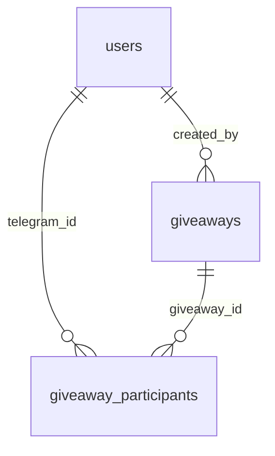
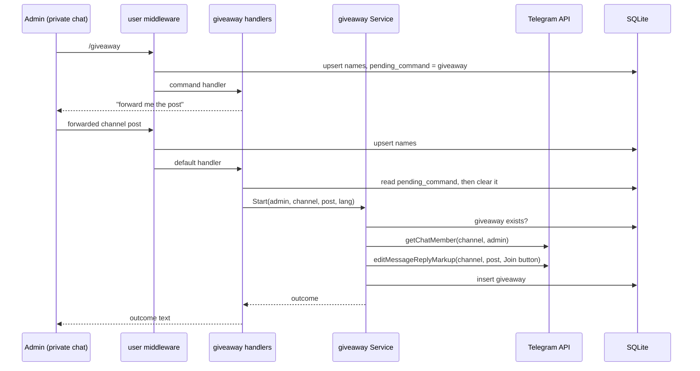
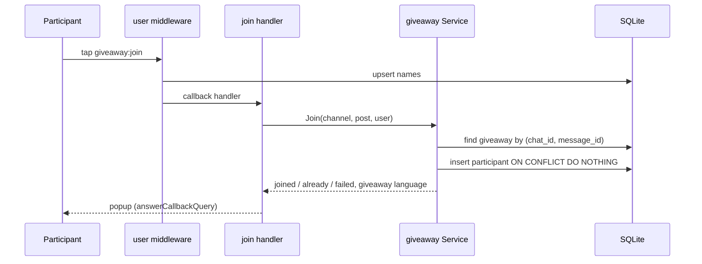

# Giveaway join button - Plan

## Goal Capsule

- **Objective:** a channel admin starts a giveaway under any of their channel posts from a private chat with the bot, and every subscriber who taps the post's button is recorded once, with a current name, so winners can be drawn and announced later.
- **Product authority:** this Product Contract, then `CLAUDE.md` (Fail fast, Database, Dependencies, SOLID), then existing code patterns.
- **Means:** a new `internal/giveaway` package (store, rules, Telegram handlers) plus a user-tracking middleware in `internal/user` (KTD1, KTD2).
- **Execution profile:** Standard Go change, 6 units; store and rules test-first against in-memory SQLite and hand-written fakes; Telegram handlers verified by build, lint and an owner smoke test.
- **Stop conditions:** a change needs a module outside the approved list; a destructive schema change; a settled decision proves unworkable.
- **Shipping:** commits straight to the current branch (`main`); no new branch, no pull request, no push.
- **Open blockers:** none.

---

## Product Contract

### Summary

A new private-chat command `/giveaway` makes the bot wait for a forwarded channel post. On a valid forward from an admin of that channel, the bot attaches a join button to the original post and records the post as a giveaway. Each tap on the button records the tapper as a participant once and refreshes their name in `users`.

### Problem Frame

Running a giveaway in @read_wine needs a join button under the channel post and a list of who joined. A post written in the Telegram app cannot carry an inline button, and nothing records who wants to take part. Drawing a winner later also needs each participant's current first and last name, which the bot does not store today: the `users` table holds only the Telegram ID and the `/language` choice.

### Actors

- A1. Admin: a Telegram user who is an administrator of the channel the post belongs to. Starts giveaways.
- A2. Participant: any Telegram user who sees the post and taps the button.
- A3. Bot: an administrator of the channel with the right to edit other users' messages.

### Key Decisions

- **Explicit `/giveaway` command before the forward.** A forward with no pending command does nothing, so a stray forward never starts a giveaway. (session-settled: user-directed — chosen over reacting to any forwarded channel post: the admin states intent first.) Governs R1, R5.
- **The pending command lives in the database.** A restart does not lose a started `/giveaway`. (session-settled: user-directed — chosen over in-memory waiting state: survives app restarts.) Governs R2.
- **Only an admin of the post's channel may start a giveaway.** Anyone can forward a public post, so the bot asks Telegram whether the forwarder is an admin of that channel. (session-settled: user-approved — chosen over a fixed allow-list of IDs in `.env` and over no check.) Governs R7.
- **One giveaway per post; a repeat forward changes nothing.** The bot reports that the giveaway already exists. (session-settled: user-directed — chosen over re-attaching the button.) Governs R9.
- **All texts use the starting admin's language.** The button label, the admin's replies, and the participant popups all use the language resolved for the admin when the giveaway starts, stored on the giveaway. (session-settled: user-directed — chosen over popups in each tapper's own language.) Governs R4, R11, R14.
- **Every user the bot sees is a row in `users`, with first and last name.** Participants reference `users`, and each tap refreshes the names so winners are drawn with current names. Username and phone are not stored because a user may have neither. (session-settled: user-directed — chosen over storing participants without a `users` row, and over also storing the username.) Governs R3, R12.
- **The giveaway records who started it.** (session-settled: user-approved — chosen over leaving the author out: cheap now, not recoverable later.) Governs R8.

### Requirements

#### Starting a giveaway

- R1. In a private chat, `/giveaway` replies "starting a new giveaway, forward me the post" and marks the user as waiting for a forward.
- R2. The waiting mark is stored on the user's row in `users`, so it survives a bot restart. `/start` and `/language` clear it; a repeated `/giveaway` sets it again.
- R3. Any interaction with the bot (`/start`, `/language`, `/giveaway`, a forward, a button tap) creates the user's row if missing and refreshes `first_name` and `last_name`, without touching the saved language or the waiting mark unless that interaction owns them.
- R4. Replies to the admin use the admin's language: the saved `/language` choice, then the Telegram app language, then English (the existing `language.UserLanguage` order).

#### Handling the forwarded post

- R5. While the user is waiting, the bot silently ignores plain messages and forwards that are not channel posts. Without a waiting mark, the bot ignores forwards entirely.
- R6. A forwarded channel post clears the waiting mark, whether or not the giveaway is created. Trying again needs a new `/giveaway`.
- R7. The bot creates the giveaway only if the forwarder is an administrator of the channel the post came from. Otherwise it replies that only channel admins can start a giveaway.
- R8. On success the bot attaches one inline button to the original channel post, stores a `giveaways` row (channel, post, author, language), and confirms to the admin.
- R9. If a giveaway for the same channel and post already exists, the bot changes nothing and tells the admin it already exists.
- R10. If the bot cannot edit the post (not an admin there, or lacks the edit right), it stores nothing and tells the admin which right it is missing. A `giveaways` row exists only for a post whose button was attached.
- R11. The button label is "Join" in English and "Приймаю участь" in Ukrainian, chosen by the admin's language from R4.

#### Joining

- R12. A tap refreshes the tapper's row in `users`, then records them as a participant of that giveaway at most once per user per giveaway.
- R13. A first tap shows a popup confirming participation. A repeat tap shows a popup saying the user already participates and records nothing new.
- R14. Popups use the giveaway's stored language, not the tapper's.
- R15. If recording fails, the popup says it did not work and to try again; it never claims success that was not stored.

### Data model

The schema is part of the decision, so it is recorded here. Columns are only added; nothing is dropped or renamed, so `AutoMigrate` applies it to an existing database.

| Table | Column | Type | Notes |
| --- | --- | --- | --- |
| `users` | `telegram_id` | int64, PK | exists |
| `users` | `first_name` | text, not null | new; every Telegram user has one |
| `users` | `last_name` | text, not null, default `''` | new; `''` when absent |
| `users` | `language` | text, not null | exists; `''` = never chose |
| `users` | `pending_command` | text, not null, default `''` | new; `giveaway` while waiting for a forward |
| `users` | `created_at`, `updated_at` | time | exist |
| `giveaways` | `id` | integer, PK, autoincrement | referenced by participants |
| `giveaways` | `chat_id` | int64, not null | the channel |
| `giveaways` | `message_id` | int64, not null | the post carrying the button |
| `giveaways` | `created_by` | int64, not null, FK → `users.telegram_id` | the admin who started it |
| `giveaways` | `language` | text, not null | locale of the button and popups |
| `giveaways` | `created_at`, `updated_at` | time | |
| `giveaway_participants` | `giveaway_id` | integer, FK → `giveaways.id` | composite PK part 1 |
| `giveaway_participants` | `telegram_id` | int64, FK → `users.telegram_id` | composite PK part 2 |
| `giveaway_participants` | `created_at` | time | when the user joined |

- `giveaways` has a unique index on `(chat_id, message_id)`. Telegram numbers posts per channel, so `message_id` alone is not unique; the index also blocks a duplicate under a race (R9).
- The composite primary key `(giveaway_id, telegram_id)` enforces one participant per giveaway (R12).



### Key Flows

- F1. Start a giveaway
  - **Trigger:** A1 sends `/giveaway` in a private chat.
  - **Actors:** A1, A3
  - **Steps:** bot replies and sets the waiting mark; A1 forwards a post from the channel; bot checks A1 is a channel admin and no giveaway exists for the post; bot attaches the button; bot stores the giveaway; bot clears the waiting mark and confirms.
  - **Covered by:** R1, R2, R6, R7, R8, R9, R10
- F2. Join a giveaway
  - **Trigger:** A2 taps the button under the channel post.
  - **Actors:** A2, A3
  - **Steps:** bot finds the giveaway by the post's channel and message; bot refreshes A2 in `users`, then inserts the participant; bot answers with a popup.
  - **Covered by:** R12, R13, R14, R15

### Acceptance Examples

- AE1. **Covers R5, R6.** Given A1 sent `/giveaway`, when A1 sends "hello" and then forwards a message from a private user, the bot stays silent and keeps waiting; when A1 then forwards a channel post, the waiting mark clears.
- AE2. **Covers R2.** Given A1 sent `/giveaway` and the bot restarted, when A1 forwards a channel post, the bot handles it as in F1.
- AE3. **Covers R2.** Given A1 sent `/giveaway`, when A1 sends `/language` and later forwards a channel post, the bot ignores the forward.
- AE4. **Covers R7.** Given a non-admin user sent `/giveaway`, when they forward a post from @read_wine, the bot replies that only channel admins can start a giveaway and the post is unchanged.
- AE5. **Covers R9.** Given a giveaway exists on a post, when an admin forwards the same post after `/giveaway`, the bot replies that the giveaway already exists and the button stays as it was.
- AE6. **Covers R10.** Given the bot lacks the edit right in the channel, when an admin forwards a post after `/giveaway`, no `giveaways` row is created and the bot names the missing right.
- AE7. **Covers R13, R14.** Given an admin with Ukrainian saved started a giveaway, when a user with an English Telegram app taps the button twice, the first tap shows the Ukrainian "joined" popup, the second shows the Ukrainian "already participating" popup, and exactly one participant row exists.
- AE8. **Covers R12.** Given a participant changed their Telegram last name, when they tap the button again, their `users` row shows the new last name.

### Scope Boundaries

- Deferred: participant counter on the button, listing participants, removing a button or ending a giveaway, drawing winners, checking that a participant subscribes to the channel, leaving a giveaway, a `/cancel` command, a waiting timeout.
- Not stored: username and phone number.
- The button replaces any other inline buttons already on the post.

### Dependencies / Assumptions

- The bot is an administrator of the channel with "Edit messages of others"; R10 covers the case when it is not.
- Unverified: with "Restrict saving content" on, Telegram may block forwarding a post even for admins, which would make this flow unusable for that channel.
- `internal/db` already enables SQLite foreign keys (`internal/db/db.go:17`), so the foreign keys above are enforced.

### Outstanding Questions

#### Deferred to Planning

- Exact `en` and `uk` wording: resolved in U4, written during implementation.
- On-delete behavior for the foreign keys: SQLite's default (no action, so a delete of a referenced row fails) is kept, because no delete flow exists.

### Sources / Research

- `internal/language/language.go:115` — `UserLanguage`, the saved → app → English language order reused by R4.
- `internal/user/user.go` — current `users` table and the upsert pattern in `SetLanguage`.
- `main.go` — handler registration with `bot.WithMessageTextHandler` and `bot.WithCallbackQueryDataHandler`.
- `docs/plans/2026-10-09-1730-feat-persist-user-language-plan.md` — prior plan that introduced the `users` table.

Product Contract preservation: restructured, no scope change: R12 and F2 now state the order (refresh the user, then record the participant) instead of "one transaction"; the participant foreign key to `users` still guarantees no participant without a user row, and R15 covers a failed refresh.

---

## Planning Contract

### Key Technical Decisions

- KTD1. **One `bot.Middleware` in `internal/user` records every user and every command.** It runs before every handler. It upserts `first_name`/`last_name` for the sender of each private-chat message and each callback query, without touching `language` or `pending_command` (R3). For a private-chat command message it also sets `pending_command`: `giveaway` for `/giveaway`, `''` for any other command (R2). One place owns user freshness, so no handler has to remember it. The command handlers (`/start`, `/language`, `/giveaway`) stay unchanged in that respect. Instantiates the pending-command Key Decision, governs R2, R3 (session-settled: user-directed — chosen over in-memory waiting state: survives restarts).
- KTD2. **`internal/giveaway` holds the models, the store, the rules and the Telegram handlers.** The rules live in a `Service` with two methods, start and join, that return an outcome value; handlers only translate updates into service calls and outcomes into texts. Telegram calls the rules need (is this user a channel admin, attach a button to a post) go through a small interface declared in `internal/giveaway`, implemented by a thin adapter over `*bot.Bot`, so the rules are tested with hand-written fakes. This matches the project rule that handlers hold no giveaway rules and no queries.
- KTD3. **The forward arrives through `bot.WithDefaultHandler`.** A forwarded post is a plain message (text, photo with caption, anything) that no command handler matches, so the default handler sees it. It acts only on a private-chat message whose `ForwardOrigin` is a channel origin and whose sender has `pending_command = giveaway`; everything else returns silently (R5).
- KTD4. **The join button carries a constant callback, `giveaway:join`.** The callback query already carries the post's chat and message ID (in `Message.Message` or, for old posts, `Message.InaccessibleMessage`), so the giveaway is looked up by `(chat_id, message_id)` and nothing else needs to fit in the 64-byte callback data.
- KTD5. **Start checks in this order:** existing giveaway (R9), then forwarder is `creator` or `administrator` via `getChatMember` (R7), then attach the button (R10), then insert the row (R8). An error from `getChatMember` or `editMessageReplyMarkup` means the bot lacks rights in that channel and maps to the R10 reply, except Telegram's "message is not modified" error from `editMessageReplyMarkup`, which means the button is already there and counts as a successful attach. A unique-index conflict on insert maps to the R9 reply, which also covers two admins racing on one post.
- KTD6. **Join inserts with `ON CONFLICT DO NOTHING` on the composite key and reads rows affected:** 1 means joined, 0 means already a participant (R13). No read-then-write, so a double tap cannot create two rows or fail.
- KTD7. **New `users` columns get `default:''`.** SQLite rejects `ADD COLUMN ... NOT NULL` without a default on a table that already has rows, so `first_name`, `last_name` and `pending_command` all declare `''` as their default. Existing rows read as "no name yet, not waiting".

### High-Level Technical Design

Directional sketch of the two flows; the prose and units are authoritative.





### Assumptions

- The bot processes updates concurrently (go-telegram/bot runs each handler in its own goroutine). If an admin sends `/giveaway` and forwards within milliseconds, the forward could be read before the waiting mark is written and be ignored; the admin then forwards again after a new `/giveaway`. Accepted, not guarded.
- If the giveaway insert fails for a reason other than a unique conflict after the button is attached, the post keeps a button with no row; taps then get the R15 popup. The admin gets a failure reply and can retry with `/giveaway`, which re-attaches the button and inserts the row. Accepted as rare.
- `getChatMember` on a channel requires the bot to be an admin there; its failure is reported as the R10 "bot lacks rights" reply, which names the right to grant.

### Output Structure

```text
internal/giveaway/
  giveaway.go        # Giveaway and Participant models
  store.go           # GORM store: find, create, join
  service.go         # start and join rules, Telegram interface
  handler.go         # /giveaway, forward and join handlers, bot adapter
  store_test.go
  service_test.go
internal/user/
  middleware.go      # records users and pending commands
  middleware_test.go
```

---

## Implementation Units

### U1. Users carry names and the pending command

- **Goal:** `users` stores first name, last name and the pending command, and a store API reads and writes them.
- **Requirements:** R2, R3; KTD7.
- **Dependencies:** none.
- **Files:** `internal/user/user.go`, `internal/user/user_test.go`.
- **Approach:**
  1. Add `FirstName`, `LastName`, `PendingCommand` to `User` with `not null;default:''` (KTD7).
  2. Add a store method that upserts a user's names, creating the row if missing and updating only `first_name`, `last_name`, `updated_at` on conflict.
  3. Add store methods to set and read `pending_command`; reading an unknown user returns `''`.
  4. Keep `SetLanguage` from overwriting names: its conflict update stays limited to `language` and `updated_at`.
- **Patterns to follow:** `SetLanguage` upsert with `clause.OnConflict` in `internal/user/user.go`; in-memory SQLite test helper in `internal/user/user_test.go`.
- **Test scenarios:**
  - Upserting names for an unknown ID creates a row with those names, empty language and empty pending command.
  - Upserting new names for a user with language `uk` and pending `giveaway` changes the names and keeps `uk` and `giveaway`.
  - A user with no last name stores `''`.
  - Setting pending `giveaway` then `''` reads back `giveaway` then `''`; reading pending for an unknown ID returns `''` and no error.
  - `SetLanguage` on a user with names keeps the names.
- **Verification:** `go test ./internal/user/` passes.

### U2. Middleware records every user and every command

- **Goal:** every private-chat message and every callback query refreshes the sender's names, and every private-chat command sets or clears the pending command.
- **Requirements:** R2, R3; KTD1.
- **Dependencies:** U1.
- **Files:** `internal/user/middleware.go`, `internal/user/middleware_test.go`.
- **Approach:**
  1. Return a `bot.Middleware` built from a small store interface declared in `internal/user` (names upsert, pending set) and a logger.
  2. For `update.Message` in a private chat with a sender: upsert names; if the text starts with `/`, take the command name before any space or `@bot` suffix and set pending to `giveaway` for `giveaway`, else `''`.
  3. For `update.CallbackQuery`: upsert the sender's names.
  4. A store error is logged and the next handler still runs, so a database hiccup never silences a reply.
- **Patterns to follow:** error logging style in `internal/language/language.go`; fake store pattern in `internal/language/language_test.go`.
- **Test scenarios:**
  - Private message "hello" from user 7: names upserted, pending untouched, next handler called.
  - Private message `/giveaway`: pending set to `giveaway`.
  - Private message `/giveaway@read_wine_bot`: pending set to `giveaway`.
  - Private message `/start` and `/language`: pending set to `''`. Covers AE3.
  - Group-chat message `/giveaway`: no store calls, next handler called.
  - Callback query from user 9: names upserted, pending untouched.
  - Store returns an error: error logged, next handler still called.
- **Verification:** `go test ./internal/user/` passes.

### U3. Giveaway and participant tables with their store

- **Goal:** `giveaways` and `giveaway_participants` exist per the Data model and a store finds, creates and joins.
- **Requirements:** R8, R9, R12, R13; KTD6.
- **Dependencies:** U1.
- **Files:** `internal/giveaway/giveaway.go`, `internal/giveaway/store.go`, `internal/giveaway/store_test.go`, `internal/db/db.go`, `internal/db/db_test.go`.
- **Approach:**
  1. Define `Giveaway` and `Participant` per the Data model, with the unique index on `(chat_id, message_id)`, the composite primary key, and foreign keys to `users.telegram_id` and `giveaways.id`. Name the Go field for a user key differently from `User.TelegramID` (for example `UserID` mapped to column `telegram_id`, with an association tagged `foreignKey:UserID;references:TelegramID`; likewise `CreatedBy` on `Giveaway`). A field named `TelegramID` that is also a primary key makes GORM read the association as users → participants and put the foreign key on `users`, which breaks every later write to `users`.
  2. Store: find by `(chat_id, message_id)` returning a not-found sentinel error; create returning a sentinel error on unique conflict; join inserting with `ON CONFLICT DO NOTHING` and reporting whether a row was added (KTD6).
  3. Add both models to `AutoMigrate` in `internal/db/db.go` after `user.User`.
- **Patterns to follow:** `internal/user/user.go` for store shape and error wrapping; sentinel errors compared with `errors.Is` per `CLAUDE.md`.
- **Test scenarios:**
  - Create then find by the same chat and message returns the row with author and language.
  - Find for an unknown post returns the not-found sentinel.
  - Creating a second giveaway for the same chat and message returns the duplicate sentinel. Covers AE5.
  - Same `message_id` in two different channels creates two giveaways.
  - Join for a new user returns added; the second join for the same user returns not added and one row exists. Covers AE7.
  - Join for a user with no `users` row fails (foreign keys on, test DSN carries `_pragma=foreign_keys(1)`).
  - After `db.Open`, a new `users` row can still be inserted, and the `giveaway_participants` table definition references `users`, not the other way round.
  - `db.Open` on a fresh file creates all three tables; on a database whose `users` table already has a row from before this change, migration succeeds and the row reads empty names.
- **Verification:** `go test ./internal/giveaway/ ./internal/db/` passes.

### U4. Texts for the giveaway flow

- **Goal:** every new reply, button label and popup exists in `en` and `uk`.
- **Requirements:** R1, R7, R8, R9, R10, R11, R13, R15.
- **Dependencies:** none.
- **Files:** `internal/i18n/schema.json`, `internal/i18n/locales/en.json`, `internal/i18n/locales/uk.json`, `internal/i18n/i18n.go`.
- **Approach:** add keys and typed `Key` constants for: the forward prompt, created, already exists, not a channel admin, bot lacks the edit right (naming "Edit messages of others"), generic failure, the button label (`Join` / `Приймаю участь`), joined popup, already-participating popup, join-failed popup.
- **Patterns to follow:** existing keys and descriptions in `internal/i18n/schema.json`.
- **Test scenarios:** `Test expectation: none -- the existing i18n load test already fails when any locale misses a schema key.`
- **Verification:** `go test ./internal/i18n/` passes.

### U5. Start and join rules

- **Goal:** a `Service` decides every start and join outcome from store results and Telegram answers.
- **Requirements:** R6, R7, R8, R9, R10, R12, R13, R14, R15; KTD2, KTD5, KTD6.
- **Dependencies:** U3.
- **Files:** `internal/giveaway/service.go`, `internal/giveaway/service_test.go`.
- **Approach:**
  1. Declare the Telegram interface (admin check, attach button) and the store interface the service uses.
  2. Start takes admin ID, channel ID, post ID and language, runs the KTD5 order, and returns one of: created, exists, not admin, cannot edit, failed.
  3. Join takes channel ID, post ID and user ID, and returns joined, already, or failed plus the giveaway's language (empty when not found).
- **Execution note:** implement test-first; the outcomes are the product rules.
- **Patterns to follow:** constructor injection per `CLAUDE.md` (`NewService(store, telegram, log)`).
- **Test scenarios:**
  - Existing giveaway: Start returns exists and never calls Telegram. Covers AE5.
  - Admin check says not admin: returns not admin, no attach, no insert. Covers AE4.
  - Admin check returns an error: returns cannot edit, no insert. Covers AE6.
  - Attach returns an error: returns cannot edit, no insert. Covers AE6.
  - All checks pass: attach called with the label for the given language, row inserted with author and language, returns created.
  - Insert hits the duplicate sentinel: returns exists.
  - Insert fails otherwise: returns failed.
  - Attach reports success for a post whose button is already there (retry after a failed insert): row inserted, returns created.
  - Join on a known post, first time: joined with the giveaway's language. Covers AE7.
  - Join again: already. Covers AE7.
  - Join on an unknown post: failed with empty language.
  - Join store error: failed.
- **Verification:** `go test ./internal/giveaway/` passes.

### U6. Telegram handlers and wiring

- **Goal:** the bot answers `/giveaway`, handles the forward, attaches the button and answers taps.
- **Requirements:** R1, R4, R5, R6, R11, R14; F1, F2; KTD1, KTD3, KTD4.
- **Dependencies:** U2, U3, U4, U5.
- **Files:** `internal/giveaway/handler.go`, `main.go`.
- **Approach:**
  1. `/giveaway` command handler: private chats only, replies with the forward prompt in the user's language via `language.UserLanguage` (R4). The middleware already set the waiting mark.
  2. Forward handler for `bot.WithDefaultHandler` (KTD3): private chat, channel `ForwardOrigin`, pending `giveaway`; clear pending first (R6), then call Start and reply with the outcome text.
  3. Join handler for callback data `giveaway:join` (KTD4): read chat and message ID from `Message.Message` or `Message.InaccessibleMessage`, call Join, answer the callback query with the popup text in the returned language, falling back to the tapper's language when empty.
  4. Bot adapter implementing the service's Telegram interface over `GetChatMember` (`creator` or `administrator` counts) and `EditMessageReplyMarkup` with one inline button; a "message is not modified" error counts as success (KTD5).
  5. `main.go`: build the giveaway store and service, add `bot.WithMiddlewares(user middleware)`, register the command, callback and default handlers.
- **Patterns to follow:** `internal/language/language.go` handler shape (`bot.HandlerFunc` factory, private-chat guard, error logging); `main.go` handler registration.
- **Test scenarios:** `Test expectation: none -- handlers only translate updates to Service calls and outcomes to texts; the rules are covered in U5 and the middleware in U2. The owner smoke test below covers the Telegram wiring.`
- **Verification:** `go build .` succeeds and the owner smoke test passes.

---

## Verification Contract

| Gate | Command or check | Applies to |
| --- | --- | --- |
| Compile | `go build ./...` | all units |
| Tests | `go test ./...` | U1, U2, U3, U4, U5 |
| Lint | `golangci-lint run ./...` reports 0 issues | all units |
| Modules | `go mod tidy` leaves `go.mod` and `go.sum` unchanged (no new modules) | all units |
| Owner smoke test | In a test channel where the bot is admin with "Edit messages of others": `/giveaway`, forward a post, see the button; tap twice from another account; send `/giveaway` and forward the same post again, expect "already exists"; send `/giveaway` then `/start` then forward, expect silence | U6, AE1–AE7 |

---

## Definition of Done

- Every unit's verification holds and the full lint reports 0 issues.
- `AutoMigrate` adds columns and tables only; no column is dropped or renamed.
- No new module in `go.mod`.
- Work lands as Conventional Commits on `main`; nothing is pushed and no pull request is opened.
- Code from abandoned approaches is removed from the diff.
