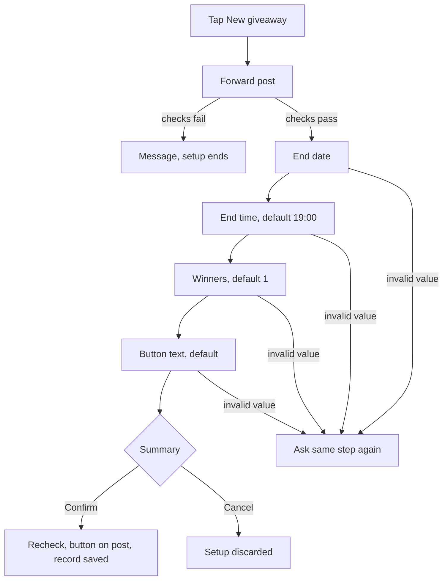
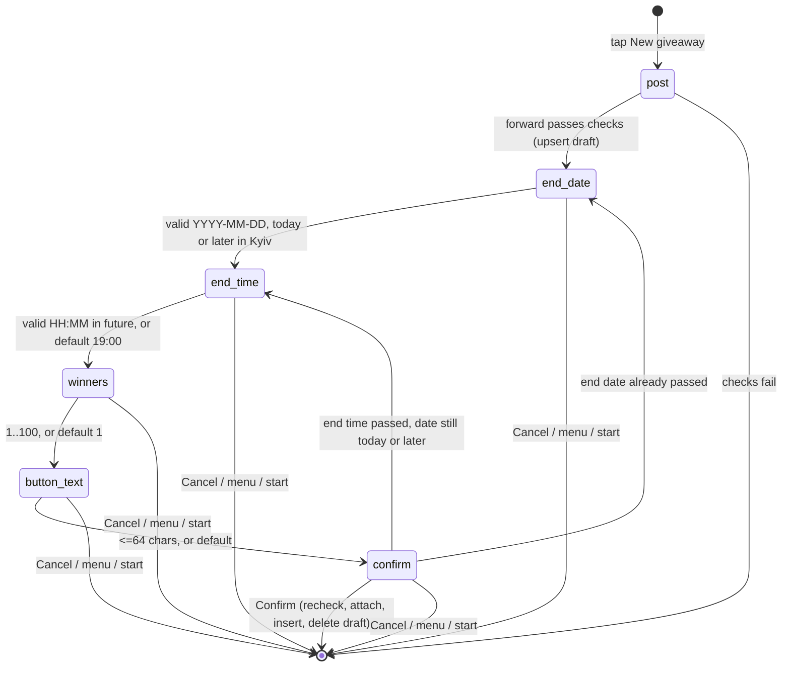

# Giveaway Setup Steps and Menu Keyboard - Plan

## Goal Capsule

- **Objective:** A channel admin creates a giveaway from a menu button by entering the post, end date and time, winner count and button text step by step, reviews a summary, and the join button appears on the post only after they confirm.
- **Product authority:** the owner, in the 2026-10-09 brainstorm. Winner selection and result handling are not active scope; this work only stores winners and the finished state.
- **Means:** step state in the existing pending-command column, inputs in an unpublished giveaways row, menu labels matched in every locale (KTD1, KTD2, KTD5).
- **Open blockers:** none.
- **Stop conditions:** stop and report if a Telegram API call the plan relies on (`getChatMember` for the bot, `editMessageReplyMarkup`) cannot do what KTD6 assumes, or if SQLite refuses the KTD3 columns on a table with rows.
- **Execution:** `ce-work` implements on `main`, commits per unit, no pull request.

---

## Product Contract

### Summary

The bot's private chat gets a persistent two-button keyboard, «🎁 Новий розіграш» and «🌐 Змінити мову», which replaces the `/giveaway` and `/language` commands. «Новий розіграш» starts a guided setup that collects every giveaway input, shows a summary, and attaches the join button to the post only on Confirm. The database can also record which participants won and whether a giveaway is finished.

### Problem Frame

Today the admin must know `/giveaway` and `/language` by heart. Forwarding the post creates the giveaway at once, with no end date, no winner count and a fixed button text, so the admin cannot set those up or review them before the button is live in the channel.

### Key Decisions

- **Menu buttons replace the commands.** `/start` stays because Telegram sends it on first contact. Governs R1, R4. (session-settled: user-directed — chosen over keeping both commands and buttons: the user asked to remove the commands)
- **Everyone sees «Новий розіграш».** The admin check stays where it is, after the post is forwarded. Governs R2, R8. (session-settled: user-approved — chosen over showing it to channel admins only: no new channel setting needed)
- **Labels name the action.** Governs R2. (session-settled: user-directed — chosen over short labels «Розіграш» / «Мова»)
- **This work only collects and stores inputs.** The end date and time trigger nothing yet. Governs R15. (session-settled: user-directed — chosen over closing entry or drawing winners at the end date: drawing and results are a later feature)
- **A giveaway is finished when its winners are recorded, not when its end time passes.** A giveaway past its end time without winners is due for drawing. Governs R18, R19, R20. (session-settled: user-approved — chosen over deriving it from the end time alone and over separate entry-closed and finished states: the later drawing can find due giveaways)
- **Date and time are separate steps stored as one timestamp.** Governs R9, R10, R15. (session-settled: user-directed — chosen over date-only and over a combined date-time input)
- **End date and time are Kyiv time (`Europe/Kyiv`), fixed for everyone.** The summary shows the zone next to the time. Governs R9, R10, R14. (session-settled: user-approved — chosen over a time-zone setting in `.env` and over UTC: one audience, no config)
- **The summary offers only Confirm and Cancel.** To change a value, the admin cancels and starts again. Governs R13, R14. (session-settled: user-approved — chosen over per-field edit buttons and a Back button: fewer states)
- **Steps are an ordered list per command.** A second multi-input command can reuse the mechanism, but no general framework is built ahead of that need. Governs R6.

### Requirements

#### Menu keyboard

- R1. `/language` and `/giveaway` are removed as commands; a user who types them gets the same reply as any other unrecognized text.
- R2. The private chat shows a persistent keyboard with two buttons: «🎁 Новий розіграш» / «🌐 Змінити мову» in Ukrainian, «🎁 New giveaway» / «🌐 Change language» in English.
- R3. The bot sends the keyboard on `/start` and again after the user picks a language, with labels in that language.
- R4. Each button does what its former command did, and the bot recognizes a press in either language, so a keyboard shown before a language switch still works.
- R5. Texts that tell the user to send `/giveaway` point to the «Новий розіграш» button.

#### Setup steps

- R6. «Новий розіграш» starts a setup that asks for these inputs in order: the forwarded channel post, the end date, the end time, the number of winners, and the join button text.
- R7. Each step with a default shows the default as a button; tapping it accepts the default, and typing a value replaces it.
- R8. Right after the forward, the bot runs the existing post checks (the forwarder is a channel admin, the bot can edit the post, no giveaway exists on the post yet) and stops the setup with the matching message if one fails.
- R9. The end date is typed as `YYYY-MM-DD` and has no default.
- R10. The end time is typed as `HH:MM`, defaults to 19:00, and together with the date must lie in the future.
- R11. The number of winners is a whole number from 1 to 100 and defaults to 1.
- R12. The join button text is at most 64 characters and defaults to «Приймаю участь» (en: the existing English join text).
- R13. An invalid value gets a short message naming the expected format, and the bot asks the same step again.

#### Confirmation and cancel

- R14. After the last step the bot shows a summary of all inputs with Confirm and Cancel; nothing appears on the post before Confirm.
- R15. On Confirm the bot repeats the R8 checks and the R10 future check, attaches the join button with the chosen text to the post, and saves the end timestamp, winner count and button text on the giveaway record.
- R16. Every step and the summary offer Cancel, which discards the unfinished setup and changes nothing in the channel.
- R17. Pressing a menu button or sending `/start` during setup discards the unfinished setup the same way.

#### Results storage

- R18. Each participant can be marked as a winner of the giveaway they joined.
- R19. A giveaway records when it finished; it has no finish time until its winners are recorded, and the winners and the finish time are saved together.
- R20. The bot can tell apart an active giveaway, a giveaway past its end time with no finish time (due for drawing), and a finished giveaway.

### Key Flows

- F1. Admin creates a giveaway
  - **Trigger:** The admin taps «🎁 Новий розіграш».
  - **Steps:** Forward the post, checks pass; type `2026-10-25`; tap «19:00»; tap «1»; tap «Приймаю участь»; review the summary; tap Confirm.
  - **Outcome:** The join button with the chosen text is on the post, and the giveaway record holds 2026-10-25 19:00, 1 winner and the button text.
  - **Covered by:** R6, R7, R8, R9, R10, R11, R12, R14, R15

### Acceptance Examples

- AE1. **Covers R10, R13.** Given today is 2026-10-09 and the admin entered date `2026-10-09`, when they type `09:00` at 19:55, then the bot says the time must be in the future and asks for the time again.
- AE2. **Covers R13.** When the admin types `25.10.2026` at the date step, then the bot names the `YYYY-MM-DD` format and asks for the date again.
- AE3. **Covers R15.** Given the admin reached the summary and another admin started a giveaway on the same post meanwhile, when they tap Confirm, then the bot reports the giveaway already exists and attaches nothing.
- AE4. **Covers R17.** Given the admin is at the winners step, when they tap «🌐 Змінити мову», then the setup is discarded and the language buttons appear; a later number they type is not taken as a winner count.
- AE5. **Covers R4.** Given a user's keyboard shows English labels, when they switch to Ukrainian and then tap the old «🎁 New giveaway» button, then the setup starts.

### Scope Boundaries

- Drawing winners, setting the R18 and R19 marks, closing entry at the end time, and posting results. This work adds only the storage those need.
- Showing the end date or winner count on the channel post.
- Editing a single field from the summary, or a Back button.
- Cleaning abandoned setups out of the database.
- Hiding «Новий розіграш» from users who are not channel admins.
- The Telegram «Menu» button command list (`setMyCommands`).

### Dependencies / Assumptions

- An abandoned setup leaves nothing in the channel; it stays until the user starts a new one, presses a menu button or sends `/start`.

### Sources / Research

- `internal/giveaway/handler.go`, `internal/giveaway/service.go`: current `/giveaway` flow, post checks and start outcomes reused by R8.
- `internal/user/middleware.go`, `internal/user/user.go`: the pending-command mechanism that the step state replaces.
- `internal/language/language.go`, `internal/greeting/greeting.go`: `/language` and `/start` handlers that send the keyboard (R3).
- `internal/i18n/locales/uk.json`: `giveaway.no_rights` and `giveaway.failed` mention `/giveaway` (R5).
- `docs/plans/2026-10-09-1804-feat-giveaway-join-button-plan.md`: the plan this work extends.

**Product Contract preservation:** Product Contract unchanged. The two Deferred to Planning questions are answered by KTD2 and KTD3 and were removed from Outstanding Questions.

---

## Planning Contract

### Key Technical Decisions

- KTD1. **The step lives in `users.pending_command` as `giveaway:<step>`.** Steps are `post`, `end_date`, `end_time`, `winners`, `button_text`, `confirm`. A new user-store method moves the column from one exact value to the next in one conditional update and reports whether it did. A duplicate update, an old button, or a race between two messages therefore advances the setup at most once, the same guarantee `TakePendingCommand` gives today. The 32-character column already fits. Each step claims its transition before any side effect. The forward moves `post` to `end_date` before the post check and the draft upsert. Confirm moves `confirm` to `""` before the recheck and the attach. A value step writes its draft field, then advances. A failed check after a claim clears the step and deletes the draft. Governs R6, R13, R17.
- KTD2. **A draft is an unpublished `giveaways` row.** The forward step deletes the user's earlier drafts and upserts an unpublished row on the post, taking over another admin's unpublished row on the same post. Each step writes its field to that row, and Confirm sets `published` once the button is on the post. `Find` and the join flow see only published giveaways. A draft taken over by another admin answers the first admin with the "already exists" text. Rejected: a separate `giveaway_drafts` table, which duplicates the giveaway's columns. (session-settled: user-directed — chosen over a separate drafts table: one table, one boolean)
- KTD3. **New columns on existing tables are nullable or defaulted, because `AutoMigrate` adds them to tables with rows.**
  - `giveaways.ends_at`: nullable, UTC. Rows created before this work have none.
  - `giveaways.winners`: not null, default 1.
  - `giveaways.button_text`: not null, default `''`. Old rows keep it empty; their posts already carry a button.
  - `giveaways.finished_at`: nullable.
  - `giveaways.published`: not null, default true, so existing giveaways count as published. GORM swaps a false zero value for that default on struct inserts, so drafts are inserted from a column map.
  - `giveaway_participants.winner`: bool, not null, default false.

  A `State(now)` method on `Giveaway` returns active, due or finished (R20). A row without `ends_at` is active until finished. Governs R15, R18, R19, R20.
- KTD4. **Kyiv time comes from Go's embedded time-zone database.** `main` imports `time/tzdata`, loads `Europe/Kyiv` before the bot starts and exits on failure, then passes the location to the giveaway service. Docker images often lack `/usr/share/zoneinfo`; the import adds about 450 KB to the binary. The service takes a `now` function so tests fix the clock. Instantiates the Kyiv Key Decision. Governs R9, R10, R14. (session-settled: user-approved — chosen over a time-zone setting in `.env` and over UTC: one audience, no config)
- KTD5. **Menu labels are i18n keys, matched in every locale.** A new `menu` package builds the keyboard for a language: one row, two buttons, persistent and resized. The i18n catalog gains a method that returns one key's text in every locale. `main` registers an exact-match text handler for each label variant, which keeps R4's "either language" rule in one place.
- KTD6. **The post checks split into one shared check plus the attach.** The check runs at the forward step and again on Confirm (R8, R15). It verifies no giveaway exists on the post, the forwarder is a channel admin, and the bot is an admin with `can_edit_messages` (via `getChatMember` with `bot.ID()`). The attach and the insert run only on Confirm. A failed attach still reports `NoRights`, so a right lost between check and confirm is caught.
- KTD7. **Default values, Cancel and Confirm are inline buttons under the step's prompt.** Their callback data carries the step they belong to, for example `giveaway:default:end_time`. Through KTD1 an old button whose step has passed changes nothing: the bot answers the tap with a short "this button is outdated" popup and removes the inline keyboard from that message. `giveaway:cancel` works from any step.
- KTD8. **Leaving the setup is the middleware's job.** `user.Middleware` already clears the pending command on any private command. It also clears it on a menu label, through a predicate that `main` injects so `internal/user` does not import `menu` or `i18n` (R17). Starting a setup then sets `giveaway:post` in the «Новий розіграш» handler, which runs after the middleware.

### High-Level Technical Design

An invalid value, or the wrong kind of input (text at `post`, a forward at a later step), keeps the same state and re-sends that step's prompt (R13). Every transition uses KTD1's conditional update.

### Assumptions

- The keyboard shows both buttons in one row, side by side, as in the owner's screenshot.
- Unrecognized text and typed `/giveaway` or `/language` get no reply, the same as unrecognized text today (R1).
- The summary shows the end as `2026-10-25 19:00 (Київ)`, or `(Kyiv)` in English, and the post as a `https://t.me/c/<channel>/<post>` link instead of the channel title, which would need its own column.
- The setup's prompts follow the user's language, like every other reply. The giveaway stores that language for its popups, as today.
- `ButtonText` up to 64 characters is measured in runes, not bytes, so Cyrillic text gets the full length.

### Sequencing

U1 → U3 → U4 → U5. U2 depends on U1 only and can land before U3.

---

## Implementation Units

### U1. Texts for the menu and the setup

**Goal:** add every new user-facing text in English and Ukrainian, plus a way to read one key in every locale.

**Requirements:** R2, R5, R7, R9–R14, R16

**Dependencies:** none

**Files:**

- `internal/i18n/schema.json`
- `internal/i18n/locales/en.json`
- `internal/i18n/locales/uk.json`
- `internal/i18n/i18n.go`
- `internal/i18n/i18n_test.go`

**Approach:**

1. Add keys and typed constants: two menu labels, a prompt for each step (end date, end time, winners, button text), an error for each validation (date format, date in the past, time format, time in the past, winners range, button text length), an "outdated button" popup, the summary with indexed placeholders, the Confirm and Cancel labels, and a "setup cancelled" message.
2. Reword `giveaway.no_rights` and `giveaway.failed` to point to the menu button. Reword `giveaway.prompt` so it fits the button.
3. Add a catalog method that returns a key's text in every loaded locale, sorted and without duplicates.

**Patterns to follow:** the existing key constants and `schema.json` descriptions; `Load`'s key check catches a key missing from one file.

**Test scenarios:**

- `Load` succeeds with the new keys present in `schema.json`, `en.json` and `uk.json`.
- The every-locale method returns `["🌐 Change language", "🌐 Змінити мову"]` for the language menu key.
- The summary text fills its placeholders in order in both locales.

**Verification:** `go test ./internal/i18n/` passes, and neither locale mentions `/giveaway` or `/language`.

### U2. Menu keyboard replaces the commands

**Goal:** `/start` and a language choice send the keyboard, the language button works in both languages, and the `/language` and `/giveaway` commands stop working.

**Requirements:** R1, R2, R3, R4, R17; AE4, AE5

**Dependencies:** U1

**Files:**

- `internal/menu/menu.go` (new)
- `internal/menu/menu_test.go` (new)
- `internal/greeting/greeting.go`
- `internal/language/language.go`
- `internal/language/language_test.go`
- `internal/user/middleware.go`
- `internal/user/middleware_test.go`
- `main.go`

**Approach:**

1. `menu` exposes the keyboard for a language and the label variants for each button (KTD5).
2. The greeting attaches the keyboard. The language-selected message attaches the keyboard in the newly chosen language.
3. Drop `language.Command`. The language prompt handler is registered once per label variant.
4. `user.Middleware` takes an injected reset predicate (KTD8) and no longer special-cases `giveaway`. Any private command or menu label clears the pending command.
5. In `main.go`, remove the `/language` and `/giveaway` registrations and register the label handlers. The «Новий розіграш» handler is a stub until U5.

**Patterns to follow:** inline keyboards in `language.CommandHandler`; hand-written fakes in `internal/user/middleware_test.go`.

**Test scenarios:**

- The keyboard for `uk` has one row with «🎁 Новий розіграш» and «🌐 Змінити мову», persistent and resized.
- The keyboard for an unknown language falls back to English labels.
- Covers AE4. The middleware clears a pending `giveaway:winners` when the message text is «🌐 Змінити мову».
- The middleware clears a pending step on `/start`.
- The middleware leaves a pending step alone for plain text such as `5`.
- The middleware ignores group messages, as today.

**Verification:** `go test ./...` passes; `/language` and `/giveaway` no longer appear in `main.go` registrations.

### U3. Storage for drafts, end time, winners and finished state

**Goal:** the database holds setup drafts, the new giveaway fields and the winner mark, and code can read a giveaway's state.

**Requirements:** R15, R18, R19, R20

**Dependencies:** none

**Files:**

- `internal/giveaway/giveaway.go`
- `internal/giveaway/store.go`
- `internal/giveaway/store_test.go`
- `internal/giveaway/giveaway_test.go` (new)
- `internal/user/user.go`
- `internal/user/user_test.go`
- `internal/db/db.go`
- `internal/db/db_test.go`

**Approach:**

1. Add the KTD3 columns, a `Draft` model per KTD2, and `State(now)`.
2. Add store methods: save a draft (upsert that resets every field), read a user's draft, update a draft's fields, delete a draft. `Create` saves the new giveaway fields.
3. Add the user-store method from KTD1 that moves `pending_command` from an exact value to a new one.
4. Add `Draft` to `AutoMigrate`.

**Patterns to follow:** `Store.Create` and `Store.Join` with `OnConflict`; `user.Store.TakePendingCommand` for the conditional update; foreign-key naming notes on `Participant.UserID`.

**Execution note:** test the migration against a database file that already holds a pre-change giveaway row.

**Test scenarios:**

- `State` returns active before `ends_at`, due after it with no `finished_at`, finished when `finished_at` is set, and active when `ends_at` is nil.
- Saving a draft twice for one user leaves one row, with the second save's fields and the rest reset.
- Moving the pending command from `giveaway:end_date` to `giveaway:end_time` succeeds once; a second identical call reports false.
- Moving from a value the user does not hold reports false and changes nothing.
- Opening an existing database with an old giveaway row migrates it: winners 1, button text empty, `ends_at` and `finished_at` null, existing participants not winners.
- Deleting a draft for a user without one is not an error.

**Verification:** `go test ./internal/giveaway/ ./internal/user/ ./internal/db/` passes.

### U4. Setup rules in the giveaway service

**Goal:** the service validates each step's input, advances the step, and on Confirm re-checks, attaches the chosen button and saves the giveaway.

**Requirements:** R6–R16; AE1, AE2, AE3

**Dependencies:** U1, U3

**Files:**

- `internal/giveaway/service.go`
- `internal/giveaway/setup.go` (new)
- `internal/giveaway/handler.go`
- `internal/giveaway/service_test.go`
- `internal/giveaway/setup_test.go` (new)

**Approach:**

1. Extract the post check from `Start` (KTD6), add the bot-rights check to the `Telegram` interface, and implement it on `telegramAPI` in `handler.go` so the package keeps compiling.
2. Add parsers for the date, time, winners and button text steps, each returning a value or an i18n error key (R9–R13). A date before today in Kyiv is rejected at the date step, so the time step cannot trap the admin. The date and time combine in the Kyiv location (KTD4) and must lie after `now`.
3. Add service methods: begin the setup from a forward, apply a typed or default value to the current step, build the summary, confirm, cancel. Each method claims its transition first (KTD1), and the handler only translates updates.
4. `Confirm` re-runs the post check and the future check, then attaches the draft's button text and saves `ends_at` (UTC), winners, button text and language. It deletes the draft on success and on a terminal failure. A passed end time returns the admin to `end_date` when the date is before today, else to `end_time`.
5. Keep the old `Start` until U5 removes its last caller.

**Patterns to follow:** `StartResult` outcomes mapped to i18n keys in `handler.go`; fake `Storage` and `Telegram` in `service_test.go`.

**Execution note:** write the parser tests table-driven first; they hold most of the edge cases.

**Test scenarios:**

- Date `2026-10-25` is accepted.
- Covers AE2. Date `25.10.2026` is rejected with the date-format key.
- Date `2026-02-30` is rejected with the date-format key.
- Time `19:00` with date `2026-10-25` and `now` 2026-10-09 is accepted and stored as 17:00 UTC: Kyiv leaves summer time that morning, so the offset is +02:00.
- Covers AE1. Time `09:00` with today's date at 19:55 Kyiv is rejected with the time-in-past key.
- Time `24:00` and `9am` are rejected with the time-format key.
- Winners `0`, `101` and `abc` are rejected; `1` and `100` are accepted.
- A 65-rune button text is rejected; a 64-rune Cyrillic text is accepted.
- The default for the end-time step yields 19:00, for winners 1, and for the button text the locale's join text.
- Forwarding a post that already has a giveaway ends the setup with `Exists` and saves no draft.
- Forwarding a post when the bot lacks `can_edit_messages` ends the setup with `NoRights`.
- Covers AE3. Confirm after another giveaway was created on the post returns `Exists` and does not call attach.
- Date `2026-10-08` with `now` 2026-10-09 is rejected with the date-in-past key.
- Confirm when the end time passed earlier today returns the time-in-past key and moves the step to `end_time`.
- Confirm when the end date passed while the summary waited moves the step to `end_date`.
- A second Confirm on the same draft does not call attach.
- Two forwards at the `post` step run the post check once.
- Confirm saves the giveaway with the draft's fields and deletes the draft.
- Applying a value when the pending step is different returns "not current" and changes nothing.

**Verification:** `go test ./internal/giveaway/` passes with the fakes; no handler code is needed for these tests.

### U5. Setup handlers and wiring

**Goal:** Telegram updates drive the setup: the menu button, the forward, typed values, and the default, Cancel and Confirm buttons.

**Requirements:** R6, R7, R14, R16, R17; F1

**Dependencies:** U2, U4

**Files:**

- `internal/giveaway/handler.go`
- `internal/giveaway/handler_internal_test.go`
- `main.go`

**Approach:**

1. Replace `CommandHandler` with the «Новий розіграш» handler: set `giveaway:post`, send the forward prompt with Cancel. Remove `ForwardHandler`'s old `Start` call and then `Start` itself.
2. The default handler routes a private message to the setup when the user's pending command starts with `giveaway:`. A forward is accepted only at `post`, and text only at the other steps; the wrong kind re-sends the current step's prompt.
3. One callback handler, registered by the `giveaway:` prefix, serves the default, Cancel and Confirm buttons and answers every callback query so the spinner stops. `JoinCallback` stays an exact match and must be registered before the prefix handler, or the prefix handler must ignore it.
4. Each prompt carries its default button (KTD7) and Cancel; the summary carries Confirm and Cancel.
5. In `main.go`, load the Kyiv location (KTD4) and pass the location and `time.Now` to the service.

**Patterns to follow:** `ForwardHandler` and `JoinHandler` structure; the `telegramAPI` adapter for new Telegram calls.

**Test scenarios:**

- A text message from a user with no pending step gets no reply.
- A forward while the pending step is `end_date` re-sends the end-date prompt.
- Text while the pending step is `post` re-sends the forward prompt.
- The callback `giveaway:default:end_time` while the step is `winners` answers with the outdated popup, removes that message's buttons and leaves the step at `winners`.
- The join button's callback still reaches `JoinHandler` and not the setup callback handler.
- The callback data for every step's default button fits Telegram's 64-byte limit.

**Verification:** `go build .` and `go test ./...` pass, and `golangci-lint run ./...` reports 0 issues.

---

## Verification Contract

| Gate | Command | Applies to |
| --- | --- | --- |
| Compile | `go build ./...` | every unit |
| Tests | `go test ./...` | every unit |
| Lint | `golangci-lint run ./...`, 0 issues | every unit |
| Modules | `go mod tidy` leaves `go.mod` unchanged | U5; no new modules, `time/tzdata` is stdlib |
| Markdown | `markdownlint-cli2 "**/*.md"` | docs edits |

A live Telegram smoke test of F1 needs the owner's bot token and a test channel. It is not part of automated verification; the owner runs it after the work lands.

---

## Definition of Done

- R1–R17 and R20 each trace to a passing test or a unit's verification above. R18 and R19 trace to U3's migration and `State` tests: this work adds the winner and finish columns, and the drawing feature will set them together.
- `/language` and `/giveaway` are gone from handler registrations, texts and package docs.
- The `giveaway` package doc and `CONCEPTS.md` describe the setup, not the old `/giveaway` flow.
- No abandoned-attempt code, unused helpers or commented-out code remain in the diff.
- Every gate in the Verification Contract passes.
