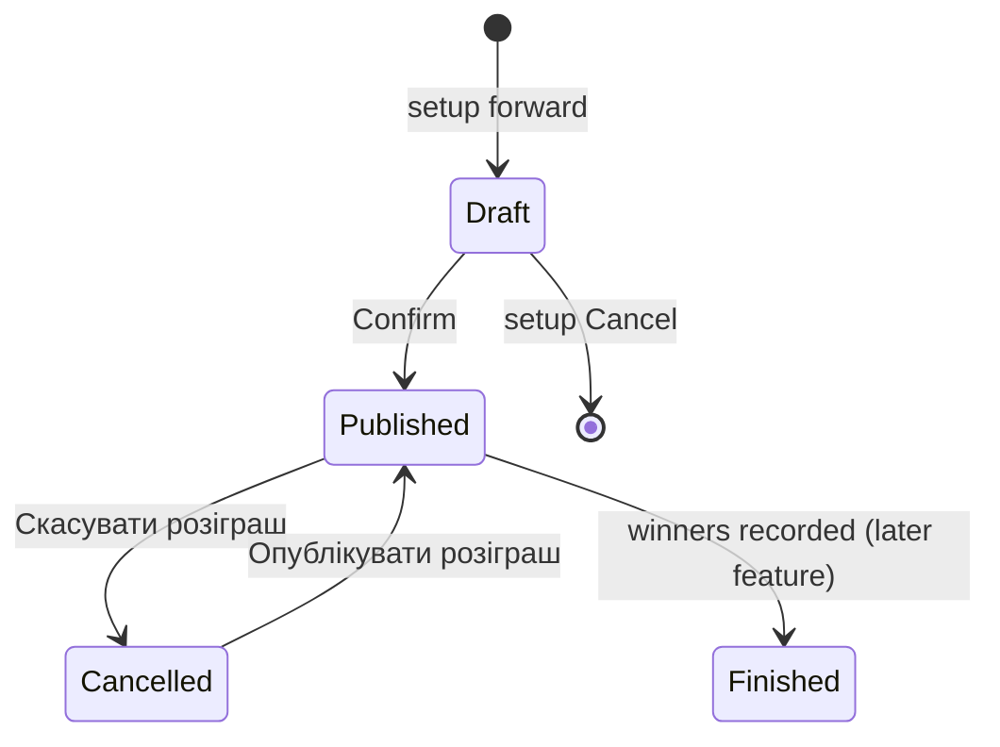
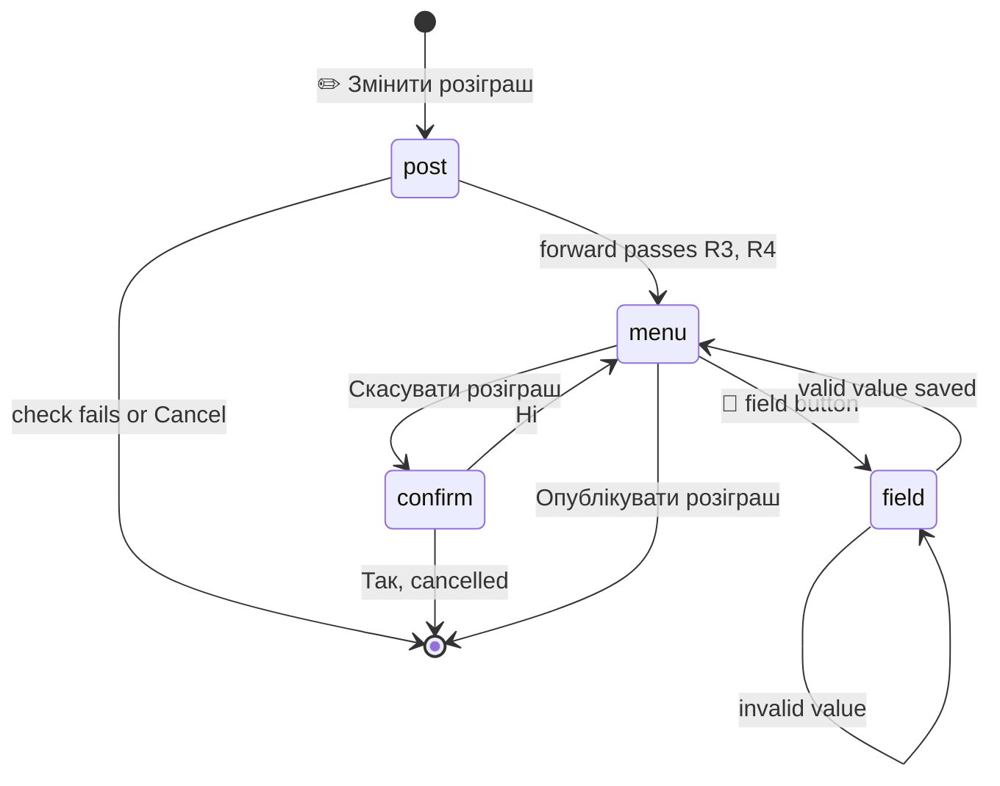

# Giveaway Edit, Cancel and List - Plan

## Goal Capsule

- **Objective:** The admin who created a giveaway can correct its end time, winner count and button text, take it off the post and later put it back, and see a list of their running giveaways, all from the bot's private chat and never after the giveaway is finished.
- **Product authority:** the owner, in the 2026-10-09 brainstorm and plan review. Winner drawing and result handling stay out of scope, as in [the setup plan](2026-10-09-1955-feat-giveaway-setup-steps-plan.md).
- **Means:** each field change is saved at once, and the only state between messages is the user's pending command (KTD2); a cancelled giveaway is an unpublished row with its own cancel mark (KTD1).
- **Open blockers:** none.
- **Stop conditions:** stop and report if removing the join button with `editMessageReplyMarkup` and no markup does not clear the post's keyboard, or if `AutoMigrate` refuses a nullable column on `giveaways`.
- **Execution:** `ce-work` implements unit by unit with a commit per unit; the branch and PR follow the owner's instruction at launch.

---

## Product Contract

Product Contract preservation: changed R5–R11, R13, F1, F2, AE3–AE5 — during plan review the owner named the field buttons and switched from applying changes together to saving each field at once; R8 also states that a cancelled giveaway's button text is only saved, which R14 requires. The other R/AE IDs are unchanged.

### Summary

The menu gains «✏️ Змінити розіграш» and «📋 Мої розіграші». After «Змінити розіграш» the creator forwards the post and gets a field menu: each field change is saved and shown on the post at once, and «Скасувати розіграш» takes the join button off the post while keeping the participants. «Мої розіграші» lists links to the user's unfinished published giveaways.

### Problem Frame

Once a giveaway is published, nothing about it can be changed: forwarding the post again answers that a giveaway already exists. A wrong end date, winner count or button text stays live in the channel, and the only way to take the button off is by hand, which leaves the giveaway record believing it is still running. The admin also has no way to see which giveaways they have running without scrolling the channel.

### Key Decisions

- **A field menu, not the setup steps again.** The admin changes only the fields they need. Governs R5, R6. (session-settled: user-approved — chosen over repeating all four setup steps with the current values as defaults: one fix should not take four steps)
- **Each field change is saved at once.** Governs R6, R8. (session-settled: user-directed — chosen over collecting changes and applying them together on a publish button: no state to manage between messages)
- **Only the creator can edit, cancel or restore a giveaway.** Governs R3, R8, R13, R15. (session-settled: user-directed — chosen over any channel admin with edit rights)
- **Cancelling keeps the participants.** A cancelled giveaway is unpublished, and publishing it again brings its participants back. Governs R11, R12, R13, R14. (session-settled: user-directed — chosen over deleting the participants with the cancel: people who joined are not lost)
- **A cancelled giveaway is restored through the same field menu.** Governs R13. (session-settled: user-approved — chosen over a fresh setup and over making the cancel final)
- **Editing has its own menu button.** «Новий розіграш» keeps meaning a new giveaway. Governs R1, R15. (session-settled: user-directed — chosen over reusing «Новий розіграш» and over a plain forward outside any setup)
- **The list is a separate menu button with links only.** Governs R1, R17, R18.
- **Only a finished giveaway is locked.** A giveaway past its end time with no winners recorded can still be edited, and a new future end time makes it active again. Governs R4, R9.

### Requirements

#### Menu

- R1. The private-chat keyboard has four buttons: «🎁 Новий розіграш», «✏️ Змінити розіграш», «📋 Мої розіграші», «🌐 Змінити мову» in Ukrainian, and «🎁 New giveaway», «✏️ Edit giveaway», «📋 My giveaways», «🌐 Change language» in English. Each is recognized in either language, as the existing two are.

#### Opening an edit

- R2. «Змінити розіграш» asks the user to forward the giveaway's post; any other input repeats the request, and Cancel ends it.
- R3. The forwarded post opens the field menu only when its giveaway was created by the forwarder, the forwarder is still an admin of the channel, and the bot can still edit the post. Otherwise the bot names the failed check and ends: no giveaway on this post, someone else's giveaway, not an admin, or no rights.
- R4. A finished giveaway (winners recorded) answers that it is finished and cannot be changed.

#### Field menu

- R5. The field menu shows the giveaway's post link, end date and time, winner count and button text, with one button per field: «📝 Змінити дату закінчення», «📝 Змінити час закінчення», «📝 Змінити кількість переможців», «📝 Змінити текст кнопки» (en: «📝 Edit end date», «📝 Edit end time», «📝 Edit winners», «📝 Edit button text»).
- R6. A field button asks for that one value with the same format, default button and validation as the setup step. A valid value is saved at once, and the bot shows the field menu again with the new value.
- R7. Changing only the end date keeps the stored time of day, and changing only the time keeps the stored date; a giveaway with no stored end time takes 19:00 for a new date.
- R8. Before saving a field, the bot repeats the R3 and R4 checks; a failure saves nothing and names the failed check. A new button text of a published giveaway is put on the post before it is saved, so a post that cannot be edited keeps the giveaway unchanged; a cancelled giveaway's text is only saved, since its post has no button.
- R9. A new end time must be in the future.
- R10. Pressing a menu button or sending `/start` while the bot waits for a field value stops the wait, as it stops an unfinished setup; values saved before stay saved.

#### Cancel and restore

- R11. «Скасувати розіграш» asks for confirmation; «Ні» shows the field menu again. On confirm, after the R3 and R4 checks, the bot removes the join button from the post and marks the giveaway cancelled.
- R12. A cancelled giveaway keeps its participants and its values. Starting or cancelling another setup never deletes it.
- R13. Forwarding a cancelled giveaway's post through «Змінити розіграш» opens the field menu with its stored values; field changes save as in R6. In place of «Скасувати розіграш» it shows «✅ Опублікувати розіграш» (en: «✅ Publish giveaway»), which needs a future end time and the R3 checks, puts the join button back on the post and marks the giveaway published. Earlier participants count again.
- R14. Joining a cancelled giveaway is not possible: its post has no button, and a tap on a button that was left behind adds no participant and gets the existing join-failed popup.

#### New giveaway on a used post

- R15. Forwarding a post through «Новий розіграш» when it already has a published or cancelled giveaway does not start a setup. The creator is pointed to «Змінити розіграш»; anyone else is told the post has someone else's giveaway.
- R16. An unfinished setup on a post, which has no join button yet, keeps today's behavior: the admin who forwards the post later takes the setup over.

#### My giveaways

- R17. «Мої розіграші» replies with one message listing the user's published, unfinished giveaways: a link to each post and its end date and time in Kyiv. Giveaways past their end time are marked as awaiting results.
- R18. With no such giveaways, the reply says the user has no running giveaways. Cancelled and finished giveaways are not listed.

### Key Flows

- F1. Edit
  - **Trigger:** the creator taps «✏️ Змінити розіграш».
  - **Steps:** forward the post; the bot checks it (R3, R4) and shows the field menu; the creator taps «📝 Змінити кількість переможців» and types 3; the bot rechecks, saves, and shows the menu with 3.
  - **Outcome:** the giveaway has 3 winners; the post is unchanged because the button text is the same.
  - **Covered by:** R2, R3, R5, R6, R8
- F2. Cancel and restore
  - **Trigger:** the creator opens the field menu of a published giveaway.
  - **Steps:** tap «Скасувати розіграш», confirm; the button disappears from the post. Later, «Змінити розіграш», forward the same post, tap «✅ Опублікувати розіграш».
  - **Outcome:** the button is back, and everyone who joined before the cancel is still a participant.
  - **Covered by:** R11, R12, R13

### Acceptance Examples

- AE1. **Covers R3.** Given admin B forwards the post of admin A's giveaway through «Змінити розіграш», then the bot answers that it is someone else's giveaway and shows no menu.
- AE2. **Covers R4.** Given a giveaway whose winners are recorded, when its creator forwards the post through «Змінити розіграш», then the bot answers that it is finished and shows no menu.
- AE3. **Covers R7.** Given a giveaway ending 2026-10-20 19:00, when the creator changes the end date to 2026-10-25, then it ends 2026-10-25 19:00.
- AE4. **Covers R8.** Given the bot lost the right to edit posts while the menu was open, when the creator enters a new button text, then the bot reports the missing rights and both the post and the giveaway keep the old text.
- AE5. **Covers R9.** Given a giveaway whose end time passed and whose winners are not recorded, when the creator sets an end date tomorrow, then the giveaway is active again.
- AE6. **Covers R12, R16.** Given the creator cancelled a giveaway with participants, when they start a new setup on another post and then cancel it, then the cancelled giveaway and its participants still exist.
- AE7. **Covers R15.** Given a cancelled giveaway of admin A, when admin B forwards its post through «Новий розіграш», then B is told the post has someone else's giveaway and no setup starts.
- AE8. **Covers R17.** Given the user has one active giveaway, one past its end time without winners, one cancelled and one finished, when they tap «Мої розіграші», then the reply lists the first two, the second marked as awaiting results.

### Scope Boundaries

- Winner drawing, results posts and the finish action stay out of scope.
- No notifications to participants about changes or cancellation.
- No editing of the post itself or moving a giveaway to another post.
- No handing a giveaway over to another admin; if the creator leaves the channel, nobody can edit the giveaway.
- The list has no per-item buttons; editing starts from a forward.
- Concurrent edits are not locked against each other; the last saved value wins.

### Dependencies / Assumptions

- Today the cleanup of an unfinished setup deletes every unpublished giveaway of the user ([store.go](../../internal/giveaway/store.go), `DeleteDraft`). Participants reference giveaways with a foreign key and no cascade, so deleting a cancelled giveaway with participants fails, and deleting one without participants loses it. R12 requires telling a cancelled giveaway apart from an unfinished setup.
- Today, saving a setup on a post whose giveaway is unpublished takes the row over, including its creator ([store.go](../../internal/giveaway/store.go), `SaveDraft`). R15 needs that to stop for cancelled giveaways while R16 keeps it for unfinished setups.

---

## Planning Contract

### Key Technical Decisions

- KTD1. **A cancelled giveaway is an unpublished row with a nullable `CancelledAt` time.** An unfinished setup is `published = false AND cancelled_at IS NULL`, and every draft query (`Draft`, `DeleteDraft`, the `SaveDraft` conflict guard) narrows to it; restoring clears the mark together with publishing. A nullable column needs no default on a table with rows, the same as `EndsAt`. Governs R11, R12, R13, R15, R16.
- KTD2. **The only state between messages is the pending command, which carries the giveaway ID.** Steps take the form `edit:post` and `edit:<field>:<giveaway ID>`; `edit:button_text:4294967295` is 27 characters, inside the column's 32. The `edit:` prefix keeps edit steps away from setup's `giveaway:` prefix, so setup `Cancel` never deletes drafts during an edit. The field menu itself is no step: its buttons carry the giveaway ID, and each tap is checked again (KTD4). Governs R2, R6, R10. (session-settled: user-directed — chosen over a separate pending-changes table and a publish button: no state to manage between messages)
- KTD3. **Edit and list live in a new `Editor` type in `internal/giveaway`, composed with `Service`.** It reuses `Service`'s parsers, step claim and admin checks, and keeps `NewService` and the setup flow unchanged. Its dependencies are new consumer-side interfaces of at most three methods: `Giveaways` (read a published or cancelled giveaway by ID and by post, list the creator's running giveaways), `GiveawayWriter` (save field values, cancel) and `ButtonRemover` (take the join button off a post). Both reads return `ErrNotFound` for a draft, so no edit action can reach another admin's unfinished setup. Governs R2–R13, R17, R18.
- KTD4. **Every action that changes a giveaway reads the row again and repeats the checks.** Creator, still a channel admin, bot can edit posts, not finished; the restore button also needs a future end time. `checkPost`'s admin and rights part becomes a shared helper; its "giveaway exists" part changes to the R15 lookup. Telegram goes first and the database second. A database failure after a cancel leaves a published giveaway with no button, which the next cancel completes, since removing a button that is already gone counts as success. A database failure after a button-text change leaves the post ahead of the record until a later button-text save or a restore re-attaches the stored text. Governs R3, R4, R8, R11, R13.
- KTD5. **Callback data carries the action and the giveaway ID under a new prefix**, for example `giveaway-edit:field:winners:42`, `giveaway-edit:cancel:42`, `giveaway-edit:cancel-yes:42`, `giveaway-edit:publish:42`, `giveaway-edit:default:winners:42`, and `giveaway-edit:stop`. «Скасувати» under the forward prompt and the field prompts is `giveaway-edit:stop`, never setup's Cancel: it claims any `edit:` pending command to empty, ends the edit at `edit:post` and shows the field menu again at a field step. The prefix is not a prefix of `giveaway-setup:` or `giveaway:join`, and a payload stays under Telegram's 64 bytes. A default button acts only while the pending command still names its field and giveaway; otherwise it gets the existing "outdated" popup. Governs R5, R6, R11, R13.
- KTD6. **The setup forward checks the post with a lookup that sees cancelled giveaways.** A new `StartResult` for "someone else's giveaway" sits next to `Exists`, and the `Exists` text points the creator to «✏️ Змінити розіграш». Governs R15, R16.

### High-Level Technical Design

Giveaway life after this work:

Draft, Published and Cancelled rows are told apart by `published` and `cancelled_at` (KTD1); Finished is `finished_at` set. Field edits keep a Published or Cancelled giveaway in its state.

Edit conversation, by pending command:

`post` is `edit:post` and `field` is `edit:<field>:<id>`; `menu` and `confirm` are messages whose buttons carry the ID, with an empty pending command (KTD2, KTD5).

### Assumptions

- `editMessageReplyMarkup` with no markup removes a post's inline keyboard; `setupHandler.removeButtons` in [setup_handler.go](../../internal/giveaway/setup_handler.go) already relies on it for private chats.
- Lists stay well under Telegram's 4096-character message limit: about 50 running giveaways per creator would be needed to reach it.

### Sources

- Setup state machine, step claim and parsers: [setup.go](../../internal/giveaway/setup.go), [setup_handler.go](../../internal/giveaway/setup_handler.go).
- Post checks and interfaces: [service.go](../../internal/giveaway/service.go) (`checkPost`, `Telegram`, `Storage`, `Drafts`).
- Join button: [handler.go](../../internal/giveaway/handler.go) (`telegramAPI.AttachButton`, `ignoreNotModified`).
- Menu: [menu.go](../../internal/menu/menu.go), `menuHandlers` in [main.go](../../main.go).
- Migration tests: [db_test.go](../../internal/db/db_test.go) (`TestOpenExistingGiveaways`).

---

## Implementation Units

### U1. Cancel mark and giveaway queries

- **Goal:** the store tells drafts, published and cancelled giveaways apart and offers the lookups and writes the edit flow needs.
- **Requirements:** R11, R12, R13, R15, R16, R17, R18; KTD1.
- **Dependencies:** none.
- **Files:** `internal/giveaway/giveaway.go`, `internal/giveaway/store.go`, `internal/giveaway/store_test.go`, `internal/db/db_test.go`.
- **Approach:**
  1. Add `CancelledAt *time.Time` to `Giveaway` with a comment on what it marks.
  2. Narrow `Draft`, `DeleteDraft` and the `SaveDraft` conflict guard to rows with no cancel mark, so a cancelled post returns `ErrExists`.
  3. Make `Publish` clear `cancelled_at` in the same update.
  4. Add a lookup by post and a read by ID, each returning a published or cancelled giveaway and `ErrNotFound` for a draft or nothing.
  5. Add a cancel write (published, unfinished → unpublished with the mark), a field write for end time, winners and button text that refuses a finished giveaway, and the creator's published unfinished giveaways ordered by end time.
- **Patterns to follow:** conditional updates with `RowsAffected` → `ErrNotFound` as in `Publish`; map or `Update("col", v)` writes, never `Updates(struct)` (the GORM zero-value note on `Published`).
- **Test scenarios:**
  - Covers AE6. A cancelled giveaway with a participant survives `DeleteDraft` of its creator, and the creator's real draft on another post is deleted.
  - `Draft` returns the creator's real draft when the creator also has a cancelled giveaway.
  - `SaveDraft` on a cancelled post returns `ErrExists` and keeps its creator and values.
  - Lookup by post and read by ID each find a published and a cancelled giveaway and return `ErrNotFound` for a draft and a missing row.
  - Cancel then publish brings back a giveaway with its participants, and the cancel mark is cleared.
  - Cancel of a cancelled, a finished and a draft giveaway changes nothing and returns `ErrNotFound`.
  - Field write on a finished giveaway changes nothing and returns `ErrNotFound`.
  - The creator's list holds active and due giveaways ordered by end time, and leaves out cancelled, finished, drafts and other creators' giveaways.
  - Migration: an old database's giveaways get no cancel mark and stay published.
- **Verification:** store tests pass on real SQLite with foreign keys on.

### U2. Setup forward on a used post

- **Goal:** «Новий розіграш» never starts a setup on a post with a published or cancelled giveaway, and points the creator to editing.
- **Requirements:** R15, R16; KTD6.
- **Dependencies:** U1.
- **Files:** `internal/giveaway/service.go`, `internal/giveaway/handler.go`, `internal/giveaway/service_test.go`, `internal/giveaway/setup_test.go`, `internal/i18n/i18n.go`, `internal/i18n/schema.json`, `internal/i18n/locales/en.json`, `internal/i18n/locales/uk.json`.
- **Approach:**
  1. Split `checkPost` into the giveaway lookup and a shared admin-and-rights helper (KTD4).
  2. The lookup uses U1's post lookup and returns `Exists` for the creator and a new "someone else's" result for anyone else.
  3. Map the new result in `startText`, add its text, and reword `giveaway.exists` to point to «✏️ Змінити розіграш».
  4. Grow `Storage` or add a one-method interface for the lookup, staying within three methods per interface.
- **Patterns to follow:** `fakeStore`/`fakeTelegram` in `service_test.go`; `newSetup` in `setup_test.go`.
- **Test scenarios:**
  - Covers AE7. Admin B forwards admin A's cancelled post: someone-else notice, no draft saved, setup ended.
  - The creator forwards their own cancelled post: the notice points to editing, no draft saved.
  - A published post forwarded by its creator gets the same edit pointer.
  - Covers R16. A post with another admin's unfinished draft is still taken over.
- **Verification:** setup tests pass; the i18n test accepts both locales.

### U3. Editor rules

- **Goal:** the creator can open a giveaway, change each field, cancel and restore it, and list running giveaways, with every rule in one type.
- **Requirements:** R2–R13, R17, R18; KTD2, KTD3, KTD4.
- **Dependencies:** U1, U2.
- **Files:** `internal/giveaway/edit.go` (new), `internal/giveaway/edit_test.go` (new), `internal/giveaway/service.go`, `internal/giveaway/setup.go`, `internal/giveaway/service_test.go`.
- **Approach:**
  1. `Editor` holds `*Service`, `Giveaways`, `GiveawayWriter` and `ButtonRemover` (KTD3); the step constants and the step parser for `edit:<field>:<id>` live in `edit.go`.
  2. Begin sets `edit:post`. Forward claims `edit:post` → "", looks the post up, and runs the creator, finished and KTD4 checks before returning the menu data.
  3. A field tap rechecks the giveaway (KTD4) and sets `edit:<field>:<id>`. A value claims that step, parses it with the setup parsers, combines date and time per R7, rechecks, writes the post first when a published giveaway's button text changed, then the database, and returns the menu again. An invalid value keeps the step and names the format.
  4. Cancel confirm rechecks, removes the button, then marks the giveaway cancelled. Restore rechecks, requires a future end time, attaches the button with the stored text (or the locale's join text when empty), then publishes.
  5. List reads U1's list and builds the text with links and a due marker per R17, R18.
  6. Turn `fill`'s date handling into a helper both flows share, so editing a date keeps the time of day while setup keeps its midnight-then-time order.
- **Execution note:** write the service tests against real SQLite and `fakeTelegram` first; most of the risk is in the ordering of checks and writes.
- **Patterns to follow:** `Service.claim`, `recheckEnd`, `publish` in `setup.go`; `Reply` for what the handler sends.
- **Test scenarios:**
  - Covers AE1. Forward of another creator's post: someone-else notice, no menu, step cleared.
  - Covers AE2. Forward of a finished giveaway: finished notice, no menu.
  - Forward of a post without a giveaway, or with only a draft: no-giveaway notice.
  - Forward when the creator lost admin or the bot lost rights: the matching notice.
  - Covers F1. Winners field with 3: saved, menu again, no Telegram call.
  - Covers AE3. End date changed alone keeps 19:00; end time changed alone keeps the date; a legacy giveaway with no end time gets 19:00.
  - Covers AE5. A due giveaway gets tomorrow's date and its state becomes active.
  - Covers R9. A date or time that makes a past moment is rejected and the step stays.
  - Covers AE4. Button text when the bot cannot edit: Telegram error, the database keeps the old text.
  - Button text on a cancelled giveaway: saved, no Telegram call, the post keeps no button.
  - A value typed after a menu press finds no step and is ignored.
  - Covers F2. Cancel with a participant: button removed, giveaway cancelled, participant kept; restore attaches the button with the stored text and publishes.
  - Restore with a past end time: notice to set a new end time, nothing published.
  - Cancel tapped twice: the second tap changes nothing and says the giveaway is already cancelled.
  - Covers AE8. List with active, due, cancelled and finished giveaways: the first two, the due one marked; an empty list gets the empty text.
- **Verification:** `edit_test.go` passes; setup tests still pass.

### U4. Edit handlers and Telegram button removal

- **Goal:** Telegram updates reach the `Editor`, and its replies become messages, menus and popups.
- **Requirements:** R2, R5, R6, R10, R11, R13, R14, R17; KTD5.
- **Dependencies:** U3.
- **Files:** `internal/giveaway/edit_handler.go` (new), `internal/giveaway/handler.go`, `internal/giveaway/setup_handler.go`, `internal/giveaway/handler_test.go`, `internal/i18n/i18n.go`, `internal/i18n/schema.json`, `internal/i18n/locales/en.json`, `internal/i18n/locales/uk.json`.
- **Approach:**
  1. Add `RemoveButton` to `telegramAPI`, mirroring `removeButtons` and wrapped in `ignoreNotModified`.
  2. `MessageHandler` stays the only default handler and routes `edit:` steps to the edit handler: a forward at `edit:post`, text at a field step, anything else repeats the current prompt.
  3. An edit callback handler parses the KTD5 payload and answers every query; a stale default tap gets the outdated popup and loses its buttons.
  4. The menu message shows the summary with a status line (published or cancelled), the four R5 field buttons, then «Скасувати розіграш» or «✅ Опублікувати розіграш».
  5. Handlers for the «✏️ Змінити розіграш» and «📋 Мої розіграші» labels.
  6. Add every new text to `i18n.go`, `schema.json` and both locales: the forward prompt, field labels, menu header and status, cancel confirmation with «Так» / «Ні», the notices from U3, and the list header, line, due marker and empty text.
- **Patterns to follow:** `setup_handler.go` (`prompt`, `reply`, `removeButtons`, `SetupCallbackHandler`); the `fakeAPI` Bot API server in `handler_test.go`.
- **Test scenarios:**
  - A forward at `edit:post` sends the field menu with four field buttons and the cancel button, and each payload carries the giveaway ID.
  - A cancelled giveaway's menu shows the publish button and no cancel button.
  - Text at a field step saves and sends the menu again.
  - The cancel button sends the confirmation; «Ні» sends the menu; «Так» calls `editMessageReplyMarkup` on the channel post with no `reply_markup`.
  - «Скасувати» at the forward prompt ends the edit with the cancelled notice; at a field prompt it sends the field menu again; neither touches setup drafts.
  - A default tap whose field is no longer pending gets the outdated popup and an `editMessageReplyMarkup` on the chat message.
  - Every callback payload is at most 64 bytes, and the edit prefix is not a prefix of the setup or join data.
  - The list label sends one message with the list.
- **Verification:** handler tests pass against the fake Bot API.

### U5. Four-button menu and wiring

- **Goal:** users see and can use the two new menu buttons.
- **Requirements:** R1, R10.
- **Dependencies:** U4.
- **Files:** `internal/menu/menu.go`, `internal/menu/menu_test.go`, `main.go`, `internal/i18n/i18n.go`, `internal/i18n/schema.json`, `internal/i18n/locales/en.json`, `internal/i18n/locales/uk.json`, `CONCEPTS.md`.
- **Approach:**
  1. Add the two menu keys and labels, and lay the keyboard out in two rows: «Новий розіграш», «Змінити розіграш» / «Мої розіграші», «Змінити мову».
  2. Add both keys to `menu.IsLabel`, so the middleware stops a field wait on any menu press (R10).
  3. In `main.go`, build the `Editor`, register the two label handlers and the edit callback prefix.
  4. Check that `CONCEPTS.md` "Cancelled giveaway" matches the shipped behavior.
- **Patterns to follow:** `menuHandlers` and `labelHandlers` in `main.go`.
- **Test scenarios:**
  - The keyboard has two rows of two buttons with the labels of each locale.
  - `IsLabel` matches all four labels in both languages and nothing else.
- **Verification:** `go build .` succeeds; the bot starts and the menu shows four buttons.

---

## Verification Contract

| Check | Command | Applies to |
| --- | --- | --- |
| Compile | `go build ./...` | every unit |
| Tests | `go test ./...` | every unit |
| Lint, 0 issues | `golangci-lint run ./...` | every unit |
| Modules unchanged | `go mod tidy` leaves `go.mod` and `go.sum` unchanged | U5 |
| Markdown | `markdownlint-cli2 "**/*.md"` | U5, plan edits |
| Live smoke | in a test channel: edit winners, change the button text, cancel, restore, list | after U5 |

## Definition of Done

- Every R1–R18 holds, and each AE has a test that fails if it breaks.
- U1–U5 verification passes, and the full lint reports 0 issues.
- No new module, and `.golangci.yml` is unchanged.
- Code from abandoned approaches is removed from the diff.
- `CONCEPTS.md` describes the cancelled giveaway as shipped.
