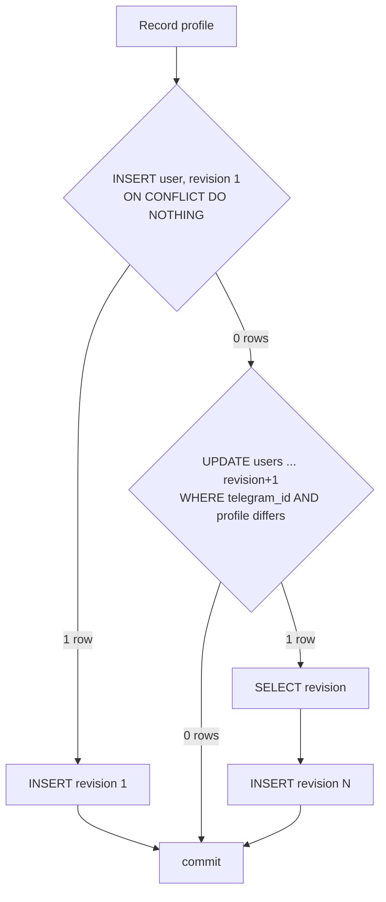

# Record full user profiles and keep a revision history

## Goal Capsule

- **Objective:** the bot knows every Telegram user it sees, with their current profile and every earlier version of it, so later features (giveaway checks, spam detection) can tell who a user was at any point.
- **Means:** one store call records a sender and writes a revision only on a profile change, in one transaction (KTD1, KTD2).
- **Product authority:** this Product Contract, then `CLAUDE.md` (Database, Fail fast, SOLID), then existing code patterns.
- **Open blockers:** none.
- **Stop conditions:** a change that needs a module outside the approved list; a destructive schema change; SQLite refusing the backfill or the conditional update.
- **Execution:** `lfg` implements unit by unit and commits straight to `main`; no branch and no pull request (owner's instruction, 2026-10-09).

Product Contract preservation: changed R2 — the `getMe`-only flags and the attachment-menu flag are excluded because Telegram never sends them for other users (user-approved at plan review). Outstanding questions resolved in place by KTD3 and Dependencies / Assumptions.

## Product Contract

### Summary

The bot saves every profile field Telegram sends about a user, from every update that has a sender. The users table always holds the latest values. When an incoming profile differs from the saved one, the bot adds a full snapshot to a separate revisions table and raises the user's latest revision number. An unchanged profile writes no revision.

### Problem Frame

Today the users table keeps only the first and last name, and only from private messages and button taps. A rename overwrites the old name, so the bot cannot say who a giveaway participant was when they joined. The planned spam detection has no history to use either, such as rename tricks or username swaps.

### Key Decisions

- **Only Telegram profile fields create revisions.** Bot state (the language chosen in the menu, the pending command) is never part of a revision. The pending command changes on every giveaway setup step and would flood the history. Governs R7. (session-settled: user-approved — chosen over also revising on the chosen language, or on every column: bot state is not profile history.)
- **Record senders from every update that has one.** This adds group and discussion-chat messages to today's private messages and button taps. Governs R1. (session-settled: user-approved — chosen over keeping today's sources only, or also recording join/leave/ban events.)
- **A revision is a full snapshot, not a diff.** Any one revision can be read on its own. Governs R6.
- **Revision numbers count per user, from 1.** "Latest revision number" on the user row is that user's own counter, not a table-wide ID. Governs R9.

### Requirements

#### Capturing users

- R1. The bot records the sender of every update that carries one: private messages, button taps, and messages in groups and the channel's discussion chat that the bot can see.
- R2. The bot stores every user field Telegram sends about other users: ID, bot flag, first name, last name, username, Telegram language code and premium flag. Flags Telegram fills only in the bot's own `getMe` reply, and the attachment-menu flag, are not stored.
- R3. The bot skips placeholder senders: messages posted as a channel and messages from an anonymous group admin.
- R4. The users row always holds the latest recorded profile. Recording a profile leaves the chosen language and the pending command unchanged.
- R5. A database error while recording is logged and the handler still runs, as it does today.

#### Revisions

- R6. When the incoming profile differs from the saved profile in any field from R2, the bot writes a revision holding the full profile snapshot, its revision number and the time it was recorded.
- R7. When the incoming profile equals the saved profile, the bot writes no revision. A change to the chosen language or the pending command never writes a revision.
- R8. The first time the bot records a user, it writes revision 1.
- R9. Each user's revision numbers start at 1 and increase by one with no gaps or duplicates, even when two updates from the same user arrive at once. The users row stores the latest number.
- R10. Seeing the same unchanged user through different update types, such as a private message and then a group message, writes no revision.
- R11. Revisions are never edited or deleted.

#### Existing data

- R12. When the change ships, each user already in the users table gets revision 1, copied from their current row.

### Key Flows

- F1. **Recording a sender.** Covers R1–R4, R6–R9.
  1. An update with a sender arrives; placeholder senders stop here (R3).
  2. The bot compares the incoming profile with the saved users row.
  3. Unknown user: create the row and write revision 1 (R8).
  4. Profile differs: update the row, write the next revision, raise the latest revision number (R6, R9).
  5. Profile equal: change nothing (R7).
  6. The handler runs whatever happened above (R5).

### Acceptance Examples

- AE1. **Covers:** R6, R9. **Given** a user at revision 2 named "Anna", **when** they rename to "Anya" and send a message, **then** the users row shows "Anya" at revision 3, and revision 3 holds the full new profile while revision 2 still says "Anna".
- AE2. **Covers:** R7. **Given** a user who walks through every giveaway setup step and picks a new menu language, **when** their Telegram profile stays the same, **then** no revision is written.
- AE3. **Covers:** R1, R8. **Given** a user the bot has never seen, **when** they post in the discussion chat, **then** a users row and revision 1 exist for them.
- AE4. **Covers:** R12, R6. **Given** an existing user with only first and last name saved, **when** the change ships, **then** they have revision 1 with those names; **when** they next send a message carrying a username, **then** revision 2 is written with it.
- AE5. **Covers:** R3. **Given** a message posted in the discussion chat as the channel, **when** it arrives, **then** no user is recorded for it.

### Scope Boundaries

- Join, leave and ban events (`chat_member` updates) are not recorded.
- Profile photos are not recorded.
- Nothing reads the history yet: no command, report or spam rule uses it.
- No retention limit and no pruning of old revisions.
- Bot accounts that post in groups are recorded like any other sender; they are not filtered out.

### Dependencies / Assumptions

- For R1 to cover ordinary group and discussion-chat messages, the bot is a group admin or has privacy mode turned off in BotFather. This is an operational step for the owner, not code.
- Telegram fills `is_premium` the same way in every update type; only `language_code` is known to be missing in some.

---

## Planning Contract

### Key Technical Decisions

- KTD1. **One store method, `Record`, replaces `SaveNames`.** It takes a profile value (the R2 fields) and does everything in one GORM transaction. `SaveNames` is removed and its callers (middleware, `internal/db/db_test.go`, `internal/giveaway/store_test.go`) move to `Record`. Governs R4, R6–R9.
- KTD2. **Write first, then read, inside the transaction.** SQLite's deferred transactions fail with a busy error when a reader later tries to write, and `busy_timeout` does not retry that case. So the transaction's first statement is always a write:
  1. Insert the user with revision 1, `ON CONFLICT (telegram_id) DO NOTHING`. One row affected → insert revision 1, done (R8).
  2. Otherwise one conditional `UPDATE users SET <profile>, revision = revision + 1 WHERE telegram_id = ? AND <any profile column differs>`. Zero rows → no change, done (R7, R10).
  3. One row → read the updated users row (profile columns and `revision`) and build the revision row from it, not from the incoming profile, so the snapshot carries any value KTD3 kept (R6, R9).

  The SQL comparison does the "differs" check, so no read-compare-write race exists. A unique index on (user, number) in the revisions table rejects a duplicate if a bug ever slips through.
- KTD3. **An empty incoming language code keeps the saved one.** The update and the comparison both use the saved `language_code` when the incoming one is empty (SQL `CASE`/`COALESCE(NULLIF(?, ''), language_code)`). Names, username and premium flag are taken as sent, so a removed last name or username still counts as a change. Governs R10.
- KTD4. **Schema.** `users` gains `username`, `language_code`, `is_bot`, `is_premium` and `revision` (the latest revision number), all `not null` with a default because the table already has rows. `language_code` is named apart from `language` (the language chosen in the menu); Go comments on the fields say which is which, per `docs/solutions/conventions/document-columns-with-go-comments-not-gorm-comment-tags.md`. New `user_revisions` table: autoincrement `id`, `user_id` (foreign key to `users.telegram_id`), `number`, the R2 profile fields, `created_at`, and a unique index on (`user_id`, `number`). The struct is `user.Revision` with `TableName() string { return "user_revisions" }`, which avoids the `user.UserRevision` stutter. The foreign-key column is `UserID`, not `TelegramID`, as `giveaway.Participant` documents (GORM otherwise reverses the link).
- KTD5. **Backfill runs at startup, after `AutoMigrate`.** `internal/db.Open` calls a `user` package function that, in one transaction, copies every `users` row with `revision = 0` into `user_revisions` as number 1 and sets `revision = 1`. Backfilled revisions get `created_at` = the time the backfill runs (when they are recorded, per R6), not `users.created_at`: the names they hold are only the latest ones. It is idempotent, so restarts are safe. A row created later with revision 0 by `SetLanguage` or `SetPendingCommand` (only if recording failed) has an empty profile, and Telegram always sends a first name, so its next `Record` differs and lands as revision 1 through KTD2 step 2. Governs R12.
- KTD6. **Middleware sources.** Every update type that carries a user and can reach this bot: `Message` (any chat type), `EditedMessage`, `CallbackQuery`, `MyChatMember` (a user blocking the bot, or an admin adding it to a group) and `ChatJoinRequest`. Inline queries, poll answers, payments and business updates cannot reach it: the bot has no inline mode, sends no polls and takes no payments; `ChatMember` is out of scope. A message with `SenderChat` set is skipped (R3): posts made as the channel, anonymous admins, and the channel's automatic forwards into the discussion chat. Clearing the pending command still runs only for private messages, as today. Governs R1, R3, R5.

### High-Level Technical Design

Directional sketch of `Record` (KTD2, KTD3):

### Assumptions

- Bundled SQLite (modernc, already upgraded in `go.mod`) supports `ON CONFLICT DO NOTHING` and `CASE`/`NULLIF`; both have been in SQLite for years.
- `bot.Start` delivers `edited_message` updates by default; the bot sets no `allowed_updates`.

### Sources

- `internal/user/user.go`, `internal/user/middleware.go` — current store and middleware.
- `internal/db/db.go` — `AutoMigrate` list and the place for the backfill.
- `internal/giveaway/giveaway.go` `Participant` — foreign-key naming pattern.
- `docs/solutions/conventions/document-columns-with-go-comments-not-gorm-comment-tags.md`, `docs/solutions/conventions/telegram-buttons-and-the-pending-command.md`.

---

## Implementation Units

### U1. Profile columns, revisions table and `Record`

**Goal:** the store records a profile and writes revisions per KTD1–KTD4.

**Requirements:** R2, R4, R6–R11; AE1, AE2.

**Dependencies:** none.

**Files:** `internal/user/user.go`, `internal/user/revision.go` (new), `internal/user/user_test.go`, `internal/user/middleware.go`, `internal/user/middleware_test.go`, `internal/db/db.go` (add `&user.Revision{}` to `AutoMigrate`), `internal/db/db_test.go`, `internal/giveaway/store_test.go`.

**Approach:**

1. Add the KTD4 columns to `User` and a `Profile` value type holding the R2 fields.
2. Add `Revision` with `TableName`, the foreign key and the unique index.
3. Replace `SaveNames` with `Record(ctx, Profile)` following KTD2 and KTD3; move every caller, including the middleware's `Recorder`, `saveNames` helper and `fakeRecorder` with a `*models.User` → `Profile` mapping, so this unit's commit builds. The middleware's sources stay as today until U3.

**Execution note:** write the store tests first against in-memory SQLite, as `user_test.go` already does.

**Patterns to follow:** `upsert` and `MovePendingCommand` in `internal/user/user.go` (conditional update with `RowsAffected`); `giveaway.Participant` for the foreign key.

**Test scenarios:**

- Covers AE3 (store side). Unknown user → users row with all profile fields and revision 1; one revision row, number 1, same fields.
- Covers AE1. Rename "Anna" → "Anya" at revision 2 → row shows "Anya" and revision 3; revision 2 still says "Anna".
- Same profile recorded twice → still one revision, `revision` unchanged.
- Covers AE2. `SetLanguage` and `SetPendingCommand` between two identical `Record` calls → no new revision; language and pending command survive `Record`.
- Empty incoming language code after "uk" was saved → no revision, saved "uk" kept.
- Last name "Koval" then "" → new revision with empty last name.
- Username added, premium flag flipped → one revision each.
- Row created by `SetLanguage` (revision 0), then `Record` with a real profile → revision 1 written with that profile; language kept.
- "uk" saved, then a rename arriving with an empty language code → new revision holds the new name and "uk".
- Three changes in a row → revision numbers 1, 2, 3 with no gaps.
- Second revision row with a duplicate (user, number) → rejected by the unique index.

**Verification:** store tests pass; `AutoMigrate` on a database made by the previous version succeeds (db test).

### U2. Backfill existing users

**Goal:** every user already in the table has revision 1 after startup (KTD5).

**Requirements:** R12; AE4.

**Dependencies:** U1.

**Files:** `internal/user/revision.go`, `internal/user/user_test.go`, `internal/db/db.go`, `internal/db/db_test.go`.

**Approach:** a `user` package function runs the KTD5 transaction; `db.Open` calls it after `AutoMigrate` and fails startup on error, wrapped as `backfill user revisions: %w`.

**Test scenarios:**

- Covers AE4. Two rows with revision 0 → each gets revision 1 with its names; `revision` is 1.
- Backfilled revision's `created_at` is the backfill time, not the user's `created_at`.
- Running the backfill twice → still one revision per user.
- A row already at revision 3 → untouched.
- Covers AE4. After backfill, `Record` with a new username → revision 2.

**Verification:** `db.Open` on a file holding pre-change rows ends with one revision per user.

### U3. Middleware records every sender

**Goal:** the middleware records senders from every source in KTD6 and skips placeholder senders.

**Requirements:** R1, R3, R5; AE3, AE5.

**Dependencies:** U1.

**Files:** `internal/user/middleware.go`, `internal/user/middleware_test.go`.

**Approach:** widen the sources to every KTD6 update type, all chat types, and skip messages with `SenderChat` set. Group messages are recorded but never clear the pending command.

**Patterns to follow:** existing table-driven `TestMiddleware` and `fakeRecorder`.

**Test scenarios:**

- Covers AE3. Group message from a user → recorded; pending command not cleared.
- Edited message in a private chat → recorded.
- `MyChatMember` and `ChatJoinRequest` from a user → recorded.
- Button tap → recorded with every R2 field.
- Covers AE5. Discussion-chat message with `SenderChat` set → nothing recorded.
- Private `/start` → recorded and pending command cleared (unchanged behaviour).
- Recorder error → logged, next handler still runs.

**Verification:** middleware tests pass; `go build ./...` with `main.go` unchanged except for comments.

### U4. Glossary and wiring comments

**Goal:** docs match the shipped behaviour.

**Requirements:** none new.

**Dependencies:** U1–U3.

**Files:** `main.go` (middleware comment), `CONCEPTS.md`.

**Approach:** update the `main.go` comment "keeps users' names current" to say it records every sender's profile; confirm `CONCEPTS.md` User profile and User revision entries match R2 as narrowed.

**Test expectation:** none -- comments and glossary only.

**Verification:** `markdownlint-cli2` reports 0 issues.

---

## Verification Contract

| Check | Command | Applies to |
| --- | --- | --- |
| Compile | `go build ./...` | every unit |
| Tests | `go test ./...` | every unit |
| Lint, 0 issues | `golangci-lint run ./...` | every unit |
| Modules unchanged | `go mod tidy` leaves `go.mod` and `go.sum` unchanged | U4 |
| Markdown | `markdownlint-cli2 "**/*.md"` | U4, plan edits |
| Live smoke | rename yourself in Telegram, message the bot, check `user_revisions` with `sqlite3` | after U3 |

## Definition of Done

- R1–R12 hold, and each AE has a test that fails if it breaks.
- U1–U4 verification passes; full lint reports 0 issues.
- No new module; `.golangci.yml` unchanged; no column dropped or renamed.
- Code from abandoned approaches is removed from the diff.
