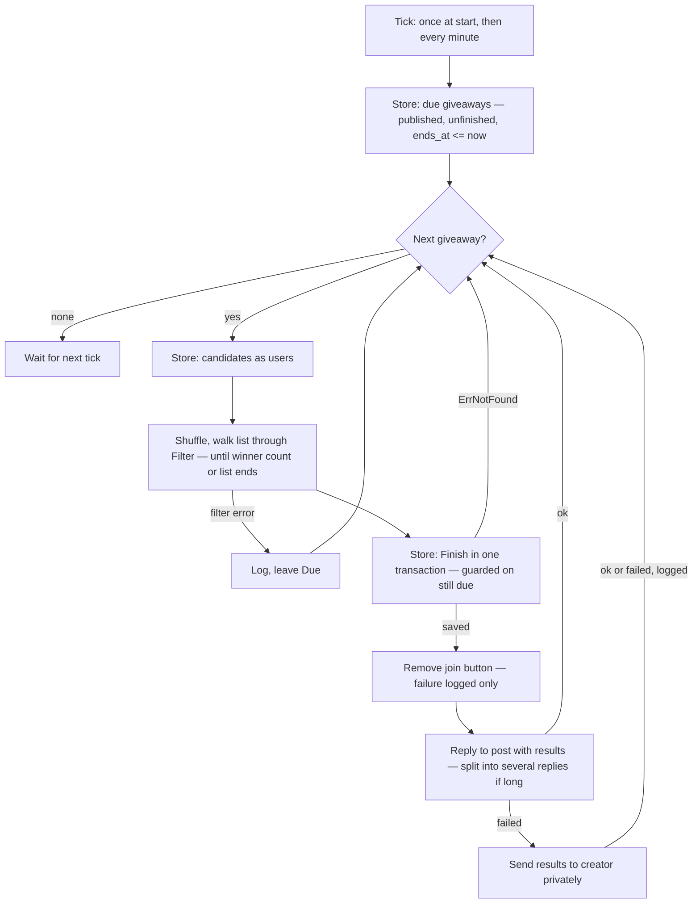

# Giveaway Winner Draw - Plan

## Goal Capsule

- **Objective:** When a giveaway's end time passes, the bot picks its winners within about a minute and announces them in the channel as a reply to the giveaway post, with no admin action needed.
- **Product authority:** the owner, in the 2026-10-09 brainstorm. Rules for the candidate filter are not part of this work.
- **Means:** a background loop started by `main` runs one draw pass per minute in `internal/giveaway`. Each pass saves winners in one guarded transaction before any Telegram call (KTD2, KTD3).
- **Open blockers:** none.
- **Stop conditions:** stop and report if `gosec` flags the shuffle source and a `//nolint` reason cannot honestly call it a false positive (KTD4), or if Telegram rejects a `tg://user?id=` link in a channel message with an error instead of showing plain text.
- **Execution:** `ce-work` implements unit by unit with a commit per unit. The branch and PR follow the owner's instruction at launch.

---

## Product Contract

Product Contract preservation: Product Contract unchanged. Planning answered the five questions deferred to it (KTD5–KTD8, and the result wording in U3), so the Outstanding Questions section is removed.

### Summary

Once a minute, the bot draws winners for every published, unfinished giveaway whose end time has passed. Each candidate goes through a filter hook that accepts everyone for now. The draw records the winners, finishes the giveaway, removes the join button and replies to the post with the winners' names linked to their Telegram profiles. If the channel reply fails, the creator gets the same message in private.

### Problem Frame

Giveaways can be set up, published, edited and cancelled, but nothing ever picks winners. A giveaway that passes its end time stays Due for good. Its join button keeps taking new participants, and the channel audience never learns who won. The data model already has a place for winners: a participant's winner mark, and a finish time on the giveaway. Nothing writes either one.

### Key Decisions

- **The participant's winner mark is the only record of a win.** There is no separate winners table. Governs R6. (session-settled: user-directed — chosen over a new `giveaway_winners` table with a `giveaway_id` + `user_id` key: the existing `giveaway_participants.winner` column already holds this fact)
- **The draw redraws until it has a set of distinct winners, and each candidate passes a filter first.** Governs R3, R4. (session-settled: user-directed — the user asked for this when choosing the winner store)
- **For now the filter is a hook that accepts every candidate.** Rule sets come later. Governs R4. (session-settled: user-directed — chosen over skipping bot accounts now and over checking with Telegram that the candidate is still in the channel)
- **A short pool finishes with fewer winners, possibly zero.** A giveaway never stays Due because it has too few participants. Governs R5, R11. (session-settled: user-directed — chosen over finishing only with at least one winner, and over staying Due until the full count is met)
- **Results are posted as a reply to the giveaway post.** Governs R9. (session-settled: user-directed — chosen over posting nothing yet, messaging only the creator, a standalone channel post, and editing the giveaway post)
- **A failed channel reply falls back to the creator's private chat once, with no retry.** Governs R12. (session-settled: user-directed — chosen over retrying the post every minute, logging only, and posting before saving)
- **The draw removes the join button.** Late taps are refused. Governs R7, R8. (session-settled: user-directed — chosen over keeping the button and refusing late taps, and over leaving the button and join handler unchanged)
- **Winners are named by a `tg://user?id=` link around their full name.** Governs R10. (session-settled: user-directed — the user specified the link and name format)
- **Winners are saved before anything is sent to Telegram.** A failed Telegram call can then never change who won, and a second draw can never pick different winners. Governs R6, R12.

### Requirements

#### Finding due giveaways

- R1. Once a minute, the bot draws every giveaway that is published, not finished, and has an end time at or before the current time. This includes giveaways whose end time passed while the bot was not running.
- R2. Drafts, cancelled giveaways and giveaways without an end time are never drawn.

#### Drawing winners

- R3. The draw picks participants of the giveaway at random, one at a time. A user already picked for this giveaway is never picked again. The draw stops when it has the giveaway's winner count or no participants remain.
- R4. Each picked candidate goes through a filter before it becomes a winner. A rejected candidate is set aside and the draw picks another. The first version of the filter accepts every candidate.
- R5. When fewer participants pass the filter than the winner count, every participant who passes is a winner. Zero winners is a valid result.
- R6. The winners' marks and the giveaway's finish time are saved together, so a giveaway is drawn at most once and is either fully finished or not finished at all.

#### Join button

- R7. After the draw, the bot removes the join button from the giveaway post. A failed removal is logged and does not stop the results reply.
- R8. A tap on the join button at or after the giveaway's end time records nothing and shows a popup, in the giveaway's language, saying the giveaway has ended.

#### Announcing results

- R9. After the draw, the bot replies to the giveaway post in the channel with the results, in the giveaway's language.
- R10. Each winner is shown as a link to `tg://user?id=<telegram id>` whose text is the winner's first and last name joined by a space, leaving out an empty part.
- R11. With zero winners, the reply says the giveaway ended without winners.
- R12. If the channel reply fails, the bot sends the same message to the giveaway's creator in private. If that also fails, the bot logs the error. Neither message is retried, and the recorded winners stay as they are.

### Acceptance Examples

- AE1. **Covers R3, R5.** Given a giveaway with 3 winners and 2 participants, when its end time passes, both participants are winners and the giveaway is finished.
- AE2. **Covers R5, R11.** Given a giveaway that nobody joined, when its end time passes, the giveaway is finished with no winners and the reply says it ended without winners.
- AE3. **Covers R3.** Given a giveaway with 2 winners and 10 participants, when the random pick lands on the same user twice, the second pick is discarded and the draw picks again until it has 2 different users.
- AE4. **Covers R1.** Given a giveaway that ended at 10:00 while the bot was stopped until 14:00, when the bot starts, the giveaway is drawn at the first minute check.
- AE5. **Covers R2.** Given a giveaway that its creator cancelled before its end time, when its end time passes, it is not drawn and its participants keep no winner marks.
- AE6. **Covers R8.** Given a giveaway that ended at 12:00 and has not been drawn yet, when a user taps the join button at 12:00:30, they are not added and see the "ended" popup.
- AE7. **Covers R12.** Given the bot was removed from the channel, when a giveaway is drawn, the winners are saved, the creator gets the results in private, and the giveaway is not drawn again.
- AE8. **Covers R1.** Given a giveaway due at 12:00, when its creator moves the end time to 18:00 at 12:00:20 before the minute check runs, it is not drawn until 18:00.

### Scope Boundaries

- Real filter rules (skip bot accounts, skip users who left the channel, skip the creator) are deferred to later work.
- Retrying a failed channel reply or a failed private message is out of scope.
- Messaging winners privately, and messaging the creator when the channel reply succeeds, are out of scope.
- Re-drawing, or picking a replacement for a winner, is out of scope.
- The `giveaway_winners` table from the original request is dropped in favour of the existing winner mark.

### Dependencies / Assumptions

- A `tg://user?id=` link is guaranteed to work only for a user who contacted the bot or sent it a callback query. Every participant tapped the join button, so every winner qualifies. A winner whose privacy settings block linking shows as plain text.
- Telegram requires a first name, so a winner's link text is never empty.
- One bot process runs at a time.

### Sources / Research

- `internal/giveaway/giveaway.go`: `Participant.Winner`, `Giveaway.FinishedAt` and `Giveaway.State()` (Active, Due, Finished) already exist. Nothing writes `Winner` or `FinishedAt`.
- `internal/giveaway/service.go` `Service.Join` checks only that the giveaway is published, not its end time (R8 changes this).
- `internal/giveaway/handler.go` `telegramAPI.RemoveButton` is the existing way to clear the post's keyboard, used by `Editor.Cancel`.
- `internal/giveaway/edit.go` `Editor.Restore` refuses to republish a cancelled giveaway whose end time has passed, so a cancelled giveaway never becomes due through a restore.
- `main.go` has no background job today. `b.Start(ctx)` blocks until a signal cancels `ctx`, and the database closes in a deferred call after it returns.
- `docs/solutions/conventions/sqlite-one-connection-and-write-first-transactions.md`: the SQLite rules the draw's write must follow.
- `docs/solutions/conventions/giveaway-crud-around-the-published-flag.md`: how published, draft and cancelled giveaways are told apart.

---

## Planning Contract

### Key Technical Decisions

- KTD1. **The draw lives in `internal/giveaway` as a `Drawer`, next to `Service` and `Editor`.** It owns finding due giveaways, picking, saving and announcing (R1–R12). A separate package would need the unexported `telegramAPI`, the store scopes and `postLink`, and it would split the giveaway rules across two packages.
- KTD2. **One pass, then a ticker.** `Drawer.Run` runs a pass right away and then once per `time.Minute` on a `time.Ticker` until its context is cancelled. Passes run one after another in a single goroutine, so two passes never overlap. The first pass at startup covers giveaways that ended while the bot was down (R1, AE4).
- KTD3. **Winners are saved in one transaction that starts with a guarded write.** The transaction first runs `UPDATE giveaways SET finished_at = now WHERE id = ? AND published = true AND finished_at IS NULL AND ends_at <= now`. If no row matches, the store returns `ErrNotFound`, the pass skips the giveaway, and nothing else is written. That covers a cancel, an end time moved later (AE8) and an already-finished giveaway. Otherwise the same transaction sets `winner = true` on the chosen participants (R6). `now` is converted with `.UTC()` before it reaches SQL, both here and in `Due`. The driver binds a `time.Time` as text with its zone offset, and `ends_at` is stored as UTC text, so `ends_at <= ?` compares strings: a Kyiv-time `now` would match giveaways up to three hours early. This follows [the SQLite rules](../solutions/conventions/sqlite-one-connection-and-write-first-transactions.md): only `tx` inside the transaction, write first. It also follows [the guarded-update convention](../solutions/conventions/giveaway-crud-around-the-published-flag.md). It deliberately reverses that doc's "button first, then the row" order: the row comes first, so a failed Telegram call can never change who won (Product Contract Key Decision on saving first).
- KTD4. **Shuffle once, then walk the list.** The pass loads every candidate into a slice, shuffles it with `math/rand/v2`'s `Shuffle`, and takes candidates in order. Each one goes through the filter until the winner count is reached or the list runs out (R3–R5). A shuffle draws without replacement, so the same user can't come up twice (AE3) and no redraw loop is needed. The global `math/rand/v2` generator is ChaCha8 seeded from the OS. If `gosec` G404 flags it, a `//nolint:gosec` with that reason is acceptable. The `Drawer` takes the shuffle function as a constructor parameter so tests can fix the order, the same way `Service` takes `now`.
- KTD5. **The filter is a function type: `Filter func(ctx, Giveaway, user.User) (bool, error)`, with `AcceptAll` as the only implementation.** A function type avoids an interface with one implementation. Passing `user.User` gives later rules the profile, including `IsBot`. If the filter returns an error, the pass stops that giveaway before saving anything and logs it. The giveaway stays Due and the next minute tries again with a fresh shuffle (R4).
- KTD6. **Shutdown waits for the draw.** `main` starts `Drawer.Run` in a goroutine with `sync.WaitGroup.Go`, before `b.Start(ctx)`. After `b.Start` returns, it waits on the group before the deferred `sqlDB.Close()` runs. Once a giveaway's winners are saved, the announcement calls use `context.WithoutCancel(ctx)`, so a SIGTERM in the middle of announcing does not leave saved winners unannounced. A cancel signal still stops the loop between giveaways (R9, R12).
- KTD7. **Results are HTML messages.** Each winner line is `<a href="tg://user?id=ID">NAME</a>`. `NAME` is `FirstName` and `LastName` joined with a space, skipping an empty part, and escaped with `html.EscapeString` (R10). A header comes from `i18n` in the giveaway's language. With zero winners, a separate `i18n` text is the whole message (R11). Every i18n text goes through `html.EscapeString` as well, so the winner links are the only markup and a translator's `&` or `<` cannot break the message.
- KTD8. **Long results are split into several replies.** Lines are packed into messages of at most 4096 UTF-16 code units of visible text. That is Telegram's limit, which counts text after entity parsing, so the link markup does not count. The header goes only in the first message. Every message replies to the post. When a channel send fails, the fallback sends the creator a short message with the giveaway's existing `postLink`, so they can tell which giveaway it is. It then sends all the results messages, unchanged and without the reply (R12).
- KTD9. **Late taps check the end time in `Service.Join`.** A new `JoinResult` `Ended` is returned when `g.State(s.now())` is not `Active`, before the participant is written. The handler maps it to a new `giveaway.ended` popup (R8, AE6).

### High-Level Technical Design

One draw pass. The diagram shows the order; the prose above and the Requirements are authoritative.

### Assumptions

- `math/rand/v2`'s global `Shuffle` is fair enough for a channel giveaway. Nobody asked for verifiable draws.
- The participant set of a giveaway fits in memory. Participants are loaded with `Find` into a slice, never through an open cursor (SQLite rule 3).

---

## Implementation Units

### U1. Store: due giveaways, candidates and finishing

**Goal:** the storage the draw needs, as three `Store` methods.

**Requirements:** R1, R2, R6; KTD3.

**Dependencies:** none.

**Files:**

- `internal/giveaway/store.go`
- `internal/giveaway/store_test.go`

**Approach:**

1. `Due(ctx, now)` returns giveaways with `published = true AND finished_at IS NULL AND ends_at IS NOT NULL AND ends_at <= now`, with `now` converted to UTC first (KTD3), ordered by `ends_at`, then `id`. A draft or a cancelled row has `published = false`, so R2 holds without naming `cancelled_at`.
2. `Candidates(ctx, giveawayID)` returns the `user.User` rows of the giveaway's participants. It joins `giveaway_participants.user_id` to `users.telegram_id`, ordered by participant `created_at` so the order is stable before the shuffle.
3. `Finish(ctx, id, winnerIDs, now)` converts `now` to UTC and runs the transaction described in KTD3 and returns `ErrNotFound` when the guard matches no row. With an empty `winnerIDs`, it only sets `finished_at`.
4. Add a `colFinished = "finished_at"` constant next to the existing `col*` constants.

**Patterns to follow:** `Store.Cancel` and `Store.Publish` for guarded `Updates(map[string]any{...})` with `RowsAffected`. Follow `user.Store.Record` for a transaction that uses only `tx`.

**Test scenarios:**

- `Due` returns a published giveaway whose end time equals `now`, and one that ended an hour ago.
- `Due` leaves out a published giveaway ending one minute after `now`.
- `Due` leaves out a draft, a cancelled giveaway, a finished giveaway and a giveaway with no end time.
- `Candidates` returns the admin and the fan with their first names after both joined. It returns an empty slice for a giveaway nobody joined.
- `Finish` with the fan as winner sets `finished_at` and the fan's `winner` mark, and leaves the admin's mark false.
- `Finish` with no winners sets `finished_at` only.
- Covers AE8. `Finish` on a giveaway whose `ends_at` was moved after `now` returns `ErrNotFound` and writes nothing.
- `Finish` on a cancelled giveaway, and a second `Finish` on a finished one, return `ErrNotFound` and leave every winner mark unchanged.
- With `now` in Europe/Kyiv 30 minutes before a UTC `ends_at`, `Due` leaves the giveaway out and `Finish` returns `ErrNotFound`. With `now` in Kyiv one minute after it, both include it.

**Verification:** store tests pass against a real database file opened through `db.Open`.

### U2. Drawer: picking and saving winners

**Goal:** a `Drawer` whose pass finds due giveaways, picks distinct winners through the filter, and saves them.

**Requirements:** R1–R6; KTD1, KTD4, KTD5.

**Dependencies:** U1.

**Files:**

- `internal/giveaway/draw.go`
- `internal/giveaway/draw_test.go`

**Approach:**

1. Declare a `DrawStore` interface (`Due`, `Candidates`, `Finish`) in `draw.go`. `*Store` implements it.
2. Declare the `Filter` type and `AcceptAll` (KTD5).
3. `NewDrawer(store, filter, shuffle, texts, now, log)` returns `*Drawer`. Telegram arrives per pass, as it does for the handlers (U3).
4. The pass loops over `Due`, then for each giveaway: `Candidates`, shuffle, walk through the filter, `Finish`. `ErrNotFound` from `Finish` is skipped silently. Any other error is logged with `giveaway_id`, and the pass moves on to the next giveaway.

**Patterns to follow:** `Service` for constructor-injected `now` and `log` and for logging with `log.With("giveaway_id", ...)`. Use the hand-written fakes in `service_test.go`.

**Test scenarios:**

- Happy path: 2 winners from 5 candidates with an identity shuffle saves the first 2 candidates.
- Covers AE1. 3 winners and 2 candidates saves both.
- Covers AE2. No candidates saves the giveaway with an empty winner list.
- Covers AE3. With a shuffle that reverses the list, 3 winners from 3 candidates are 3 distinct user IDs.
- A filter that rejects the second candidate leads to winners 1 and 3.
- A filter that rejects everyone leads to a finished giveaway with zero winners.
- A filter error on any candidate means `Finish` is never called for that giveaway, the next due giveaway is still drawn, and the error is logged.
- `Finish` returning `ErrNotFound` is not logged as an error and does not stop the pass.
- A `Due` error ends the pass with one logged error.

**Verification:** draw tests pass with a fake store and a fixed shuffle.

### U3. Announcing results

**Goal:** after `Finish` succeeds, remove the join button and post the results, with the private fallback.

**Requirements:** R7, R9–R12; KTD6, KTD7, KTD8.

**Dependencies:** U2.

**Files:**

- `internal/giveaway/draw.go`
- `internal/giveaway/draw_test.go`
- `internal/giveaway/handler.go`
- `internal/i18n/i18n.go`
- `internal/i18n/schema.json`
- `internal/i18n/locales/en.json`
- `internal/i18n/locales/uk.json`
- `docs/solutions/conventions/giveaway-crud-around-the-published-flag.md`

**Approach:**

1. Add a `Messenger` interface with one method that sends an HTML text to a chat, optionally as a reply to a message. Add `ButtonRemover` (already in `edit.go`) to what the pass needs. Combine them in a small `Announcer` interface in `draw.go`, and implement the new method on `telegramAPI` in `handler.go`. Use `ParseMode: models.ParseModeHTML` and `ReplyParameters` with the post's message ID. Turn off the link preview.
2. Build the messages (KTD7, KTD8) in a pure function so it can be tested without Telegram.
3. Order after `Finish`: remove the button and log a warning on failure. Then send the messages to the channel, replying to the post. On the first failed send, stop sending to the channel and send the creator the post-link message, then every results message (KTD8). Log a failed private send as an error. Every call uses `context.WithoutCancel` (KTD6).
4. Add i18n keys to `i18n.go`, `schema.json` and both locale files. `draw.results` is the header. `draw.no_winners` is the zero-winner text. `draw.private_prefix` takes `%[1]s`, the post link, and is the whole first private message. Ukrainian text is written to match the existing tone of `uk.json`.
5. Amend the "Order with Telegram" section of the published-flag doc with one paragraph: the draw saves the row first, and why (KTD3).

**Patterns to follow:** `telegramAPI.RemoveButton` and `ignoreNotModified` in `handler.go`. Use `postLink` in `edit.go`. For keys, follow the i18n `Key` constants and the schema's "add a key to both properties and required" rule.

**Test scenarios:**

- Message builder: two winners, Ann Smith and Bob with no last name, gives a header plus two lines linking `tg://user?id=` with the texts `Ann Smith` and `Bob`.
- Message builder: a first name `<b>&` is escaped and is not treated as markup.
- Covers R11. Zero winners gives one message, the `draw.no_winners` text.
- 100 winners with 64-character first and last names give more than one message. Each is at most 4096 UTF-16 code units of visible text, only the first carries the header, and no winner is lost or repeated.
- A name with emoji counts as 2 UTF-16 units per astral character when packing.
- Pass with a fake announcer: after `Finish`, the button is removed, then the messages are sent to the channel chat as replies to the post.
- Covers AE7. The channel send fails, so the creator gets the post-link message and then every results message, and the giveaway stays finished.
- The channel send and the private send both fail: one error is logged and the pass continues to the next giveaway.
- Removing the button fails: a warning is logged and the results are still sent.
- The context is cancelled right after `Finish` succeeds: the announcement still goes out.
- Message builder: a header text containing `&` and `<` comes out escaped.
- i18n: the existing catalog test passes with the new keys in both locales.

**Verification:** draw and i18n tests pass. `golangci-lint` reports no findings in `internal/giveaway` and `internal/i18n`.

### U4. Refuse late taps on the join button

**Goal:** a tap at or after the end time records nothing and shows an "ended" popup.

**Requirements:** R8; KTD9.

**Dependencies:** none.

**Files:**

- `internal/giveaway/service.go`
- `internal/giveaway/service_test.go`
- `internal/giveaway/handler.go`
- `internal/giveaway/handler_test.go`
- `internal/i18n/i18n.go`
- `internal/i18n/schema.json`
- `internal/i18n/locales/en.json`
- `internal/i18n/locales/uk.json`

**Approach:**

1. Add an `Ended` `JoinResult`. In `Service.Join`, after the `Published` check, return `Ended` with the giveaway's language when `g.State(s.now())` is not `Active`.
2. Map `Ended` to a new `giveaway.ended` key in `joinText`.

**Patterns to follow:** the existing `JoinResult` constants and `joinText` switch.

**Test scenarios:**

- Covers AE6. A giveaway that ended at 12:00 and a tap at 12:00:30 return `Ended` with no participant written.
- A tap exactly at the end time returns `Ended`.
- A tap one second before the end time still joins.
- A tap on a giveaway with no end time still joins.
- A finished giveaway returns `Ended`.
- Handler: `Ended` answers the callback with the `giveaway.ended` text in the giveaway's language.

**Verification:** service and handler tests pass.

### U5. Run the draw every minute

**Goal:** the bot starts the draw loop at startup and stops it cleanly on shutdown.

**Requirements:** R1; KTD2, KTD6.

**Dependencies:** U3.

**Files:**

- `internal/giveaway/draw.go`
- `internal/giveaway/draw_test.go`
- `main.go`

**Approach:**

1. Add `Drawer.Run(ctx, b *bot.Bot)`. It runs a pass with `telegramAPI{b}` at once, then on every tick of a minute ticker. It returns when `ctx` is done and stops the ticker. Keep the pass method callable with any `Announcer` so tests drive it without `*bot.Bot`.
2. In `main.go`, build the `Drawer` from the same `giveaway.Store`, `texts` and `log` as `handlers()`, with `giveaway.AcceptAll`, `rand.Shuffle` and `time.Now`. Restructure `handlers()` so the store is built once in `run()` and passed in.
3. Start `Run` with `sync.WaitGroup.Go` after `bot.New` and before `b.Start(ctx)`. Call `wg.Wait()` after `b.Start` returns, so the wait happens before the deferred database close.

**Patterns to follow:** `main.go`'s existing order of fail-fast checks, then wiring, then `b.Start`. Constructors take dependencies; wiring stays in `main`.

**Test scenarios:**

- `Run` with an already-cancelled context returns without blocking.
- The pass runs once at once, before the first tick. To test this, have `Run` delegate to an unexported loop that takes the interval and the announcer, and drive it with a short interval and a fake store that counts `Due` calls.

**Verification:** `go build .` succeeds and `go test ./...` passes. Run the bot locally against a test channel with a giveaway that ends in two minutes. The results reply appears within a minute of the end time, and the join button is gone. Stopping the bot with Ctrl-C logs "bot stopped" with no database-closed errors.

---

## Verification Contract

| Gate | Command | Applies to |
| --- | --- | --- |
| Compile | `go build ./...` | every unit |
| Tests | `go test ./...` | every unit |
| Lint | `golangci-lint run ./...` with 0 issues | every unit; the stop hook enforces it |
| Markdown | `markdownlint-cli2 "**/*.md"` | U3 (solutions doc), this plan |
| Manual | a giveaway ending soon in a test channel is drawn, announced and loses its button | U5 |

---

## Definition of Done

- Every requirement R1–R12 is covered by at least one passing test or by the U5 manual check.
- `go test ./...` passes and `golangci-lint run ./...` reports 0 issues, with no new `//nolint` other than the one KTD4 permits.
- No new module is added to `go.mod`.
- Both locale files and `schema.json` have the new keys.
- The published-flag solutions doc describes the draw's save-first order.
- Code from approaches that were tried and dropped is removed from the diff.
