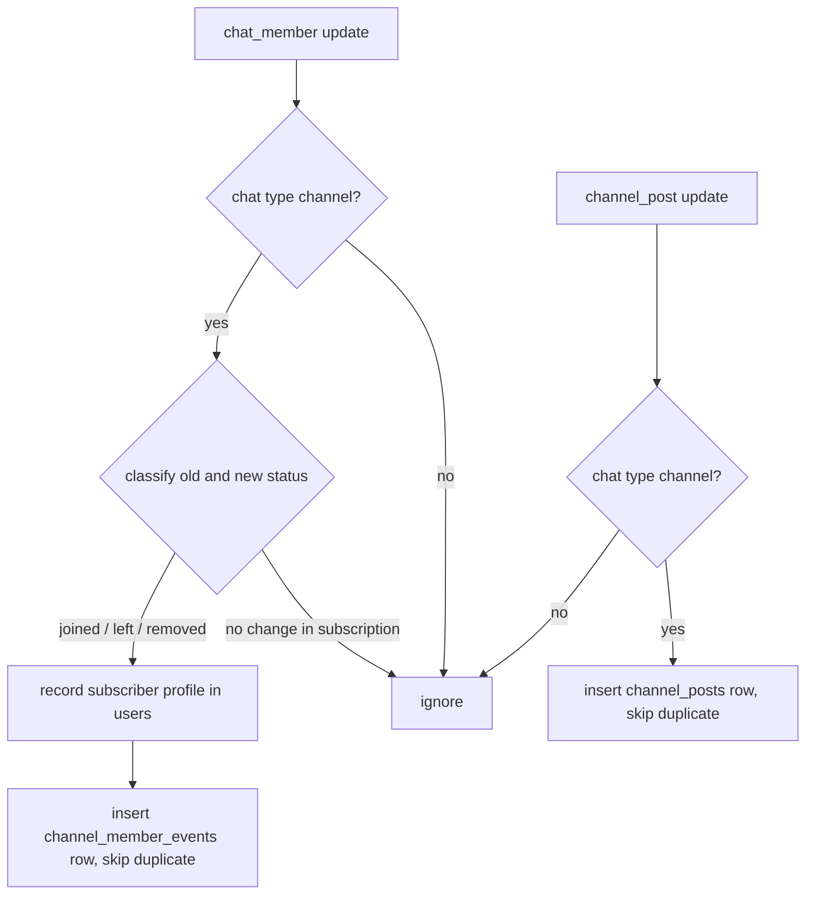

# Channel subscriber log - Plan

## Goal Capsule

- **Objective:** the owner can answer, with SQL against the bot's database, which ad invite links bring subscribers who stay, after which channel posts people leave, and how long subscribers stay.
- **Means:** the bot writes one insert-only row per subscribe, unsubscribe and removal in the channel, and one per channel post (KTD1, KTD4).
- **Product authority:** this Product Contract, then `CLAUDE.md` (Database, Challenge protocol, SOLID, Fail fast), then existing code patterns.
- **Open blockers:** none.
- **Stop conditions:** a change that needs a module outside the approved list; a destructive schema change; evidence that Telegram does not send `chat_member` updates for channel subscribers to an admin bot.
- **Execution:** `lfg` implements unit by unit and commits straight to `main`; no push and no pull request (owner's instruction, 2026-10-18).

---

## Product Contract

### Summary

The bot records every change in who is subscribed to the channel: a join (with the invite link it came through), a leave, and a removal by an admin. It also records the time of every channel post. Both tables only grow. The owner analyses them with ready SQL queries kept in the repo; the bot gets no new command.

### Problem Frame

Telegram's built-in channel statistics show totals and charts but not people. The owner cannot tell which paid placement brought subscribers who stayed a month, which posts make people leave, or how long a typical subscriber stays. The Bot API cannot list subscribers or return the past, so the bot can only collect from now on.

### Key Decisions

- **Insert-only event log instead of membership periods.** Governs R1, R4. (session-settled: user-approved — chosen over a periods table with joined_at/left_at updated on leave: no UPDATE, no open-row logic, and a missed update cannot corrupt state.)
- **SQL queries in docs instead of a /stats command.** Governs R9. (session-settled: user-approved — chosen over a /stats command now: wait until the owner knows which numbers they check.)
- **Prize-hunter filtering is out of scope.** (session-settled: user-directed — chosen over including it now: later work.)

### Requirements

#### Membership events

- R1. For each subscriber change in a channel where the bot is admin, the bot writes one event: `joined`, `left` or `removed` (an admin removed or banned the subscriber).
- R2. A `joined` event keeps the invite link and its name as Telegram reported them at the join; other events keep both empty.
- R3. Every event keeps the channel ID, the subscriber's Telegram ID and the time Telegram reports for the change.
- R4. Events are never changed or deleted.
- R5. Changes that do not move a user in or out of the subscribers (an admin promotion, a restriction of a subscriber, an unban of someone who was not subscribed) write no event.
- R6. The same Telegram update delivered twice writes one event.
- R7. The subscriber's profile is recorded in `users` the way every other sender is.

#### Channel posts

- R8. For each new post in a channel where the bot is admin, the bot keeps the channel ID, the message ID and the post time, once per post.

#### Analysis

- R9. The repo holds ready SQL queries for: joins and 30-day retention per invite link name, leaves within 24 hours after each post, and subscriber lifetime.

#### Existing behaviour

- R10. Every update type the bot handles today keeps reaching its handler.

### Scope Boundaries

- No /stats command, no dashboards.
- No prize-hunter rules in giveaways.
- No import of past subscribers: the Bot API cannot list them.
- Not built: recovering events Telegram dropped while the bot was down more than 24 hours. Telegram keeps undelivered updates for 24 hours only; nothing in the Bot API can replay them. Would change if an MTProto account were approved.
- Not built: deleting a subscriber's events on request. No one has asked; add when a privacy request arrives.

---

## Planning Contract

### Key Technical Decisions

- KTD1. **Table `channel_member_events`, columns `id`, `chat_id`, `user_id`, `kind`, `invite_link`, `invite_link_name`, `happened_at`.** `user_id` references `users.telegram_id` through an association field, as `user.Revision.User` does. `kind` has a `CHECK` limiting it to `joined`, `left`, `removed`. Link columns are `NOT NULL DEFAULT ''`. (session-settled: user-approved — chosen over a separate invite-links table kept in sync: the name at join time is a fact of the event.)
- KTD2. **`id` is the usual auto-increment integer.** (session-settled: user-approved — chosen over UUID v7: same insertion order, matches the other tables, no dependency on PostgreSQL 18's `uuidv7()`.)
- KTD3. **A unique index `idx_channel_member_events_once` on (`chat_id`, `user_id`, `kind`, `happened_at`), with inserts using `ON CONFLICT DO NOTHING`.** go-telegram/bot acknowledges updates by offset; updates fetched but not acknowledged before a restart come again, and a duplicate join would inflate the ad numbers with no one noticing. Two real events of the same kind for the same user in the same second do not occur, because a join and a leave alternate. The table is new, so no existing row can break the index.
- KTD4. **Table `channel_posts` with `chat_id`, `message_id`, `posted_at`, primary key (`chat_id`, `message_id`), insert with `ON CONFLICT DO NOTHING`.** (session-settled: user-approved — chosen over correlating posts by hand in the Telegram app: the owner wants SQL.)
- KTD5. **New package `internal/channel`** owns both models, their store and the two handlers. It provides the channel's audience log, which is one reason to change; `user` and `giveaway` stay untouched apart from wiring. The package declares its own small interfaces for the store and for recording a profile (`user.Store.Record` satisfies it).
- KTD6. **Classification is a pure function of the old and new member status.** A user counts as subscribed when the status is `creator`, `administrator`, `member`, or `restricted` with `is_member`. Not subscribed before and subscribed after is `joined`. Subscribed before and `left` after is `left`. Subscribed before and `kicked` after is `removed`. Everything else writes nothing (R5).
- KTD7. **Only chats of type `channel` are recorded.** The bot may also be admin of the discussion group, whose member changes are out of scope.
- KTD8. **The bot requests updates explicitly with `bot.WithAllowedUpdates`:** `message`, `edited_message`, `channel_post`, `callback_query`, `my_chat_member`, `chat_member`, `chat_join_request`. Telegram sends `chat_member` only when asked for by name, and an explicit list replaces the default set. The first five and `chat_join_request` are what `user.Middleware` and the handlers read today; the default set's remaining types (inline queries, polls, payments, boosts, business messages, edited channel posts) reach no handler.
- KTD9. **The two handlers are registered with `RegisterHandlerMatchFunc` on the bot after `bot.New`,** matching `update.ChatMember != nil` and `update.ChannelPost != nil`. They are evaluated before the default handler, so `giveaway.MessageHandler` never sees these updates. `user.Middleware` still wraps them.
- KTD10. **The profile is recorded before the event**, in two calls, not one transaction. The event row needs the `users` row for its foreign key; a profile saved without its event is harmless. A failed write is logged with `slog` and the handler returns; Telegram gets no reply for these updates.

### High-Level Technical Design

### Assumptions

- Telegram sends `chat_member` updates for channel subscribers to a bot that is a channel admin and lists `chat_member` in `allowed_updates`. The bot is already an admin of @read_wine for giveaways.
- Invite links created by other admins arrive with the second half replaced by `…`, so the owner names each ad link uniquely and the queries group by name.
- Subscribers who never wrote to the bot get a `users` row with an empty bot language; that is how `users` already treats any sender.

---

## Implementation Units

### U1. Models, store and schema wiring

- **Goal:** the two tables exist with comments, constraints and a store that inserts into them.
- **Requirements:** R1–R4, R6, R8; KTD1–KTD5.
- **Dependencies:** none.
- **Files:** `internal/channel/channel.go` (package doc, `Event`, `Post`, kind constants), `internal/channel/store.go` (GORM store), `internal/db/db.go` (add both models after `user.User`, add `COMMENT ON TABLE` for both tables and `COMMENT ON INDEX` for `idx_channel_member_events_once`), `internal/db/db_internal_test.go` (unchanged; it covers the new models).
- **Approach:**
  1. Model fields carry a `comment:` each; table name `channel_member_events` via `TableName`.
  2. Store methods insert one event and one post, each with `clause.OnConflict{DoNothing: true}`, wrapping errors with context.
- **Patterns to follow:** `user.Revision` for the association field and the `UserID` naming warning; `giveaway.Giveaway` for `check:` and named unique index tags; `docs/solutions/conventions/describe-every-column-table-and-index-in-the-database.md`.
- **Test scenarios:**
  - `TestEverythingDescribed` passes with both new models in `models()` and fails if a comment is removed.
- **Verification:** `go test ./internal/db/` passes; a manual start against local PostgreSQL creates both tables, the `CHECK`, the unique index and the foreign key.

### U2. Classification and handlers

- **Goal:** `chat_member` and `channel_post` updates from channels turn into rows.
- **Requirements:** R1–R3, R5–R8; KTD5–KTD7, KTD10.
- **Dependencies:** U1.
- **Files:** `internal/channel/handler.go`, `internal/channel/handler_test.go`, `internal/channel/classify_internal_test.go` (or one test file, implementer's call).
- **Approach:**
  1. A pure classify function implements KTD6.
  2. The member handler ignores non-channel chats, classifies, records the subscriber's profile (from `NewChatMember`'s user), then writes the event with the invite link only for `joined`.
  3. The post handler ignores non-channel chats and writes the post.
- **Patterns to follow:** handler constructors in `internal/giveaway/handler.go`; profile mapping in `user.recordSender`; fakes in `internal/giveaway/fake_store_test.go`.
- **Test scenarios:**
  - left to member gives `joined`; kicked to member gives `joined`; restricted non-member to member gives `joined`.
  - member to left gives `left`; administrator to left gives `left`; restricted member to left gives `left`.
  - member to kicked gives `removed`.
  - member to administrator, member to restricted member, kicked to left: no event.
  - A join through a named invite link stores link and name; a leave stores both empty.
  - A `chat_member` update from a supergroup writes nothing and records no profile.
  - The fake store rejects an unknown kind (mirrors the `CHECK`) and keeps one row for a repeated (chat, user, kind, time) (mirrors the unique index); the handler sends the same update twice and one event remains.
  - Profile recording fails: no event is written and the error is logged.
  - A `channel_post` stores chat ID, message ID and time; the same post twice keeps one row; a group message writes nothing.
- **Verification:** `go test ./internal/channel/` passes.

### U3. Bot wiring

- **Goal:** the running bot receives and routes the new updates without losing existing ones.
- **Requirements:** R10; KTD8, KTD9.
- **Dependencies:** U2.
- **Files:** `main.go`, `internal/user/middleware.go` (doc comment on `sender` that says chat_member updates are not recorded: point to `internal/channel`).
- **Approach:**
  1. Add `bot.WithAllowedUpdates` with the KTD8 list to the options passed to `bot.New`.
  2. After `bot.New`, register the two handlers with `RegisterHandlerMatchFunc`, built from a `channel.NewStore(conn)` and the existing `users` store.
- **Patterns to follow:** existing `handlers` wiring in `main.go`.
- **Test expectation:** none -- wiring in `main` has no tests in this repo; covered by the manual run below.
- **Verification:** a manual run against a real `DATABASE_URL` with a test channel: subscribe through a named invite link, unsubscribe, get removed by an admin, publish a post; each produces its row. A giveaway setup and a join tap still work.

### U4. Analysis queries and glossary

- **Goal:** the owner has copy-paste SQL for the three questions and the terms are in the glossary.
- **Requirements:** R9.
- **Dependencies:** U1, U3.
- **Files:** `docs/channel-analytics.md` (new), `CONCEPTS.md`, `CLAUDE.md` (Layout block: one line for the new doc).
- **Approach:**
  1. Queries, where a subscription ends with either `left` or `removed`:
     - joins and 30-day retention per `invite_link_name`, pairing each join with the next end event of the same user via `LEAD()`;
     - leaves per post, linking each end event to the latest channel post before it in the same channel when that post is at most 24 hours older, so one leave counts against one post;
     - subscriber lifetime distribution.
  2. Note the data limits next to the queries: collection starts at deploy, a leave without a matching join means the user joined before logging started, outages over 24 hours drop events.
  3. `CONCEPTS.md`: a "Channel audience" section with Subscriber, Membership event and Channel post.
- **Test expectation:** none -- documentation; queries are checked by hand against the local database after U3.
- **Verification:** each query runs without error on the local database with the rows from the U3 manual run.

---

## Verification Contract

| Gate | Command or check | Applies to |
| --- | --- | --- |
| Unit tests | `go test ./...` | U1, U2 |
| Lint | `golangci-lint run ./...` reports 0 issues | all Go units |
| Markdown | `markdownlint-cli2 "**/*.md"` | U4 |
| Manual flow | run the bot against a real `DATABASE_URL`, exercise U3's steps, run U4's queries | U3, U4 (store SQL has no automated tests, per `CLAUDE.md` Gotchas) |

## Definition of Done

- All units' verification met; `go test ./...` and `golangci-lint run ./...` clean.
- `TestEverythingDescribed` covers both new tables and the index.
- The fake store mirrors the `CHECK` and the unique index.
- No abandoned-attempt code left in the diff.
- Local commits on `main` only; nothing pushed.
- The manual flow against a real database is reported to the owner as still to do if it could not run in this session.
