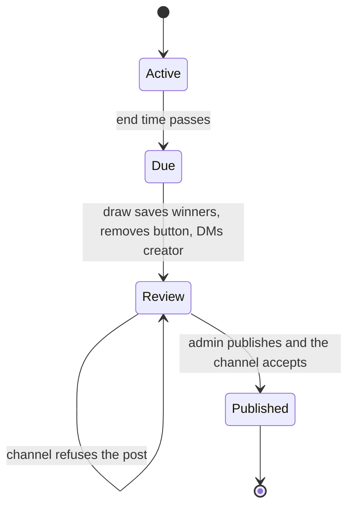

# Giveaway Results Review Before Publishing - Plan

## Goal Capsule

- **Objective:** Only winners that a channel admin has checked appear in the channel. An admin can replace any winner who fails a manual check before the results are posted.
- **Product authority:** this Product Contract.
- **Means:** the winner draw sends the results to the giveaway's creator in private instead of the channel. The message has a reroll button per winner and a publish button.
- **Open blockers:** none.
- **Stop conditions:** stop and ask the owner before any schema change that the CLAUDE.md challenge protocol rejects or flags.
- **Execution profile:** local commits on `main`, no new branch, no push, no PR. `ce-work` implements, the owner ships.
- **Done when:** the Definition of Done below holds.

---

## Product Contract

### Summary

When a giveaway ends, the bot removes the join button and sends the results to the creator in private, with a reroll button for each winner and a "Publish results" button. Any current admin of the giveaway's channel can reroll winners one at a time or publish. Publishing posts the final winners as a reply to the giveaway post and closes rerolls.

### Problem Frame

The winner draw posts the results to the channel the moment a giveaway ends. The owner runs giveaways with partner channels and requires winners to subscribe to all of them. The bot is not an admin of those channels, and the owner does not want to ask partners to add it, so the bot cannot check those subscriptions. A winner who fails the check is already announced in the channel before anyone can look.

### Actors

- A1. Creator: the admin who set the giveaway up. Receives the results message.
- A2. Channel admin: any current admin of the giveaway's channel, including the creator. Can reroll and publish.
- A3. Winner draw: the once-a-minute step that finishes due giveaways.

### Requirements

#### Draw and review

- R1. When a giveaway is drawn, the bot records the winners and removes the join button as today, but does not post anything to the channel.
- R2. The bot sends the results to the creator (A1) in private. Under the results are one reroll button per winner and a "Publish results" button.
- R3. The results message is the live message with buttons in the creator's chat (`keyboard.Tracker`), so any command deletes it like any other.
- R4. `/list` shows every drawn giveaway whose results are not published, in every channel where the user is currently an admin, with a mark that says so. Its link reopens the results message with its buttons.

#### Reroll

- R5. A reroll replaces one winner with a random participant who is not a winner and was not rerolled out of this giveaway. The replacement takes the same place in the list.
- R6. A participant rerolled out of a giveaway can never win that giveaway again.
- R7. When no eligible participant remains, the reroll removes the winner without a replacement, so the giveaway has fewer winners, possibly none.
- R8. The database holds the current winners at all times. After each reroll the results message is rebuilt from the database.
- R9. Each reroll asks for confirmation first.

#### Publish

- R10. "Publish results" asks for confirmation, then posts the current winners as a reply to the giveaway post, in the same format as today's results. The post does not mention rerolls.
- R11. A giveaway's results are published at most once. After publishing, its results message loses its buttons and rerolls are refused.
- R12. If the channel refuses the post, the results stay unpublished, the admin who tapped gets a notice that says so, and the publish button stays.

#### Access and concurrency

- R13. Rerolling and publishing are open to any user who is an admin of the giveaway's channel at the moment of the tap. Others get a refusal notice.
- R14. Of two taps that conflict (a double tap, or two admins at once), only the first takes effect. The other gets the `GiveawayOutdated` popup.
- R15. Only the creator gets the results message when the draw runs. Nobody is notified when another admin rerolls or publishes.

#### Compatibility

- R16. Giveaways drawn before this version count as published.
- R17. Every new user-facing text exists in every locale.

### Key Decisions

- **Rerolls are manual, not a candidate-filter rule.** The bot cannot check subscriptions to partner channels where it is not an admin. (session-settled: user-directed — chosen over an automatic candidate-filter check: the owner checks partner-channel subscriptions by hand and will not make partners add the bot as admin.) Governs R5.
- **Results are reopened through `/list`.** (session-settled: user-directed — chosen over keeping the results message outside `keyboard.Tracker`: keeps one live message with buttons per chat.) Governs R3, R4.
- **No replacement left means fewer winners.** (session-settled: user-directed — chosen over keeping the winner with a "no participants left" popup: an unchecked person must not reach the channel.) Governs R7.
- **Any current channel admin may reroll and publish; only the creator is notified.** (session-settled: user-directed — chosen over creator-only: other admins share the work.) Governs R4, R13, R15.
- **Entry closes at the end time, not at publish.** The join button goes when the draw runs, so nobody joins while results are reviewed. Governs R1.
- **Reroll and publish both confirm.** Neither can be undone, and CLAUDE.md requires confirmation for such actions. Governs R9, R10.

### Key Flows

- F1. Review and publish
  - **Trigger:** a published giveaway passes its end time.
  - **Actors:** A3, A1, A2
  - **Steps:** the draw records winners and removes the join button; the creator gets the results with buttons; an admin rerolls zero or more winners, confirming each; an admin taps "Publish results" and confirms; the bot replies to the post with the final winners.
  - **Outcome:** the channel shows only checked winners; the giveaway's results are published.
  - **Covered by:** R1, R2, R5, R9, R10, R11

### Acceptance Examples

- AE1. **Covers R5, R6.** Given winners Ann and Bob and participants Cid and Dan, when an admin rerolls Ann and the draw picks Cid, then the winners are Cid and Bob. A later reroll of Cid picks only Dan.
- AE2. **Covers R7.** Given one winner and no other eligible participant, when an admin rerolls that winner, then the giveaway has no winners and publishing posts the no-winners text.
- AE3. **Covers R14.** Given an admin taps the confirmed reroll of Ann twice, then Ann is replaced once and the second tap gets the `GiveawayOutdated` popup.
- AE4. **Covers R11, R14.** Given admin X published the results, when admin Y taps a reroll on an older copy of the message, then nothing changes and Y gets the `GiveawayOutdated` popup.
- AE5. **Covers R12.** Given the bot lost the right to post in the channel, when an admin publishes, then the results stay unpublished, the admin gets a notice, and the publish button is still there.
- AE6. **Covers R3, R4.** Given the creator ran `/list` after the draw and the results message was deleted, then `/list` shows the giveaway marked as results not published, and its link brings back the results with buttons.

### Scope Boundaries

- Undoing a reroll.
- Showing the reroll history anywhere.
- Reminders when results stay unpublished.
- Notifying the creator about another admin's reroll or publish (per R15).
- Automatic checks of subscriptions to partner channels.

### Product Contract preservation

Product Contract unchanged. The three questions deferred to planning are answered by KTD1, KTD6 and KTD7. Two planning-time edge cases extend it without changing scope: KTD3 sends a silent `/list` notice instead of the review while the creator has a step open, and KTD5 posts a standalone message when the reply that R10 asks for is impossible because the post is gone.

### Sources / Research

- `internal/giveaway/draw.go`: today's draw, results format and `sendToCreator` fallback, which this work replaces.
- `internal/giveaway/store.go`: `Store.Finish` is the guarded-update-in-a-transaction pattern that rerolls and publishing should follow. `Store.Running` shows that `/list` is creator-only today.
- `internal/giveaway/edit.go`: `Editor.check` shows that edits are creator-only today and checks channel admin rights at tap time.
- `CONCEPTS.md`: Winner draw, Finished giveaway and Participant need updating for review, reroll and published results.

---

## Planning Contract

### Key Technical Decisions

- KTD1. **Three columns, three `CHECK` constraints and one partial unique index; no backfill.**
  - `giveaways.results_pending` (bool, not null, default false): true while drawn results wait for an admin to publish them. `CHECK chk_giveaways_results: NOT results_pending OR finished_at IS NOT NULL`. Every existing row gets false, so giveaways drawn before this version count as published without a data migration. Governs R11, R16.
  - `giveaway_participants.rerolled_at` (timestamptz, NULL unless rerolled out). `CHECK chk_participants_rerolled: rerolled_at IS NULL OR NOT winner`. Governs R6.
  - `giveaway_participants.winner_place` (smallint, NULL for non-winners and for winners drawn before places existed). `CHECK chk_participants_place: winner_place IS NULL OR winner`, plus the partial unique index `idx_participants_place` on `(giveaway_id, winner_place) WHERE winner_place IS NOT NULL`. Governs R5.
  - The `winner` bool stays the only record of a win, as `docs/solutions/conventions/giveaway-winner-draw.md` requires. `rerolled_at` and `winner_place` describe a participant row and live on it.
- KTD2. **`Store.Finish` also sets `results_pending` and the winner places in its existing transaction.** Places follow the order of the draw's pick, starting at 1. The draw still saves winners before any Telegram call. Governs R1, R5.
- KTD3. **The draw sends the review, not the results.** `Drawer.announce` keeps removing the join button and replaces the channel reply and `sendToCreator` with one call through a small interface the draw declares. In production the review service implements it and sends the results message through `keyboard.Tracker` to `g.CreatedBy`. When the creator is in the middle of a setup or edit step (a pending command is set), the draw sends a silent notice without buttons instead: the giveaway ended and its results wait in `/list`. That keeps the open step's prompt and Cancel button. A failed private send is logged; the results stay reachable through `/list`. Governs R1, R2, R3, R15.
- KTD4. **A reroll is chosen outside the transaction and checked inside it.** The review service reads the eligible participants (`NOT winner AND rerolled_at IS NULL`, filtered in SQL), shuffles them with the draw's shuffle, passes each through the draw's existing `Filter` hook (production wires `AcceptAll`, so no subscription check is added) and takes the first that passes, or none. `Store.Reroll(id, out, in, now)` then runs one transaction:
  1. lock the giveaway row with `SELECT … FOR UPDATE WHERE id = ? AND results_pending`; no row means stale;
  2. clear `winner` and `winner_place` and set `rerolled_at` on `out` where it is still a winner, and read its place; no row means stale;
  3. when `in` is set, mark it the winner with that place where it is still eligible; no row rolls back and means stale.
  Locking the giveaway row serializes rerolls and publishing of one giveaway without holding a lock across a Telegram call. Governs R5–R8, R14.
- KTD5. **Publishing claims first, then posts, and gives the claim back if nothing was posted.** The publish buttons carry the number of rerolled-out participants the admin saw, and `Store.ClaimResults` is `UPDATE … SET results_pending = false WHERE id = ? AND results_pending AND <rerolled-out count> = ?`; zero rows means stale. Rerolls only add to that count, so a publish confirmed on a review older than another admin's reroll is stale and never posts a winner the publishing admin did not see. After a successful claim, posting and `ReleaseResults` run under `context.WithoutCancel`, as `Drawer.draw` does, and a failed release is logged at error level with the giveaway, chat and post. When Telegram reports that the giveaway post is gone, the results go to the channel as a standalone message instead of a reply. The service then reads the winners and posts them with today's `resultMessages` as replies to the post. If the first message fails, `Store.ReleaseResults` sets `results_pending` back and the admin gets the R12 notice with the review again. If a later part of a split result fails, the results count as published and the admin gets a notice that the channel has only part of them. This is today's partly-posted gap, now visible to the admin. Governs R10–R12, R14.
- KTD6. **The review message is one HTML message with a bounded size.** It lists the winners in place order as `N. <link to the user>` with the post link above them. Each name is shortened with `…` so the text fits Telegram's 4096-character limit for any winner count up to the maximum. Reroll buttons are labelled `🔄 N`, five to a row, and the last row is "Publish results". A giveaway with no winners shows the no-winners text and only the publish button. Governs R2, R10.
- KTD7. **The setup and edit maximum drops from 100 to 99 winners.** Telegram allows at most 100 buttons on one message, and 100 reroll buttons plus Publish would be 101. Governs R2.
- KTD8. **The reroll confirmation names the winner and the place:** "Reroll winner 3, Ann?", with Yes and No. No and every finished action return to the review in place (`Tracker.Replace`). Publishing ends in a notice, so the tapped message is deleted. Governs R9, R10.
- KTD9. **A new callback prefix `giveaway-review:` and a new start payload `results_`.** Callback data is `giveaway-review:<action>:<giveaway ID>[:<user ID or rerolled-out count>]`, at most 56 bytes. The `/list` link is `/start results_<channel>_<post>`, handled before the edit link and `/start`. Review stays out of `Editor`, whose rules are creator-only and refuse finished giveaways. Governs R4, R13.
- KTD10. **Access is checked at every tap with `Telegram.IsChannelAdmin(g.ChatID, userID)`.** A failed check gets a refusal notice; a Telegram error gets the generic failure notice. The bot's own rights are not checked up front: a refused channel post is the R12 path. Governs R13.
- KTD11. **`keyboard.Tracker` gains HTML variants of `Send` and `Replace`.** Results carry `tg://user` links, and the tracker sends plain text today. Link previews stay off. Governs R2, R3.
- KTD12. **`/list` adds the giveaways with pending results in channels the user administers.** `Store.PendingResults` returns every giveaway with `results_pending`, a handful at most; the list keeps those where `IsChannelAdmin` holds, checking each channel once per `/list`. They get their own mark and a `results_` link. Governs R4.

### Challenge protocol (schema)

- Access patterns:
  - draw: one `UPDATE` of the giveaway and one of its winners, once per giveaway, as today;
  - reroll: one locked read of the giveaway row and two `UPDATE`s by primary key, a few times per giveaway by hand;
  - publish: one guarded `UPDATE`, once per giveaway;
  - review and `/list`: read the winners of one giveaway by `giveaway_id` (primary-key prefix), and every giveaway with `results_pending` (a handful of rows).
- Rules checked: no jsonb or arrays; both nullable columns say what NULL means; invariants are database `CHECK`s and a unique index, not Go-only; no copied columns; no hot rows; nothing fans out.
- New `CHECK`s on existing rows: every existing row has the defaults (`results_pending` false, `rerolled_at` and `winner_place` NULL), so no production row breaks them.
- New index: `idx_participants_place` is created by `AutoMigrate` without `CONCURRENTLY`. `giveaway_participants` holds a few thousand rows at most, so the lock lasts milliseconds.
- The in-memory fake store mirrors all three `CHECK`s and the unique index. `internal/db/db.go` `descriptions()` describes the new index.
- No rule is broken, so no ADR is needed.

### Assumptions

- No giveaway in production waits for its draw with 100 winners. KTD7 lowers the limit for new values only; such a giveaway would fail to send its review, and its results would stay reachable only after the owner lowers its winner count. The owner checks with `SELECT id FROM giveaways WHERE winners > 99 AND finished_at IS NULL` before deploying.
- Telegram's limit is 100 inline buttons per message.
- The creator has opened the bot's private chat, as the setup requires, so the review DM can be delivered.

### High-Level Technical Design

Results lifecycle of a giveaway:

Where each state lives: Review is `finished_at` set and `results_pending` true; Published is `finished_at` set and `results_pending` false.

### Sequencing

U1 first, then U2, then U3 (needs U1 and U2), then U4 and U5 (need U3), then U6. Everything ships as one `feat(giveaway)` commit that bumps `const version` in `main.go` to `0.6.0`.

---

## Implementation Units

### U1. Schema and store writes for review, reroll and publishing

- **Goal:** the database holds pending results, winner places and rerolled-out participants, and the store reads and writes them under the guards of KTD1, KTD4 and KTD5.
- **Requirements:** R1, R5–R8, R11, R14, R16 (KTD1, KTD2, KTD4, KTD5, KTD12).
- **Dependencies:** none.
- **Files:** `internal/giveaway/giveaway.go`, `internal/giveaway/store.go`, `internal/db/db.go`, `internal/giveaway/fake_store_test.go`, `internal/giveaway/draw_internal_test.go`.
- **Approach:**
  1. Add the three fields with `comment:` tags and `check:` constraints, and the partial unique index, to `Giveaway` and `Participant`.
  2. Describe `idx_participants_place` in `descriptions()`.
  3. Extend `Finish` to take the winners in pick order and set `results_pending` and places in its transaction.
  4. Add `Winners` (ordered by place, NULLs last, then join order), `Eligible`, `Reroll`, `ClaimResults`, `ReleaseResults` and `PendingResults`, each returning `ErrNotFound` for a stale guard.
  5. Mirror every constraint and guard in the fake store.
- **Patterns to follow:** the guarded `UPDATE` in `Store.Finish` and `Store.Cancel`; the published-flag convention in `docs/solutions/conventions/giveaway-crud-around-the-published-flag.md`.
- **Test scenarios:**
  - The fake rejects a participant that is a winner and rerolled out, a place on a non-winner, and two winners with one place in one giveaway.
  - `Finish` with winners Ann, Bob marks them places 1 and 2 and sets `results_pending`.
  - `Reroll` of a non-winner, or on a giveaway without pending results, returns `ErrNotFound` and changes nothing.
  - `Reroll` whose replacement became a winner meanwhile returns `ErrNotFound` and leaves the old winner in place.
  - A second `ClaimResults` returns `ErrNotFound`; `ReleaseResults` makes the next claim succeed.
  - `TestEverythingDescribed` passes with the new columns and index.
- **Verification:** the bot starts against a real database, `AutoMigrate` adds the columns, constraints and index, and existing giveaways show `results_pending` false.

### U2. HTML messages in the keyboard tracker

- **Goal:** `keyboard.Tracker` sends and replaces a message with buttons in HTML parse mode with link previews off.
- **Requirements:** R2, R3 (KTD11).
- **Dependencies:** none.
- **Files:** `internal/keyboard/keyboard.go`.
- **Approach:** add HTML variants of `Send` and `Replace` that share the existing delete-then-remember path; keep the plain variants and their callers unchanged.
- **Patterns to follow:** `Tracker.Send` and `Tracker.Replace`.
- **Test expectation:** none -- the tracker calls `*bot.Bot` directly and has no tests today; U4's manual check covers it.
- **Verification:** a review message shows clickable winner names and no link preview.

### U3. Review service: show, reroll, publish

- **Goal:** the rules of results review live in one service that the draw, the review buttons and `/list` call.
- **Requirements:** R2, R5–R14, R17 (KTD4–KTD8, KTD10).
- **Dependencies:** U1, U2.
- **Files:** `internal/giveaway/review.go` (new), `internal/giveaway/review_test.go` (new), `internal/giveaway/setup.go`, `internal/giveaway/draw.go`, `internal/i18n/i18n.go`, `internal/i18n/locales/en.json`, `internal/i18n/locales/uk.json`.
- **Approach:**
  1. Declare the store interface the review needs (split to 1–3 methods per interface) and a constructor taking the store, the draw's filter and shuffle, texts, clock and logger.
  2. Return replies in the shape `Editor` uses (`Reply` with notice, next step and stale), so the handler stays a translator.
  3. Build the review text and button layout from the store per KTD6; share the name and link formatting with `resultMessages`.
  4. Check access per KTD10 before every action, and staleness per KTD4 and KTD5.
  5. Lower `maxWinners` to 99 per KTD7.
  6. Add every new text to both locales. Reword `edit.ask_finish` and `edit.finishing` in both locales to say the results go to the creator for review before publishing.
- **Patterns to follow:** `Editor` in `internal/giveaway/edit.go` (load, check, act, `Reply`); `Drawer.pick` for shuffle and filter.
- **Test scenarios:**
  - Covers AE1. Rerolling Ann with Cid picked gives winners Cid at place 1 and Bob at place 2; a later reroll of Cid can pick only Dan.
  - Covers AE2. Rerolling the only winner with no eligible participant leaves zero winners, and the review shows the no-winners text and only the publish button.
  - Covers AE3. A second confirmed reroll of Ann is stale.
  - Covers AE4. A reroll after publishing is stale.
  - Covers AE5. When the first channel message fails, the results stay pending, the admin gets the refusal notice, and the review returns with its publish button.
  - A failure on the second part of a split result keeps the results published and sends the partly-posted notice.
  - Admin B rerolls a winner after admin A opened the publish confirmation; A's confirmation is stale and nothing is posted.
  - A context cancelled after a successful claim still posts the results, or releases the claim when the post fails.
  - When the giveaway post is gone, publishing posts the results as a standalone channel message and counts them as published.
  - A user who is not a channel admin gets the refusal notice and nothing changes; an `IsChannelAdmin` error gets the failure notice.
  - A filter error during reroll changes nothing and returns the failure notice.
  - The review text for 99 winners with 128-character names stays within 4096 characters, and the keyboard has 100 buttons.
  - The setup refuses 100 winners and accepts 99.
- **Verification:** `go test ./internal/giveaway/` passes with the new tests.

### U4. Draw hands off to review; review buttons and link

- **Goal:** the draw DMs the creator the review instead of posting to the channel, and taps and links reach the review service.
- **Requirements:** R1–R4, R9, R13–R15, R17 (KTD3, KTD8, KTD9).
- **Dependencies:** U2, U3.
- **Files:** `internal/giveaway/draw.go`, `internal/giveaway/draw_internal_test.go`, `internal/giveaway/review_handler.go` (new), `internal/giveaway/handler_test.go`, `main.go`.
- **Approach:**
  1. Replace the channel reply and `sendToCreator` in `Drawer.announce` with the review hand-off interface; keep the button removal. Delete `sendToCreator` and the `draw.private_prefix` text with it.
  2. Add the review callback handler: parse the data, answer every query, show `GiveawayOutdated` on stale, replace in place for next steps and delete the tapped message on a notice.
  3. Add the `results_` link handler and register it before the edit link and `/start` in `main.go`.
  4. Wire the review service into the drawer and handlers in `main.go`.
- **Patterns to follow:** `EditCallbackHandler`, `EditLinkHandler` and `parseEditData` in `internal/giveaway/edit_handler.go`.
- **Test scenarios:**
  - A draw with winners saves them, removes the button, hands the creator the review, and sends nothing to the channel.
  - A draw whose review hand-off fails still leaves the giveaway finished with results pending.
  - A draw for a creator with a pending setup or edit step sends the silent `/list` notice and leaves the step's prompt in place.
  - Every review callback data fits 64 bytes for the largest giveaway and user IDs, starts with `giveaway-review:`, and overlaps no other prefix.
  - Data from an older bot or with a bad ID parses as stale.
  - `/start results_<channel>_<post>` parses into the post's chat and message IDs; a malformed payload gets the not-found notice.
- **Verification:** with the bot running against a real database, a due giveaway sends the review to the creator, and reroll, publish and stale taps behave as in AE1–AE5.

### U5. Pending results in `/list`

- **Goal:** any channel admin finds unpublished results in `/list` and reopens the review from its link.
- **Requirements:** R4, R17 (KTD12).
- **Dependencies:** U3, U4.
- **Files:** `internal/giveaway/edit.go`, `internal/giveaway/edit_test.go`, `internal/i18n/i18n.go`, `internal/i18n/locales/en.json`, `internal/i18n/locales/uk.json`.
- **Approach:** `Editor.List` renders the pending-results giveaways of channels the user administers in their own lines, with their own mark and a `results_` link. They stay outside the running-giveaway loop and never pass through `postGone`, which probes the post with `AttachButton` and would put the join button back. The empty-list text applies only when there are none of either kind.
- **Patterns to follow:** the list lines and marks in `Editor.List`.
- **Test scenarios:**
  - Covers AE6. After the draw, the creator's `/list` shows the giveaway marked as results not published, with a `results_` link.
  - Another admin of the channel sees it; a user who is not an admin does not.
  - A user with only pending results and no running giveaway does not get the empty-list text.
  - After publishing, the giveaway is gone from `/list`.
  - Listing a pending-results giveaway makes no `AttachButton` call.
- **Verification:** `go test ./internal/giveaway/` passes.

### U6. Learning and glossary

- **Goal:** the documented rules of the winner draw match the new behavior.
- **Requirements:** none directly; keeps `docs/solutions/` truthful.
- **Dependencies:** U4.
- **Files:** `docs/solutions/conventions/giveaway-winner-draw.md`, `CONCEPTS.md`.
- **Approach:** in the learning, replace the "No retry" rule and the private fallback with results review, and note `results_pending` as the "results posted" state it anticipated. `CONCEPTS.md` already has Results review and Reroll; check that it matches the final behavior.
- **Test expectation:** none -- documentation only.
- **Verification:** `markdownlint-cli2` reports 0 issues on both files.

---

## Verification Contract

| Gate | Command or action | Applies to |
| --- | --- | --- |
| Build | `go build ./...` | U1–U5 |
| Tests | `go test ./...` | U1, U3, U4, U5 |
| Lint | `golangci-lint run ./...` reports 0 issues | U1–U5 |
| Markdown | `markdownlint-cli2 "**/*.md"` | U6, this plan |
| Manual store check | run the bot against a real `DATABASE_URL`: let a giveaway end, reroll a winner, double-tap a reroll, publish, then tap an old reroll button; open the review from `/list` as a second admin | U1, U3, U4, U5 |

---

## Definition of Done

- Every unit's test scenarios exist and pass, and lint reports 0 issues.
- One local `feat(giveaway)` commit on `main`, with `const version` in `main.go` bumped to `0.6.0`. Nothing pushed, no PR.
- The draw never posts to the channel; only Publish does.
- The fake store mirrors every new `CHECK` and the unique index.
- No abandoned-attempt code, debug logging or unused locale keys remain in the diff.
- The manual store check and the KTD7 production query are either done or listed as outstanding for the owner in the final report.
