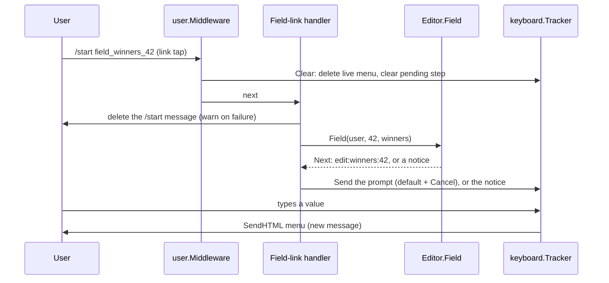

# Giveaway Inline Edit Links - Plan

## Goal Capsule

- **Objective:** A giveaway creator reads the edit menu as a card where each value sits next to the link that changes it, and tapping any bot link leaves no stray `/start …` message in the chat.
- **Product authority:** the owner's requests and answers in the 2026-10-23 brainstorm and scoping confirmation.
- **Means:** an HTML field menu with per-field `[✏️ Edit]` deep links that open the field prompt (KTD1, KTD2), restyled `/list` links, and deletion of the user's `/start` message in every deep-link handler (KTD4).
- **Open blockers:** none.
- **Stop conditions:** stop and ask the owner if a deep link cannot reach the field prompt with the existing permission checks, or if Telegram refuses to delete the incoming `/start` message in a private chat.
- **Execution profile:** local commits on `main`, no new branch, no push, no PR. Commit the uncommitted Refresh-button removal (0.7.1) on its own first, so this work lands as one `feat` commit at 0.8.0.
- **Done when:** the Definition of Done below holds.

---

## Product Contract

### Summary

The field menu becomes HTML text: one line per field, each label bold with its own emoji, and a `[✏️ Edit]` link at the end of every editable field's line. The four field buttons go away. `/list` links read `[✏️ Edit]` and `[📣 Review results]`. When the user taps any of these links, the bot deletes the `/start …` message the tap sent and then shows the next screen.

### Problem Frame

The menu shows values in one dense text block and the controls that change them in a separate stack of buttons, so the creator has to match a button to a value. Tapping an edit link in `/list` leaves a `/start edit_…` message the user never typed, which clutters the one-screen chat the bot tries to keep clean.

### Requirements

#### Field menu

- R1. Each field of the menu sits on its own line with a bold label that starts with its emoji: 📄 Post, 📅 Date, ⏰ Time, 🏆 Winners, 👥 Participants, 🔘 Button. Date and Time are separate lines. The status line stays first.
- R2. The Date, Time, Winners and Button lines end with a link reading `[✏️ Edit]` in the user's language. The whole text, brackets included, is the link. Post and Participants have no edit link.
- R3. A tap on a field's `[✏️ Edit]` opens that field's prompt, with its default-value button and Cancel, exactly as the field button did.
- R4. The menu has no per-field buttons. Move, Finish now, Cancel and Publish stay as buttons, as today.
- R5. The edit links show in every menu state: draft, running and cancelled.

#### `/list` links

- R6. The edit link of a `/list` item reads `[✏️ Edit]` and the results link reads `[📣 Review results]`, in the user's language, with the whole bracketed text as the link. The note about a deleted post names the new edit label.

#### Link taps

- R7. Every deep-link tap (field edit, `/list` edit, `/list` review results) deletes the user's `/start …` message before the bot shows the next screen. A plain `/start` is not deleted.
- R8. When that delete fails, the bot logs a warning and still shows the next screen.
- R9. A link that no longer applies (unknown giveaway, bad payload, wrong field) answers with a notice, never with silence.

### Key Decisions

- **Date and Time get separate lines.** (session-settled: user-directed — chosen over one "Ends" line with one link that asks date then time, and over one line with two links: every field gets the same single link at the end of its own line.) Governs R1, R2.
- **Labels are bold and start with an emoji.** (session-settled: user-directed — the owner asked for bold labels and an emoji per label; the emoji set above was proposed and confirmed with the scope.) Governs R1.
- **The results link keeps its own label.** (session-settled: user-directed — chosen over leaving it as is and over also calling it `[✏️ Edit]`: it opens a different screen.) Governs R6.
- **Only link-tap `/start` messages are deleted.** (session-settled: user-directed — chosen over also deleting typed commands, or all user input: typed values and forwarded posts stay as history.) Governs R7.

### Scope Boundaries

- The setup flow for a new giveaway does not change.
- Typed values, forwarded posts and typed commands stay in the chat.
- Not built: keeping the old `giveaway-edit:field:` callback alive for menus sent before the deploy. A tap on such a button gets the existing outdated popup, and `/list` opens a fresh menu.
- Not built: a guard for menus older than 48 hours. Telegram cannot delete them, so `keyboard.Tracker` strips only their buttons and their `[✏️ Edit]` links stay tappable. Every tap re-runs the creator, finished and admin checks, so an old link can only open a prompt the user may use anyway.
- Not built: caching the bot username (KTD3). Revisit if `getMe` failures show up in the logs.

---

## Planning Contract

### Key Technical Decisions

- KTD1. **Field links are start links with their own `field_` prefix, keyed by giveaway ID.** The payload is `field_<field>_<giveaway ID>`, e.g. `field_end_date_42`. The bot routes a `/start` message to the first handler whose plain prefix matches (`main.go`, `bot.MatchTypePrefix`), so a payload under `edit_` would be swallowed by `EditLinkHandler`. The giveaway ID is shorter than the channel/post pair and is what `Editor.Field` takes. Field names contain `_`, so the parser splits on the last `_`. The longest payload, `field_button_text_4294967295`, is 28 characters, inside Telegram's 64-character, `A-Za-z0-9_-` limit.
- KTD2. **The field-link handler reuses `Editor.Field`.** `Field` already sets the `edit:<field>:<id>` step and runs `Editor.check` (creator only, not finished, user still channel admin, bot can edit posts). `user.Middleware` has already deleted the live menu and cleared the pending step for the `/start` command, so the handler passes the reply to `editHandler.reply` with no tapped message, and the prompt arrives as a new message via `Tracker.Send`. A `Stale` reply or an unparsable payload becomes the `EditNotFound` notice (R9), because the message path has no popup and `editHandler.reply` drops `Stale` silently.
- KTD3. **The menu gets the bot username from `GetMe` per render, as `/list` does.** `bot.Bot` drops the username after `bot.New`, and the handlers are built as `bot.New` options before the bot exists. Handlers registered after `bot.New` (as `registerAudienceLog` does) land after the plain `/start` handler, which would swallow the deep links, so capturing the username at startup means moving the `/start` registration too. `editHandler.menu` calls `b.GetMe` and passes the username to `Editor.Menu`. A `getMe` failure shows the `EditFailed` notice, the same as `/list`.
- KTD4. **One small helper deletes the incoming `/start` message.** It sits next to `typing` in `internal/giveaway/setup_handler.go`, calls `b.DeleteMessage` with the message's chat and ID, and logs a warning on error. All three link handlers call it first. `keyboard.Tracker.Discard` is not reused, because its fallback strips buttons, which only fits the bot's own messages.
- KTD5. **The menu is sent as HTML on every path.** Each path that draws the menu uses `Tracker.SendHTML` or `Tracker.ReplaceHTML`: a new send after a typed value, a link tap or a forward, and an in-place replace after Cancel, the default-value button, `No`, Publish or Move. Both disable link previews. The user-typed button text goes through `html.EscapeString`, as `review.go` does. Date and time are formatted separately with `dateLayout` and `timeLayout`, and `—` stands in when `EndsAt` is unset.
- KTD6. **One i18n key holds the `[✏️ Edit]` label.** The menu and the `/list` item both use it, so the label cannot drift between screens. The `edit.field_*` button labels are removed from `i18n.go`, both locales and `schema.json` (`properties` and `required`) together, or `i18n.Load` fails at startup.

### High-Level Technical Design

---

## Implementation Units

### U1. Delete the `/start` message of link taps

- **Goal:** the existing `/list` edit and results links leave no `/start …` message behind.
- **Requirements:** R7, R8.
- **Dependencies:** none.
- **Files:** `internal/giveaway/setup_handler.go`, `internal/giveaway/edit_handler.go`, `internal/giveaway/review_handler.go`, `internal/giveaway/handler_test.go`, `internal/giveaway/review_handler_test.go`.
- **Approach:** add the KTD4 helper and call it at the top of `EditLinkHandler` and `ReviewLinkHandler`, before `typing`.
- **Patterns to follow:** `typing` in `setup_handler.go` for shape and logging.
- **Test scenarios:**
  - A `/start edit_<channel>_<post>` message with ID N: the fake records a `deleteMessage` for message N in the user's chat, and the menu is sent.
  - A `/start results_<channel>_<post>` message: the same deletion, and the review is sent.
  - The fake fails `deleteMessage` for the `/start` message: the menu or review is still sent.
  - A plain `/start`: no `deleteMessage` for it.
- **Verification:** the link-handler tests show the deletion, and `TestEditKeepsOneKeyboard`-style assertions on deleted IDs are updated where they now include the `/start` message.

### U2. Field deep link

- **Goal:** a `field_<field>_<id>` start link opens that field's prompt.
- **Requirements:** R3, R7, R8, R9.
- **Dependencies:** U1.
- **Files:** `internal/giveaway/edit_handler.go`, `internal/giveaway/setup.go`, `main.go`, `internal/giveaway/handler_test.go`.
- **Approach:**
  1. Add the payload constant and the exported `/start` prefix (KTD1), a link builder next to `editLink`/`resultsLink`, and a parser that splits on the last `_` and checks `isField` and a positive ID.
  2. Add the handler: delete the `/start` message (U1), show typing, parse, call `ed.Field`, and map `Stale` or a parse failure to `EditNotFound` (KTD2).
  3. Register it in `main.go` with `bot.MatchTypePrefix`, before the plain `/start` handler.
- **Patterns to follow:** `EditLinkHandler`, `parsePostPayload`, `TestEditLinkHandler`.
- **Test scenarios:**
  - The creator taps `field_winners_<id>`: the pending step becomes `edit:winners:<id>`, and a prompt with the default button and Cancel is sent as a new message.
  - `field_end_date_<id>` and `field_button_text_<id>` parse into the right field (split on the last `_`).
  - Another user taps the creator's link: the `EditNotYours` notice.
  - A finished giveaway: the `EditFinished` notice.
  - An unknown giveaway ID, an unknown field (`field_title_<id>`), a zero or non-numeric ID: the `EditNotFound` notice, never silence.
  - Payload prefixes: none of `field_`, `edit_`, `results_` is a prefix of another, and the longest field payload fits 64 characters with only `A-Za-z0-9_-`.
  - After the prompt, typing a valid value saves it and sends the menu.
- **Verification:** a link tap in tests reaches the same prompt the field button reached, and every bad link answers with a notice.

### U3. HTML field menu

- **Goal:** the menu renders as the card R1–R5 describe, with no field buttons.
- **Requirements:** R1, R2, R4, R5.
- **Dependencies:** U2.
- **Files:** `internal/giveaway/edit.go`, `internal/giveaway/edit_handler.go`, `internal/i18n/i18n.go`, `internal/i18n/locales/en.json`, `internal/i18n/locales/uk.json`, `internal/i18n/schema.json`, `internal/giveaway/edit_test.go`, `internal/giveaway/handler_test.go`.
- **Approach:**
  1. `Editor.Menu` takes the bot username and returns HTML: separate date and time, escaped button text, four field links built with the U2 builder (KTD3, KTD5).
  2. Rewrite `edit.menu` in both locales and its `schema.json` description, and add the `[✏️ Edit]` label key (KTD6).
  3. `editHandler.menu` fetches the username and sends via `SendHTML`/`ReplaceHTML`. The field-button rows go, and the Move/Finish/Cancel/Publish rows stay.
  4. Remove the `editField` action and the `edit.field_*` keys everywhere (KTD6). `editDefault` stays, because prompts still use it.
- **Patterns to follow:** `reviewHandler.reply` for choosing `SendHTML` vs `ReplaceHTML`, and `html.EscapeString` in `review.go`.
- **Test scenarios:**
  - A published giveaway's menu text has the bold labels with emojis in R1 order, date and time on separate lines, and four `<a href="https://t.me/test_bot?start=field_…">[✏️ Edit]</a>` links. Post and Participants have none.
  - A draft and a cancelled giveaway get the same four links.
  - A button text of `<b>Join & win</b>` shows escaped.
  - An unset end shows `—` for date and time.
  - The keyboard rows are Move, Finish now, Cancel for a published giveaway, and Move, Publish for a cancelled one, with no field buttons.
  - The menu is sent with HTML parse mode and previews off, both for a new send (link tap, forward) and an in-place replace (`No` after Cancel giveaway, Cancel on a field prompt).
  - The Ukrainian menu uses the Ukrainian edit label.
  - `parseEditData` rejects `giveaway-edit:field:winners:<id>`.
- **Verification:** `i18n.Load` passes with the removed and added keys, and the updated menu tests (`TestEditForwardSendsMenu`, `TestEditLinkSendsMenu`, `TestEditMenuShowsNewParticipants`, `TestEditTextAtField`, `TestEditKeepsOneKeyboard`, `TestEditMenuOfCancelled`) pass on the new shape.

### U4. `/list` link labels

- **Goal:** `/list` uses the new labels with the whole bracketed text linked.
- **Requirements:** R6.
- **Dependencies:** U3 (shares the KTD6 label key).
- **Files:** `internal/giveaway/edit.go`, `internal/i18n/locales/en.json`, `internal/i18n/locales/uk.json`, `internal/i18n/schema.json`, `internal/giveaway/edit_test.go`, `internal/giveaway/handler_test.go`.
- **Approach:** move the brackets inside `<a>` in `edit.list_item` and `edit.list_results`, use the KTD6 label in the item, and update `edit.list_gone_note` in both locales.
- **Test scenarios:**
  - A running item renders `<a href="…?start=edit_…">[✏️ Edit]</a>`.
  - A pending-results item renders `<a href="…?start=results_…">[📣 Review results]</a>`.
  - The deleted-post note names `[✏️ Edit]` in English and its Ukrainian label in Ukrainian.
- **Verification:** `TestEditList`, `TestEditListPostGone`, `TestEditListPendingResults` and `TestListHandler` pass on the new strings.

### U5. Docs and version

- **Goal:** project rules and learnings match the new link behavior, and the build shows 0.8.0.
- **Requirements:** R3, R7.
- **Dependencies:** U1–U4.
- **Files:** `CLAUDE.md`, `docs/solutions/conventions/telegram-buttons-and-the-pending-command.md`, `main.go`.
- **Approach:**
  1. In CLAUDE.md's Telegram UX section: a link tap that starts a prompt sends the prompt as a new message, because the command already deleted the live message. Start-link payloads, like callback data, start with their handler's prefix and overlap no other, and tests enforce it.
  2. In the learning doc: list the `edit_`, `results_` and `field_` links, the deletion of the `/start` message, and the stale-link notice rule.
  3. Bump `version` to `0.8.0`.
- **Test expectation:** none — docs and a version constant.
- **Verification:** `markdownlint-cli2` reports nothing on the two files, and the `version-bump-gate.sh` hook accepts the commit.

---

## Verification Contract

| Gate | Command or check | Applies to |
| --- | --- | --- |
| Build | `go build ./...` | U1–U5 |
| Tests | `go test ./...` | U1–U4 |
| Lint | `golangci-lint run ./...` reports 0 issues | U1–U5 |
| Markdown | `markdownlint-cli2 "**/*.md"` | U5 |
| Manual | `go run .` against a real bot: open `/list`, tap `[✏️ Edit]`, tap each field link, enter a value, tap Cancel, tap `[📣 Review results]`; check that each `/start` disappears and the menu renders bold labels and links | U1–U4 |

No store SQL changes, so no database check is needed.

---

## Definition of Done

- R1–R9 hold in tests and in the manual Telegram check.
- `go test ./...` passes, and `golangci-lint run ./...` reports 0 issues.
- No `edit.field_*` key, `editField` action or field-button code is left.
- CLAUDE.md and the learning doc describe the link behavior, and `version` is `0.8.0` in the same `feat` commit.
- No dead-end or experimental code is left in the diff.
